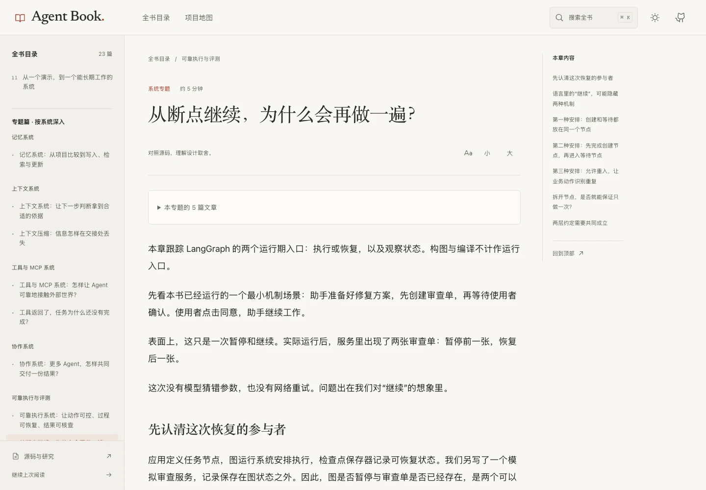

<p align="center">
  <a href="https://mar-garet.github.io/agent_book/">
    
  </a>
</p>

<h1 align="center">Agent Book</h1>

<p align="center">
  <strong>你真的懂 Agent 吗？</strong><br />
  一本从零到深入，讲清行动、上下文、记忆与协作的中文开源书。
</p>

<p align="center">
  <a href="book/README.md"></a>
  <a href="docs/source-catalog.md"></a>
  <a href="references/studies/README.md"></a>
  <a href="https://github.com/Mar-garet/agent_book/actions/workflows/pages.yml"></a>
</p>

<p align="center">
  <a href="https://mar-garet.github.io/agent_book/"><strong>在线阅读 ↗</strong></a>
  &nbsp; · &nbsp;
  <a href="book/README.md">目录</a>
  &nbsp; · &nbsp;
  <a href="book/10-project-comparisons.md">项目地图</a>
  &nbsp; · &nbsp;
  <a href="references/evidence.md">证据索引</a>
</p>

---

让模型调用一次工具很容易。让 Agent 持续推进任务、记住关键事实、从失败中恢复，再交付可以核查的结果，需要理解整个系统。

这本书从这些问题出发，比较 Pi、Codex、LangChain、LangGraph、Deep Agents 等开源项目的设计选择：下一步由谁决定？哪些信息进入上下文？记忆什么时候生效？恢复之后为什么会再做一遍？

> **思想是主线，项目是案例，源码是证据。**

## 从这里开始

- **第一次接触 Agent**：从 [开篇：你真的懂 Agent 吗？](book/00-do-you-really-understand-agents.md) 开始，建立模型、工具、运行系统与环境之间的关系。
- **已经用过一些框架**：先看 [项目比较](book/10-project-comparisons.md)，再沿自己的问题回到工具、MCP、上下文和记忆。
- **正在设计真实系统**：从 [动作边界](book/12-action-boundaries.md)、[恢复与副作用](book/14-resume-and-side-effects.md)、[记忆更新](book/15-memory-update-boundaries.md) 进入，顺着证据追到实际机制。

## 从零到深入的阅读路线

17 篇正文，分为五个阶段。展开任一阶段即可进入章节，也可以在 [阅读站](https://mar-garet.github.io/agent_book/) 连续阅读。

<details open>
<summary><strong>01 · 看见一个 Agent 如何工作</strong>　模型、工具、行动循环</summary>

- [00　你真的懂 Agent 吗？](book/00-do-you-really-understand-agents.md)
- [01　模型之外，谁让事情继续发生？](book/01-model-agent-and-harness.md)
- [02　从一次回答，到一个行动循环](book/02-the-agent-loop.md)

</details>

<details>
<summary><strong>02 · 理解 Agent 怎样接触世界</strong>　工具调用、MCP、上下文、记忆</summary>

- [03　工具调用：一次请求，几层责任](book/03-tool-calling.md)
- [04　MCP：把连接标准化之后，问题还剩什么？](book/04-mcp.md)
- [05　上下文：Agent 此刻究竟看见了什么？](book/05-context.md)
- [06　记忆：存下来之后，怎样影响下一次行动？](book/06-memory.md)

</details>

<details>
<summary><strong>03 · 理解长期工作中的取舍</strong>　规划、Skills、多 Agent、可靠性</summary>

- [07　规划与方法：下一步由谁决定？](book/07-planning-and-methods.md)
- [08　Skills 与多 Agent：经验和分工怎样进入系统？](book/08-skills-and-multi-agent.md)
- [09　可靠性：什么时候可以相信它完成了？](book/09-reliability.md)

</details>

<details>
<summary><strong>04 · 形成自己的判断</strong>　横向比较、系统设计、实验</summary>

- [10　把项目放在同一张问题地图上](book/10-project-comparisons.md)
- [11　从一个演示，到一个能长期工作的系统](book/11-design-and-experiments.md)

</details>

<details>
<summary><strong>05 · 沿真实机制深入</strong>　动作边界、默认装配、恢复、记忆、MCP 宿主</summary>

- [12　用户说了停，动作为什么还在发生？](book/12-action-boundaries.md)
- [13　默认能力，是怎样被装配出来的？](book/13-context-and-defaults.md)
- [14　从断点继续，为什么会再做一遍？](book/14-resume-and-side-effects.md)
- [15　已经记住了，为什么还要等到后来才生效？](book/15-memory-update-boundaries.md)
- [16　同一个 MCP 服务，为什么进入两个 Agent 后表现不同？](book/16-mcp-host-differences.md)

</details>

## 阅读界面

纸白排版、章节目录与源码证据放在同一个阅读空间里。支持全文搜索、项目筛选、深浅主题、字号调节和手机阅读。

[](https://mar-garet.github.io/agent_book/?read=book%2F14-resume-and-side-effects)

<details>
<summary>查看阅读首页与手机布局</summary>


<p align="center">
  
</p>

</details>

## 同一个问题，不同的设计选择

当前收录 **32 个开源项目的固定源码快照**。比较时先分清项目的职责，再讨论它们如何行动、持有状态与处理失败。

- **编程与开发**：Pi、Codex CLI、Gemini CLI、OpenCode、Cline、Aider、Qwen Code、OpenHands。
- **通用助手与浏览器**：Goose、OpenClaw、Hermes Agent、Browser Use。
- **框架与 SDK**：LangChain、LangGraph、Deep Agents、OpenAI Agents SDK、Google ADK、Pydantic AI、Smolagents、Agno、Semantic Kernel、LlamaIndex、Mastra，包含部分项目的 Python 与 JS/TS 实现。
- **多 Agent 协作**：CrewAI、AutoGen、Microsoft Agent Framework、AgentScope、CAMEL。
- **记忆系统**：Letta，以及其他项目中各自的记忆机制。

[查看全部项目与固定版本](docs/source-catalog.md) · [进入横向比较](book/10-project-comparisons.md) · [查看精确提交索引](SOURCES.json)

## 这本书写到哪里了

- [x] 17 篇正文，覆盖基础概念、设计取舍与局部实现机制。
- [x] 32 个上游源码快照，记录来源、固定提交与许可证入口。
- [x] 5 份源码研究记录，保留调用链、配置条件和证据边界。
- [x] 4 个实际运行的 LangGraph 恢复场景，提供实验代码与原始结果。
- [ ] 继续深入更多项目，补充对照案例与可复现实验。
- [ ] 建立跨项目任务集，测量成功率、延迟、成本与长任务稳定性。

这是持续完善中的书稿。源码收录、静态研究与运行实验分别标明；当前已运行的实验聚焦 LangGraph 的局部恢复机制。

[源码研究记录](references/studies/README.md) · [实验与复现](experiments/README.md) · [术语表](references/glossary.md)

## 本地阅读与研究

<details>
<summary><strong>本地打开阅读站</strong></summary>

需要 Node.js 22.12 或更新版本。构建阅读站不需要下载上游源码子模块。

```bash
git clone https://github.com/Mar-garet/agent_book.git
cd agent_book
npm ci --prefix website
npm run dev --prefix website
```

打开 <http://127.0.0.1:4173/>。正文在 Markdown 中维护，界面构建时生成阅读内容。更多说明见 [阅读界面文档](website/README.md)。

</details>

<details>
<summary><strong>下载用于研究的上游源码</strong></summary>

在本书仓库根目录执行，按需选择案例：

```bash
git submodule update --init --depth 1 pi langchain langgraph codex
```

下载全部收录项目：

```bash
git submodule update --init --recursive --depth 1
```

主仓库保存书稿、研究记录与版本索引，上游源码作为独立 Git 子模块管理。各项目使用各自的许可证，入口见 [源码目录](docs/source-catalog.md)。

</details>

## 一起把这本书写深

欢迎通过 [Issue](https://github.com/Mar-garet/agent_book/issues) 提出读不懂的地方、值得追问的问题或事实纠错，也欢迎提交章节改进和可复现实验。涉及项目机制时，请附具体版本、配置条件和证据入口。

写作方法与证据要求见 [写作与研究约定](docs/editorial-guide.md)。
