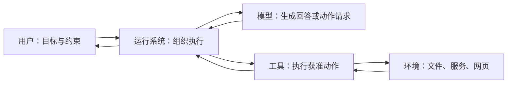

# 第一章：模型之外，谁让事情继续发生？

先想象一个最简单的模型服务：你发送一段输入，模型生成一段输出。这一轮请求结束后，服务不会自动知道你是否需要查询日志、重新运行任务，或者明天继续处理。

如果希望工作继续，就需要一个运行程序接住输出，并决定接下来发生什么。理解这个程序，是理解 Agent 的起点。

## 把任务中的参与者认清

用户提出目标和约束。例如，找到失败原因，准备修复方案，未经明确授权不修改生产环境。

模型根据当前输入生成内容。它可能回答问题，也可能提出调用某个工具及其参数。模型看到的信息与可选动作，会影响它的选择。

运行系统组织整个过程：准备输入、调用模型、接收动作请求、检查权限、调度工具、保存状态、处理错误，并判断是否需要继续。工程讨论里常把其中围绕模型的执行支撑称为 **harness**，本书称它为“运行系统”。不同项目使用这个词的范围并不完全一致。

工具执行某种明确能力，例如查询日志、读取文件、运行命令。工具背后可能还有数据库、浏览器或远程服务。它们共同组成 Agent 接触的环境。

这张图中，模型没有直接获得任意操作环境的能力。实际动作经过运行系统和工具，具体边界由系统的实现与配置决定。

## “Agent”在本书中指什么

本书采用一个工作定义：Agent 是围绕目标，利用观察结果选择行动，并根据行动反馈继续推进任务的系统。

这个定义便于我们分析责任，不是为了给所有产品贴统一标签。不同研究和产品对 Agent 的边界有不同约定。有些系统只让模型选择少量动作，有些允许模型组织较长的执行过程。

要描述自主程度，可以问一个具体问题：**系统把哪些决定交给了模型？**

模型可以只负责判断错误类型，也可以负责选择查询，再进一步负责修改方案。权限、预算和验收条件仍可以由外部程序确定。自主性可以逐项分配。

## 现成的 Agent 和框架，各自交付了什么

一个现成的编程 Agent，通常已经决定如何展示会话、选择工具、组织工作区和继续执行。使用者仍可调整配置与扩展，但很多默认选择已经存在。

框架提供构建系统的结构和能力。应用开发者还要决定自己的工具、状态、控制流程和交互方式。

协议则约定参与者如何交换信息。它可以让连接更容易复用，但应用仍要安排目标和执行流程。

因此，比较一个现成 Agent 与一个底层框架时，应先把应用开发者需要补的部分算进去。项目提供的代码量、使用时的一行调用，都不足以单独衡量系统承担了多少责任。

## LangChain、LangGraph 与 Deep Agents 的关系

这三个项目适合用来理解“层次”。在本次快照的 Deep Agents 文档中，LangGraph 提供图执行基础；LangChain 的 agent 构建机制在其上组织较轻的行动循环；Deep Agents 再提供文件系统、子 Agent 和上下文管理等默认机制。[证据 L02](../references/evidence.md#l02-langchain-生态层次)

读者可以把它们理解为逐层组合的选择。应用需要的流程越特殊，就越可能需要自己安排控制结构；希望直接采用更多长任务默认机制时，可以从更完整的运行系统开始。

这是一种责任分配的比较，还没有得出性能结论。高一层的默认机制是否合适，取决于任务是否需要它们，以及应用愿意为配置和维护付出多少成本。

## 一个实用的阅读习惯

每当项目写下“支持工具”“支持记忆”“支持多 Agent”，先追问三个细节：默认是否启用，谁负责配置，失败后由谁处理。

这些问题会把功能名称还原为真实过程。后续章节将沿着过程展开。

**本章自测：**假设模型建议执行一条命令，权限检查拒绝了它。请分别说明模型、运行系统和工具在这一步做了什么。

[上一章](00-do-you-really-understand-agents.md) · [下一章：从一次回答，到一个行动循环](02-the-agent-loop.md)
