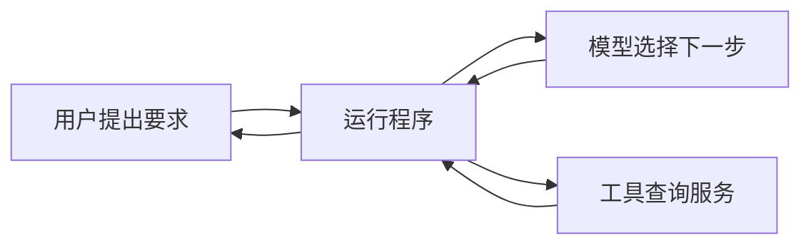

# 第一章：模型之外，谁让事情继续发生？

助手收到旅行要求，回复：“我先查一下上海到杭州的高铁。”然后停住了。

如果背后只有一次模型请求，这句话就是全部结果。模型服务生成了一段文字，并没有因为写下“查一下”，就自己连接购票平台。

要真的查到车次，还得有程序接住模型的请求，调用查询工具，把结果交回来。先把这几件事分开，后面的设计才容易理解。

## 用户、模型、程序和工具分别做什么

用户说出目的和限制：周末玩两天，1500 元以内，先看草稿，不订票房，添加日历前另问。

模型根据收到的信息提出下一步。它可以建议先查车次，也可以在看到查询结果后判断到站太晚，应该换个时间。

运行程序负责把建议变成行动。它准备模型要读的内容，告诉模型有哪些工具，检查模型提出的调用，再让工具去执行。结果回来后，程序还要决定是否继续调用模型、等待用户，或者结束。

工具执行具体操作，例如查询车次、读取酒店页面、写入日历。工具背后连接着购票服务、网站或日历服务。

在这个过程中，模型提出“订这家酒店”与酒店订单真的生成，是两件事。运行程序应该在两者之间检查：用户是否允许订房？如果没有，就拒绝这次动作。

## “运行系统”这个词包括什么

一个实际应用往往不止一个程序。它可能还要保存聊天、处理断网、显示待确认的动作，或在用户点击停止后取消后续工作。

本书把围绕模型、负责这些执行工作的部分称为“运行系统”。工程资料中也常用 harness 一词，不同项目包含的范围略有不同。读到这个词时，可以先想到：是谁接住模型输出，让事情继续发生。

模型很重要，运行系统也会影响表现。没有合适工具，模型只能建议你自己去查；没有保存结果的程序，换个会话又可能从头查起；没有提交前的检查，一次错误建议就可能变成真实订单。

## Agent 的自主程度，不是一个开关

本书用一个工作定义：Agent 是一个围绕目标选择行动、读取行动结果，再据此继续工作的系统。

这里的“自己决定”可以有不同程度。模型可以只在几班候选高铁中做比较，也可以自己选择先查交通还是住宿。它还可以提出订票，但最终是否执行，由用户许可和程序规则决定。

因此，设计时要逐项安排：哪些决定交给模型，哪些由程序固定，哪些留给用户。让模型多做一步选择，不意味着也要多给它一份付款权限。

## 现成应用和框架，各自省掉什么工作

使用一个现成助手时，工具、界面和会话保存通常已经安排了一部分。你主要调整设置与扩展，并理解它什么时候会询问、怎样停止。

使用框架时，开发者得到的是组织这些工作的方法，还要接上自己的工具，设计保存哪些信息、哪些情况需要人确认。

例如，LangGraph 可以帮助开发者表达“先查资料，再写草稿，检查通过才发出”的步骤；LangChain 在图执行基础上组织模型与工具循环；Deep Agents 又组合了文件、上下文整理和子任务等能力。记忆来源、技能和存储后端仍需按实际配置选择。

现成安排能减少接线工作，也需要你接受和理解它的默认做法。自己组合更灵活，却必须补齐错误处理和检查。调用代码短，不代表开发者要负责的事情就少。

## 先找到真正做事的组件

界面上都可能只有一个“开始”按钮，背后却不一样。有的应用直接组织模型与工具的往返；有的界面只是把请求交给另一个服务执行。比如 OpenHands 的网页界面与 Agent 服务就分开工作。修一个问题之前，要先找到真正执行查询和保存进度的程序。

现在，“查一下车次”已经有了执行过程：模型提出查询，程序检查并调工具，服务返回结果。下一步要解决的是，查回来的车次不合适时，怎样继续找。

## 延伸阅读

[相关实现与研究资料](../references/chapter-notes.md#01-model-agent-and-harness)

[上一章](00-do-you-really-understand-agents.md) · [下一章：从一次回答，到一个行动循环](02-the-agent-loop.md)
