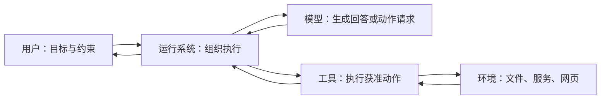

# 第一章：模型之外，谁让事情继续发生？

助手收到 R42 的任务，回复：“我先查看 run-807 的生产日志。”然后就停住了。

如果背后只有一次模型请求，这句话已经是全部输出。模型服务不会因为自己写了“查看日志”，就自动连接日志平台。还要有一个程序接住它的请求，检查动作范围，调用工具，再把结果送回来。理解这个程序，是理解 Agent 的起点。

## 把任务中的参与者认清

值班工程师代表用户提出目标和约束：调查生产运行 run-807，在测试环境验证修复方案，生产保持只读。

模型根据当前输入生成内容。它可能回答问题，也可能提出调用某个工具及其参数。模型看到的信息与可选动作，会影响它的选择。

运行系统组织整个过程：准备输入、调用模型、接收动作请求、检查权限、调度工具、保存状态、处理错误，并判断是否需要继续。工程讨论里常把其中围绕模型的执行支撑称为 **harness**，本书称它为“运行系统”。不同项目使用这个词的范围并不完全一致。

工具执行某种明确能力，例如查询日志、读取文件、运行命令。工具背后可能还有数据库、浏览器或远程服务。它们共同组成 Agent 接触的环境。

这张图中，模型没有直接获得任意操作环境的能力。实际动作经过运行系统和工具，具体边界由系统的实现与配置决定。

## “Agent”在本书中指什么

本书采用一个工作定义：Agent 是围绕目标，利用观察结果选择行动，并根据行动反馈继续推进任务的系统。

这个定义便于我们分析责任，不是为了给所有产品贴统一标签。不同研究和产品对 Agent 的边界有不同约定。有些系统只让模型选择少量动作，有些允许模型组织较长的执行过程。

要描述自主程度，可以问一个具体问题：**系统把哪些决定交给了模型？**

模型可以只负责判断错误类型，也可以负责选择查询，再进一步负责修改方案。权限、预算和验收条件仍可以由外部程序确定。自主性可以逐项分配。

## 现成的 Agent 和框架，各自交付了什么

一个现成的编程 Agent，通常已经决定如何展示会话、选择工具、组织工作区和继续执行。使用者仍可调整配置与扩展，但很多默认选择已经存在。

框架提供构建系统的结构和能力。应用开发者还要决定自己的工具、状态、控制流程和交互方式。

协议则约定参与者如何交换信息。它可以让连接更容易复用，但应用仍要安排目标和执行流程。

因此，比较一个现成 Agent 与一个底层框架时，应先把应用开发者需要补的部分算进去。项目提供的代码量、使用时的一行调用，都不足以单独衡量系统承担了多少责任。

## LangChain、LangGraph 与 Deep Agents 的关系

这三个项目可以说明责任怎样逐层增加。LangGraph 提供有状态的执行基础；LangChain 在其上构造模型与工具之间的循环；Deep Agents 再装配文件、上下文管理和子任务等长任务机制。记忆来源、技能与后端仍须按实际参数配置。

对 R42，如果困难在于“诊断可以探索，但没有验收绝不能交稿”，直接表达阶段转移很有价值。如果困难在于每次都要自己补文件读取、历史整理和任务委派，采用更多现成装配可以减少接线。前者要维护控制结构，后者要理解与调整默认行为。

其他生态也有相似分工，组合位置却不同。Semantic Kernel 把自动函数循环放在连接器一侧，Kernel 路由实际函数；OpenAI Agents SDK 由 Runner 组织模型、工具和交接；OpenHands 的 Canvas 则把用户请求交给独立 agent-server。面对一个界面上的“开始运行”，先找到真正执行循环的组件，才知道该在哪里改动。

## 一个实用的阅读习惯

每当项目写下“支持工具”“支持记忆”“支持多 Agent”，先追问三个细节：默认是否启用，谁负责配置，失败后由谁处理。

现在，“先查看日志”有了执行者：模型提出请求，运行系统组织调用，工具访问日志服务。可是日志返回以后，谁决定接着查配置，还是就此结束？一次调用还没有形成完整的工作过程。

## 延伸阅读

[相关实现与研究资料](../references/chapter-notes.md#01-model-agent-and-harness)

[上一章](00-do-you-really-understand-agents.md) · [下一章：从一次回答，到一个行动循环](02-the-agent-loop.md)
