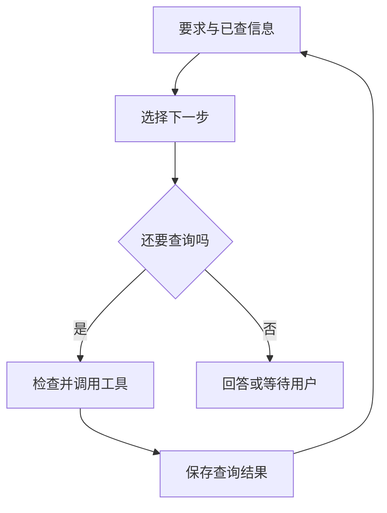

# 第二章：从一次回答，到一个行动循环

助手查到了一班周六从上海去杭州的高铁。列车确实存在，但下午才到，赶不上草稿里上午的安排。它要做的下一件事很简单：查一班更早的车。

这和一次性写完行程有什么区别？第一次查询带回了新情况，助手据此改变下一步。这样一来，“查车次”就从一句打算，变成了可以连续执行的过程。

## 从目标走到下一次观察

程序把用户的要求、已经查到的信息和可用工具交给模型。模型提出查询，程序检查后调用工具，再把结果交回模型。模型看见“到达太晚”，才有理由换一个查询条件。



这个反复进行的过程叫作**行动循环**。我们可以从外部检查每一轮查了什么、得到什么、为什么继续。模型写了多长的思考说明，并不能替代这些查询结果。

## 任务状态与聊天记录有不同用途

聊天记录保留先后说过的话；任务状态记住现在采用什么、还缺什么。

比如，记录里先出现过下午到达的车，后来又出现一班上午到达的车。接下来安排景点时，助手应该使用后者。旧车次仍可以留在记录里，但要注明“到达太晚，已放弃”，否则下一轮可能又把它选回来。

最简单的任务记录就可以写成几行：这次预算 1500 元；只做草稿；已找到合适的去程；返程和酒店仍待查询。它可以存在程序变量里，也可以存到文件或数据库里。关键在于每次查询后，谁来更新它、更新成什么。

“没有查到车次”也要记清楚原因。查询服务超时，只说明这次没有拿到结果；服务正常返回空列表，才说明在这组查询条件下没有找到车。两者会引出不同的下一步。

## 查到了，不等于已经合适

有车次、时间合适、整份行程可用，是三个不同的判断。

第一班车证明这条线路有车，却不适合原先的上午安排。换到更早的车，也只是解决了去程。助手还没查周日怎么回来，更没有算完住宿、餐饮和市内交通的总价。

因此，工具返回成功时，程序应当保存这次查询的结果，而不是顺手把整个旅行标成“完成”。后面要做哪些检查，取决于用户最初要求什么。

## 谁来决定继续和停止

模型可以说“可以结束了”，程序仍要检查：该查的信息是否齐全？有没有用完允许的查询次数？下一步是否超出了用户的授权？

这次用户只要草稿。如果模型提出预订酒店，程序应当拦住；如果两种安排都超预算，助手可以先说明差额，等待用户选择；如果查询服务一直不可用，助手应当留下已经查到的部分和缺口。

“去程已找到，返程暂时查不到”比一句“处理完毕”更有用。它让用户知道哪些可以接着用，哪些还不能据此出行。

## 循环和工作流可以一起存在

有些顺序可以提前规定：查询完成后检查往返车次，计算总价，确认没有下单，再把草稿发给用户。这种预先安排好的步骤叫作**工作流**。

步骤之间仍然可以留出灵活空间。比如，程序规定必须查到往返，但由模型决定先查哪班车、是否换站、何时换酒店。这样既能利用模型处理新情况，也能让“只做草稿”始终生效。

LangGraph 等框架允许开发者把固定步骤和模型循环放在同一条执行流程里，并保存进度、等待人工输入。这些机制解决的是程序怎样继续运行；旅行条件是否合理，还要由具体应用来检查。

## 把循环写成一个可观察的程序

下面只演示一个小片段：第一次查到的去程太晚，于是再查更早的车，找到后停止。它还没有完成整份行程。

两份程序都用固定函数代替模型和查询服务，不联网，也不查真实车次。`choose` 只提出下一步；`run` 检查动作、调用工具并更新记录。允许的工具只有两种查询，没有订票动作。

```typescript
type State = { observations: string[]; suitable: boolean };

function choose(state: State): string {
  if (state.observations.length === 0) return "search_train";
  if (!state.suitable) return "search_earlier";
  return "finish";
}

function execute(action: string): string {
  if (action === "search_train") return "arrives-too-late";
  if (action === "search_earlier") return "morning-train-found";
  throw new Error("unknown tool");
}

function run(maxSteps = 3): string {
  const state: State = { observations: [], suitable: false };
  for (let step = 0; step < maxSteps; step++) {
    const action = choose(state);
    if (action === "finish") {
      return state.suitable ? "train-option-found" : "needs-more-info";
    }
    if (!["search_train", "search_earlier"].includes(action)) return "denied";
    const observation = execute(action);
    state.observations.push(observation);
    if (observation === "morning-train-found") state.suitable = true;
  }
  return "call-limit-reached";
}

console.log(run());
```

```python
from dataclasses import dataclass, field

@dataclass
class State:
    observations: list[str] = field(default_factory=list)
    suitable: bool = False

def choose(state: State) -> str:
    if not state.observations:
        return "search_train"
    if not state.suitable:
        return "search_earlier"
    return "finish"

def execute(action: str) -> str:
    if action == "search_train":
        return "arrives-too-late"
    if action == "search_earlier":
        return "morning-train-found"
    raise ValueError("unknown tool")

def run(max_steps: int = 3) -> str:
    state = State()
    for _ in range(max_steps):
        action = choose(state)
        if action == "finish":
            return "train-option-found" if state.suitable else "needs-more-info"
        if action not in {"search_train", "search_earlier"}:
            return "denied"
        observation = execute(action)
        state.observations.append(observation)
        if observation == "morning-train-found":
            state.suitable = True
    return "call-limit-reached"

print(run())
```

两份程序都输出 `train-option-found`。如果只允许两轮，程序做完两次查询就会返回 `call-limit-reached`，没有机会进入第三轮宣布结束。这里的“三轮”把最后一次选择结束也算在内。

真实应用需要把 `choose` 换成模型调用，把 `execute` 换成实际查询，还要处理参数错误、超时和用户取消。这个例子先让一件事清楚可见：模型提出动作之后，程序才决定能否执行；查询完成之后，程序才保存新结果。

不同系统对“轮”的计数也不同。OpenAI Agents SDK 按模型调用计数；AutoGen 的一次工具迭代可以包含并行工具调用；Aider 的修正循环跟着编辑和检查反馈继续。看到“最多三轮”时，要先问它数的是什么，才能估算会做多少事。

## 中断以后，从哪里继续

假设去程查完后程序退出了。重新启动时，如果只留下原始请求，助手可能把查询从头做一遍；如果保存了已选去程、被放弃的车次和待查返程，它就能继续下一件事。

现在只有查询，重复一次主要浪费时间。等到后面涉及写日历，程序还得核对上次是否已经写入，不能简单重做。保存进度和核对已经发生的动作，是两个相关但不同的问题。

助手现在能根据查询结果调整行动了。不过，“查一家酒店”到底只是看房价，还是会连带预订？下一章要把每个工具能做什么说清楚。

## 延伸阅读

[相关实现与研究资料](../references/chapter-notes.md#02-the-agent-loop)

[上一章](01-model-agent-and-harness.md) · [下一章：工具调用](03-tool-calling.md)
