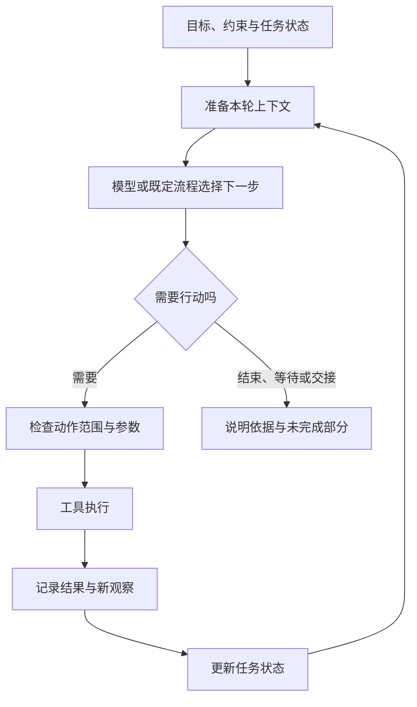

# 第二章：从一次回答，到一个行动循环

运行系统把第一次查询发给日志工具，收到的却是“没有找到 run-807”。助手先核对查询范围，发现日期过滤条件错了一天；修正后，它才取得日志 artifact:log-17。

这次调整让任务向前走了一步。工具带回的结果改变了下一次行动，原先那句“先查看日志”开始变成一个循环。

## 从目标走到下一次观察

运行系统先收集任务目标、已知约束、已知信息与可用工具，组成模型能够看到的输入。模型据此提出动作。系统验证并执行获准动作，再把结果带回下一轮。

这个循环强调的是外部可观察的过程。模型是否展示长篇解释，不能替代工具结果和状态变化。

## 任务状态与聊天记录有不同用途

聊天记录按时间保存发生过的对话。任务状态表达“此刻哪些事情成立”。

例如，历史里出现过两次修复方案，其中一次已经被否决。后续执行需要知道当前采用哪一个方案，而不能仅依靠“最近提到过什么”来猜。

一个朴素的状态记录就可以包含：目标报表、环境、受影响日期、已核实的现象、待验证假设、已完成动作、当前阻碍、剩余预算，以及验收条件。它不一定必须是某种数据库，也不一定必须全部暴露给模型。

开发者要决定状态如何更新：工具结果直接改变事实字段，还是先由模型提出解释，再经过验证？“日志服务返回空结果”和“当天没有异常”应当保存为不同的信息。

## 观察有强弱，动作也有结果不明的时候

读到一条错误日志，可以支持某个假设。重新运行一次成功，只能说明某次运行返回成功。检查输出日期和行数，则回答了更接近任务目标的问题。

如果查询超时，系统获得的观察是“未能确认结果”。如果写操作超时，系统还需要考虑动作是否已经发生。直接把两者都记成“失败”会丢失重要信息。

循环的质量取决于它怎样理解反馈。持续行动本身不能保证持续接近目标。

## 谁来决定继续和停止

模型可以提出“任务完成”，但运行系统还可以检查验收条件、预算和权限。必要时，使用者作出最终判断。

一个任务至少可能以几种方式离开循环：达到验收条件；需要补充输入；需要授权；遇到当前无法排除的阻碍；达到时间或成本限制。这些状态对接手的人有不同意义，应当分别说明。

例如，“已定位为权限不足，尚未重新运行”比“处理结束”更能帮助使用者继续工作。

## 循环和工作流可以一起存在

工作流是预先约定的执行结构。它可以规定先核对环境，再允许诊断；诊断部分交给模型循环；修改后又进入固定的验收步骤。

Agent 的决策可以嵌入工作流，工作流也可以成为 Agent 可选择的一个动作。两者的组合方式，决定哪些地方允许探索、哪些地方必须遵守顺序。

LangGraph 的材料将长期、有状态的执行、人工介入和持久化作为重要能力，适合帮助我们研究循环之外的执行结构。[参考 L01](../references/evidence.md#l01-langgraph-的执行状态)

## 中断暴露了循环的空隙

这个循环还有一个容易被忽视的空隙。假设后续验证已发起测试重跑 job-42，系统却在收到结果前退出。重启后的助手如果只看见“尚未验证”，就可能再发起一次重跑。

保存了动作请求，才知道自己尝试过什么；保留了外部任务编号，才有机会查询上次结果。上一次运行是否已经成功、重复运行会产生什么影响，都应先核对，再决定恢复动作。可靠执行专题会继续拆开这个空隙。

眼下，助手已经找到正确日志，能够依据观察调整行动。下一步要让“读取生产日志”和“重新运行测试报表”的差别进入工具约定，否则循环只会更快地放大含糊的动作。

[上一章](01-model-agent-and-harness.md) · [下一章：工具调用](03-tool-calling.md)
