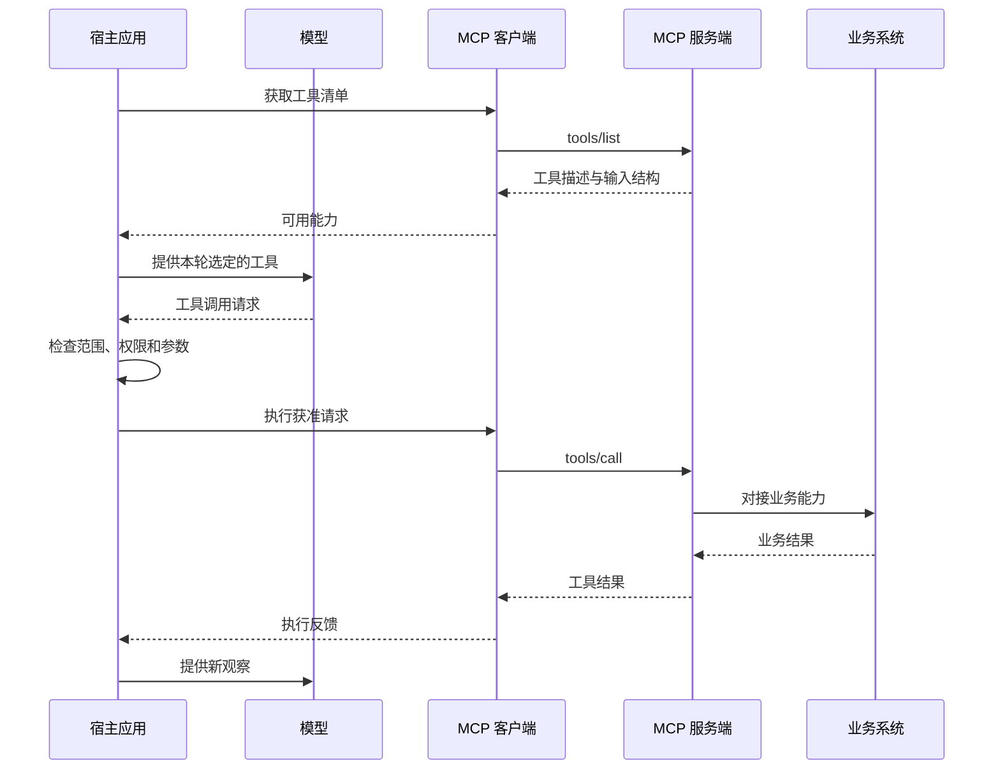

# 第四章：MCP——把连接标准化之后，问题还剩什么？

R42 的调查已经有了明确的工具约定，日志服务、报表平台和知识库却各用一套接口。团队打算让另一个 Agent 应用复用这些能力，发现连接代码又要写一遍。服务提供方和应用开发方需要一种共同的描述与调用方式。

MCP，全称 Model Context Protocol，是应用与能力提供者之间交换工具、资源等信息的协议。对于这里的工具连接，它约定怎样发现能力、提交参数并接收结果。报表为什么失败、这次能否重跑，仍是应用和业务服务要判断的事。

## 三个参与者怎样合作

**宿主**是运行 Agent 的应用。它组织模型请求、用户交互和本地策略。

**MCP 客户端**在宿主一侧，负责按照协议与服务端交换消息。一个宿主可以管理多个这样的连接。

**MCP 服务端**暴露工具等能力，并把请求对接到实际系统。服务端可以运行在本机，也可以由远程服务提供方运行。

日志服务自己的 API 或数据库仍在这条链后面。MCP 服务端承担适配工作，并不会使已有业务系统消失。

## 先发现能力，再决定如何使用

宿主通过客户端获取工具清单，得到工具名称、说明和输入结构。宿主将选定工具呈现给模型；模型提出调用请求后，宿主应用自己的策略，再由客户端发送工具调用，服务端访问实际业务系统并返回结果。

这是本书分析工具路径时使用的简化顺序，省略了连接建立、鉴权与具体传输细节。宿主是否一次加载全部工具、是否要求人工介入，由实际系统决定。

## 相同的工具，可以进入不同的运行系统

对于服务提供方，共用一种协议有助于减少重复适配。对于应用开发方，工具发现与调用可以使用已有客户端机制。

但一个宿主可以直接展示全部工具，另一个可以先筛选再展示；一个会在写入前检查任务范围，另一个可能采用不同策略。连接方式一致，不代表最终行为一致。

Goose 和 Cline SDK 都把服务工具转换成模型可用的能力，却分别安排大结果外置和目录更新。Pi 的 MCP 扩展也区分给模型的短表示与代码调用取得的结果。相同的服务响应，在不同宿主中可能占据不同的输入空间。

框架中的适配器又多一层选择。OpenAI Agents SDK 可以把 MCP 工具转成参与本地审批的函数工具；LlamaIndex 的 MCP 集成可以先按允许名单筛选；smolagents 的可选适配还要求显式建立信任。协议统一了通信，宿主依然负责采用什么能力、何时准入、把什么交给模型。

## 三种信任关系需要分别处理

第一，服务端是否是我们想连接的对象。第二，当前凭证允许访问什么。第三，返回内容应当如何影响后续行动。

即使服务端身份可靠，它返回的文档也可能包含外部用户写入的内容。文档里出现“忽略之前的限制”，仍应当按文档内容的来源来处理。把一段数据带入上下文，不会自动赋予它修改任务规则的权力。

同样，凭证允许读取整个项目，也不代表当前任务需要读取整个项目。业务系统能执行的范围、宿主愿意开放的范围和用户这次要求的范围，需要共同约束一次动作。

## 工具连接多了，模型会更容易选择吗？

工具越多，可覆盖的工作可能越广，选择却未必更容易。两个服务都提供search，模型还要判断查日志还是查知识库；一百个相似说明也会挤占当前证据的输入空间。

一个可研究的方案是按任务阶段暴露能力：诊断时优先提供读取和查询，形成方案后再开放相关修改工具。另一种方案是先检索工具，再加载具体说明。

对这次调查，一个可采用的起点是先提供日志和配置读取能力，到测试验证阶段再加入测试重跑工具。宿主因此多承担了工具筛选和目录更新的工作；是否值得，要观察发现成本、错误选择和任务完成情况。

连接现在可以复用，返回的信息却越来越多：日志、配置、工具说明，都在争取进入下一轮请求。接下来影响助手判断的，是它此刻究竟看见了其中哪一部分。

## 延伸阅读

[相关实现与研究资料](../references/chapter-notes.md#04-mcp)

[上一章](03-tool-calling.md) · [下一章：上下文](05-context.md)
