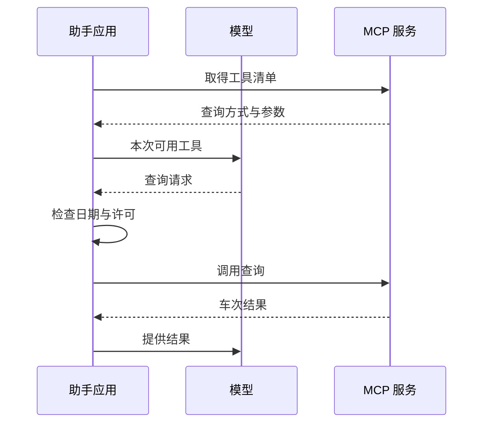

# 第四章：MCP——把连接标准化之后，问题还剩什么？

旅行助手已经能查车次和住处。另一个助手也想用同样的查询服务，开发者却发现又要写一遍连接代码：工具怎样描述、参数怎样发送、错误怎样返回，都得重新约定。

MCP，全称 Model Context Protocol，提供了一套共同的通信约定。服务可以按同一种方式介绍工具、接受调用和返回结果，应用就不必为每个服务重新发明这部分连接。

它解决的是怎样连接。查哪一天、查到什么才够用、有没有权下单，仍要由应用和服务处理。

## 谁在和谁连接

你使用的旅行助手应用叫作“宿主”。它安排模型请求、保存聊天，也决定本次开放哪些工具。

应用中的 MCP 客户端负责发送和接收协议消息。MCP 服务端则列出能力，接住调用，再访问后面的车次、酒店或其他服务。

所以，模型不会因为看到一个 MCP 工具，就自己绕过应用访问所有服务。请求仍要经过宿主安排的调用过程，服务也仍需检查访问权限。

## 先知道能查什么，再提出查询

以车次工具为例，应用先向 MCP 服务端取得工具清单。清单说明“可以查两站之间某天的高铁”，并列出出发站、到达站、日期等参数。

应用把选定工具告诉模型。模型提出查询后，应用检查参数与本次许可，再通过客户端交给服务端执行。查询结果回来，才进入下一轮模型输入。

图中将客户端合并在应用里，服务端背后的实际查询服务也没有展开。协议里的工具发现和调用分别常见为 tools/list 与 tools/call；名称只告诉我们通信操作，还没有说明业务是否完成。

## 同一个服务，应用可以用得不同

一个应用可能把全部工具一次交给模型，另一个先按任务筛选。有的直接给出完整结果，有的先保存长结果，再给模型一段预览和读取方法。

Goose、Cline SDK 和 Pi 的 MCP 接入都能看到这些宿主安排：工具怎样命名，长结果放在哪里，后续怎样读。模型面对的输入因此可能不同，即使服务最初返回的是同一份资料。

框架也会提供适配方式。例如，OpenAI Agents SDK 可以把 MCP 工具接到自己的审批过程，LlamaIndex 的集成可以先筛选允许使用的工具。选择这些做法时，还要核对是否启用、怎样配置，不能把可选接入当作每个应用的默认设置。

## 连对服务，还要问能做什么

这里有三件不同的事。第一，连接的是不是预期服务。第二，当前账号允许访问哪些数据。第三，用户这次让助手做什么。

即使账号可以订房，用户现在也只让查价格。即使酒店页面来自真实网站，页面上的“马上付款”也不是用户的新要求。

资料可信与有权指挥行动，不是同一个判断。应用需要保留“这句话来自酒店页面”，不能在摘要里改成“用户要求付款”。后面的记忆和网页处理都要遵守这一区分。

## 接的工具多了，为什么还会选错？

两个服务都提供搜索，一个查车次，一个查酒店。如果名字和说明太接近，模型就可能选错。工具清单本身也占输入空间，不能以为连得越多越省事。

只有几个稳定工具时，直接给完整说明比较容易理解。工具很多时，可以按任务筛选，或先寻找工具再读取细节；后者少占初始输入，却多了发现步骤，也要处理找不到工具的情况。

这次旅行可以先提供车次与住宿查询。订票、订房不开；日历也等用户提出并确认后再安排。通信方式可以复用，允许动作仍由这次任务决定。

工具接好了，新的问题随之出现：查回来的网页越来越长，模型下一轮究竟还看得见哪些内容？

## 延伸阅读

[相关实现与研究资料](../references/chapter-notes.md#04-mcp)

[上一章](03-tool-calling.md) · [下一章：上下文](05-context.md)
