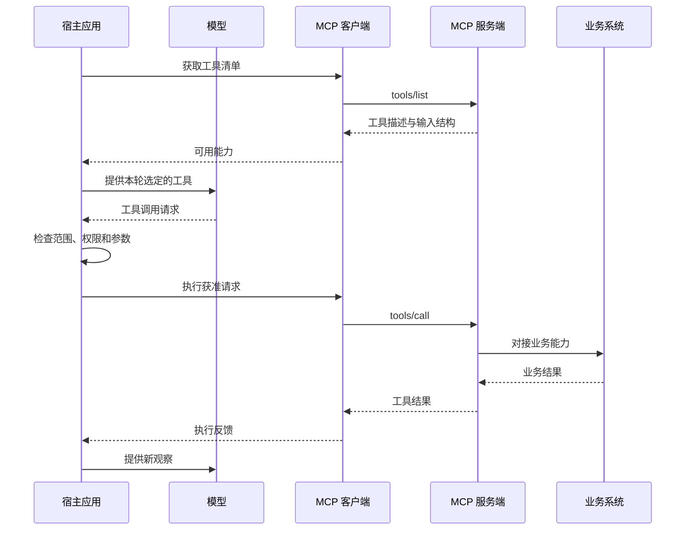

# 第四章：MCP——把连接标准化之后，问题还剩什么？

团队已经有日志服务、报表平台和知识库。每接入一个 AI 应用，都要重新写一套连接代码。服务提供方和应用开发方需要一种共同的能力描述与调用方式。

MCP，Model Context Protocol，讨论的正是这类连接问题。本章只跟踪工具路径中的 **两个实际协议操作**：`tools/list` 发现工具，`tools/call` 请求执行。工具描述、参数对象和返回结果都不另算入口；MCP 还有资源、提示等能力，本章不展开其全部接口。

## 三个参与者怎样合作

**宿主**是运行 Agent 的应用。它组织模型请求、用户交互和本地策略。

**MCP 客户端**在宿主一侧，负责按照协议与服务端交换消息。一个宿主可以管理多个这样的连接。

**MCP 服务端**暴露工具等能力，并把请求对接到实际系统。服务端可以运行在本机，也可以由远程服务提供方运行。

日志服务自己的 API 或数据库仍在这条链后面。MCP 服务端承担适配工作，并不会使已有业务系统消失。[MCP 官方架构](https://modelcontextprotocol.io/docs/learn/architecture)

## 先发现能力，再决定如何使用

宿主通过客户端获取工具清单，得到工具名称、说明和输入结构。宿主将选定工具呈现给模型；模型提出调用请求后，宿主应用自己的策略，再由客户端发送工具调用，服务端访问实际业务系统并返回结果。

这是本书分析工具路径时使用的简化顺序，省略了连接建立、鉴权与具体传输细节。宿主是否一次加载全部工具、是否要求人工介入，由实际系统决定。[工具规范](https://modelcontextprotocol.io/specification/2025-11-25/server/tools)

## 相同的工具，可以进入不同的运行系统

对于服务提供方，共用一种协议有助于减少重复适配。对于应用开发方，工具发现与调用可以使用已有客户端机制。

但一个宿主可以直接展示全部工具，另一个可以先筛选再展示；一个会在写入前检查任务范围，另一个可能采用不同策略。连接方式一致，不代表最终行为一致。

Pi 的当前快照提供 MCP 注册与扩展机制；Deep Agents 的材料也将 MCP 作为接入工具的方式之一。比较时应继续核对宿主如何装配和执行这些工具。[参考 P03](../references/evidence.md#p03-pi-的工具扩展) · [参考 L02](../references/evidence.md#l02-langchain-生态层次)

MCP 宿主专题沿 Goose 与 Cline SDK 的固定实现，继续比较工具身份、按需发现、目录更新、审批与错误。这些差异发生在宿主如何采用协议的过程里。[继续深入](16-mcp-host-differences.md)

## 三种信任关系需要分别处理

第一，服务端是否是我们想连接的对象。第二，当前凭证允许访问什么。第三，返回内容应当如何影响后续行动。

即使服务端身份可靠，它返回的文档也可能包含外部用户写入的内容。文档里出现“忽略之前的限制”，仍应当按文档内容的来源来处理。把一段数据带入上下文，不会自动赋予它修改任务规则的权力。

同样，凭证允许读取整个项目，也不代表当前任务需要读取整个项目。业务系统能执行的范围、宿主愿意开放的范围和用户这次要求的范围，需要共同约束一次动作。

## 工具连接多了，模型会更容易选择吗？

这需要实验。工具越多，覆盖的能力可能越广；描述重叠、上下文占用和选择歧义也可能增加。

一个可研究的方案是按任务阶段暴露能力：诊断时优先提供读取和查询，形成方案后再开放相关修改工具。另一种方案是先检索工具，再加载具体说明。

这些是宿主的设计选择。评价它们需要观察工具发现成本、错误选择次数与任务完成情况，不能只统计连上了多少服务端。

[上一章](03-tool-calling.md) · [下一章：上下文](05-context.md)
