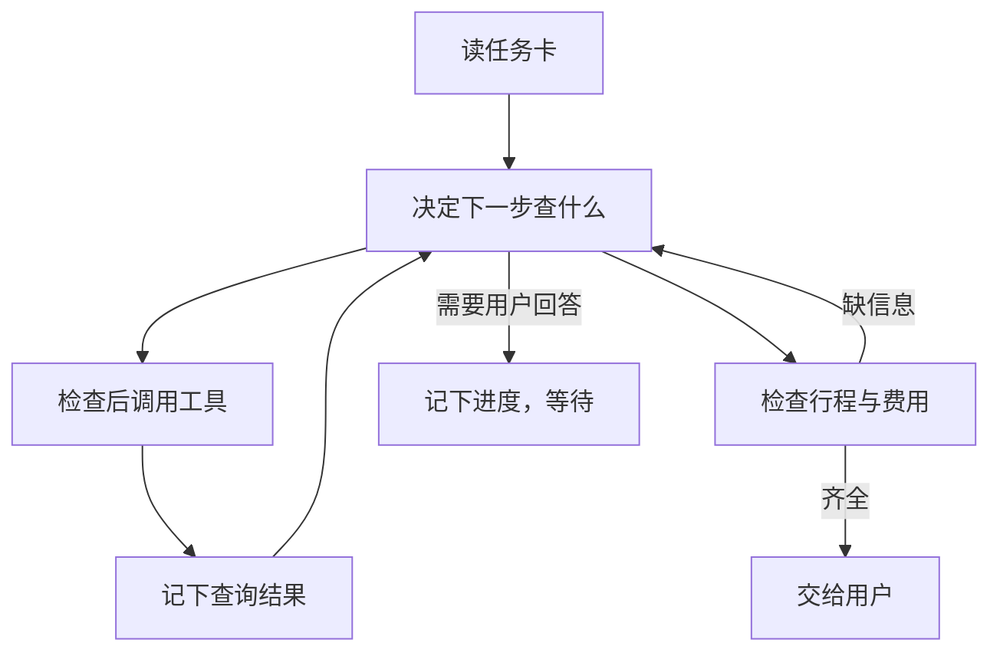

# 第十一章：从一个演示，到一个能长期工作的系统

助手的第一份行程漏了周日返程，检查程序把它拦了下来。现在还没有向用户交稿，也没有订票订房。

如果你坐在电脑前，可以提醒它“还有返程呢”，再盯着它改。但你不可能每次都守在旁边。关掉程序，第二天再打开，它能不能接着补，而不是重新查一遍去程？

从演示走向日常使用，往往就卡在这些小事上。

## 先写清楚，这次到底要做什么

聊天记录里可能既有最初要求，也有被否决的建议。让助手每次从头猜，不如留一张简短的任务卡：

```text
要做：安排上海到杭州的周末两天旅行。
要求：高铁往返，住一晚，总预算1500元，含餐饮和市内交通。
可以做：查资料，整理草稿。
不可以做：订票、订房；未经确认不能加日历。
已经查到：去程和住宿有了候选。
还缺：周日返程；两天的时间、交通住宿和餐饮等费用还要一起核对。
完成时交给用户：完整行程、费用估算、仍需确认的信息。
```

这就是任务约定，工程里也常叫“任务契约”。名字听起来正式，意思很朴素：提前说明什么算做好，什么不能做。

它不需要一开始就变成复杂数据库。一份能更新的小记录已经有用。关键是助手改了方案、用户改了要求之后，这张卡也要跟着改。

## 把“它会检查”变成真的检查步骤

用户说“不订票”，模型可能理解了，但程序仍应在调用工具时核对。助手说“行程完整”，程序也可以先检查有没有两天安排和返程。

这样，模型负责有变化的部分，例如换一班车、调整景点顺序；程序负责明确的要求，例如没有批准就不能下单。查不到关键信息时，助手把缺口留给用户，不要把猜测填成事实。



这张图是一种应用设计。它说明我们希望怎样做，不表示某个开源项目已经替我们运行了整套旅行任务。

## 别把几种不同的“记得”混在一起

第二天，助手看到聊天里有一句“准备加日历”。这还不足以让它继续。它至少要弄清下面几件事。

**任务做到了哪里？** 去程查过了，返程还缺，初稿没有通过检查。这是任务进度。

**外面已经发生了什么？** 以后获得添加日历的许可时，要问日历里有没有创建过这次安排。这要问日历服务，不能只看聊天。

**现在允许做什么？** 用户一开始只允许草稿，后来是否确认了某份行程，又有没有说“先等等”？这决定当前能不能动手。

**哪些信息以后还用得上？** 用户喜欢安静住处，11 月起预算可以提高到 2000 元，但本次仍是 1500 元。这是偏好和适用规则。

它们常被统称为“状态”或“记忆”，用途却不同。可以放在同一个数据库，但不能用一句“继续上次任务”代替逐项确认。

## 单独能用的功能，接起来仍可能出错

记忆已经保存了新预算，准备模型输入的程序却拿着旧副本；小助手已经查不下去了，主助手却把它的返回当作成功；程序恢复了进度，日历里反而多出一条重复日程。

错误往往发生在两个功能交接的时候。

有些项目专门处理其中一小段。CrewAI 的相应读取路径会等排队的记忆写入完成，避免还没写好就去读。Letta Code 的公开本地实现会根据已提交的文件准备模型输入，所以“文件改过了”和“这次请求已经用上新文件”还要分开看。

这些机制解决不了全部问题，但能帮助我们把问题问细：谁保存了？谁来读？什么时候读？读完以后，谁用它作决定？

## 先拿小问题试，不要一上来就测“有多聪明”

想知道助手为什么忘记返程，可以先检查：返程要求有没有进入这次模型输入？

如果它在准备输入时已经被删掉，换模型并不能从这份材料里找回来。如果要求完整地传进去了，模型却仍然遗漏，才继续检查模型选择与最后核对。

想知道恢复后为什么重复添加日程，可以让程序在“服务已经创建、自己还没记下结果”时停住，再启动一次，观察会不会重做。这种检查不需要模型参与。

本书已有五组、共 31 个这样的小实验，检查恢复、工具重试、摘要输入、委派预算和离线验收。它们使用固定输入、预先安排的响应或模拟服务，部分场景沿用报表与审批单；它们没有实际查旅游信息，也不代表模型完成旅行任务的成功率。

小实验的价值是缩小原因：先知道哪一步一定会怎样，再研究整项任务做得如何。

## 真要比较两种方案，怎样才算公平

比如，你想比较“全部聊天都发给模型”和“先整理摘要再发送”。就要给它们同样的旅行要求、相同的资料、工具和费用上限，尽量只改变整理输入的方式。

还要留下每次真正发给模型的内容、调用过的工具、得到的结果，以及最后为什么判为合格或不合格。只保留一张漂亮行程截图，事后很难知道它碰巧做对了，还是设计确实有用。

模型回答有波动，同样任务需要重复尝试。慢了多少、调用多了几次、有没有等用户帮忙，都要一起看。几次小实验通过，不能直接加成一个“整体成功率”。

这些记录需要维护，但能换来一个很实际的好处：当助手说“好了”，你知道该查什么；当它没做好，你知道先改哪一步。

## 从一句“我记住了”继续往下看

行程还缺返程，偏好和预算却已经积累了几条。我们不急着增加新角色，先看一件日常小事：用户明明说过喜欢安静住处，换一次会话，助手为什么又忘了？

接下来从保存这句话开始，一直看到它怎样影响下一次选择。

## 延伸阅读

[相关实现与研究资料](../references/chapter-notes.md#11-design-and-experiments)

[上一章：把项目放在同一张问题地图上](10-project-comparisons.md) · [下一章：记忆系统：从项目比较到写入、检索与更新](15-memory-update-boundaries.md)
