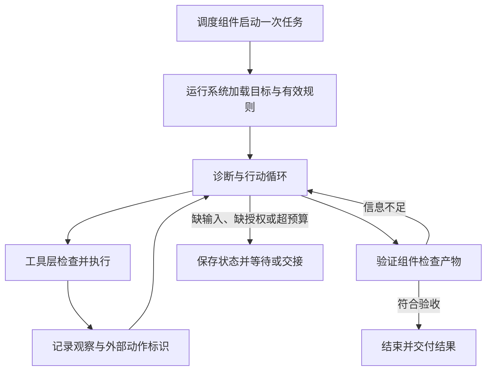

# 第十一章：从一个演示，到一个能长期工作的系统

现在，团队提出新的要求：报表助手每天运行，持续一周。有人会更改规则，日志服务偶尔超时，用户可能中途撤销权限。系统要记住项目约定，也要能够解释每天做了什么。

这一要求把前面的概念放进了同一个过程。我们先设计责任，再选择承载它们的项目。

## 先写任务契约

任务契约说明系统要完成什么、在哪个范围内完成，以及怎样判断完成。例如：每天检查指定测试环境的报表，列出缺失日期，准备修复方案，执行已经授权的验证，保留结果与未完成事项。

这份约定还应说明触发时间、允许的数据范围、写操作边界、成本限制和接手人。否则，“自主运行”会把许多尚未决定的问题藏进模型的一次输出里。

## 再安排一条能核查的责任链

调度组件在约定时间启动任务，并给本次运行分配标识。运行系统读取仍然有效的项目规则，加载上次任务状态，准备上下文。

模型或固定流程选择诊断动作。工具层检查范围并执行，返回状态和产物。系统记录观察，更新假设与任务进度。

涉及修改时，执行器按当前策略检查权限；策略已经撤销时，旧会话里的授权描述不能替代本次检查。验证组件核对产物，运行系统依据验收结果结束、等待或交接。

长期信息可以在任务过程中或结束时更新，但应说明新信息来自哪里，什么时候对后续运行生效。

这是一份讨论用设计，不是某个框架的完整实现，也不是已运行系统的轨迹。

## 四种状态必须一起看

任务状态表达正在做什么；环境状态表达外部世界已经发生什么；策略状态表达现在允许什么；知识状态表达系统认为哪些信息仍然有效。

一次恢复如果只重建任务状态，就可能忽略环境里已完成的写入。一次记忆更新如果忽略策略状态，就可能继续沿用过期授权。一次重新规划如果没有刷新知识状态，就可能依赖旧规则。

这四者之间的协调，是长期任务比单次演示困难的重要原因。

## 让局部机制变得可以观察

本书已经运行下列五组确定性场景。它们使用固定源码、预设输入、模型替身或模拟业务服务，帮助分清局部机制。原始结果、环境和复现命令见 [实验目录](../experiments/README.md)，没有真实模型任务的完成率结论。

| 实验 | 受控变化 | 实际观察 |
| --- | --- | --- |
| [中断恢复](14-resume-and-side-effects.md) | 中断位置、节点拆分、业务去重与注入异常 | 恢复会重新进入未完成节点，外部效果不随图状态回退 |
| [工具错误与重试](17-tool-results-and-retries.md) | 参数错误、执行异常、错误转换、节点重试与图步数 | 错误反馈改变恢复路径；重试整节点会重复成功的相邻动作 |
| [摘要输入](18-context-compaction.md) | 将标记放在工具结果头部、尾部或用户消息中 | 工具结果的尾部标记可能在摘要模型读取前被裁掉 |
| [委派与预算](21-execution-budgets.md) | 同一预设响应分别采用交接与 Agent 工具 | 交接沿用当前轮数，Agent 工具可启动独立计数的子运行 |
| [离线验收](22-evaluation-and-completion.md) | 人工构造排队回执、缺失日期、错误数值与越界动作 | 完成文字相同，独立检查仍能区分等待、不合格与通过 |

记忆更正后何时影响实际请求、取消怎样传播到外部服务，以及真实模型怎样汇总多个执行者，仍需继续运行观察。已有的局部记录不能代替这些问题。

## 一次实验怎样留下可复核的记录

先固定任务输入、源文件快照、模型、工具、扩展、系统提示和预算。改变某个机制时，尽量保持其余条件一致。

每次运行保留本轮实际输入、动作请求、工具结果、状态变化、产物和验收记录。记录失败原因与人工介入，不能只筛选成功样例。

对具有随机性的过程重复多轮，并报告样本量与波动。若不同项目无法使用相同模型或相同工具，应当说明比较覆盖的是整套系统，避免把差异全部归因给框架。

成本既包括运行过程，也可以包括接入、调试和维护工作；不同成本应分别记录，避免用一个数字掩盖取舍。

## 怎样逐步深入源码

先从一次实际调用走到工具执行，再走到错误返回；接着跟踪状态写入、恢复、上下文重建和最终验收。每次阅读只回答一个具体问题，记录版本与记录位置。

例如，“记忆写入后何时进入模型输入”，需要同时核对写入路径和上下文组装路径。只读存储类，无法解释生效时机。

遇到一个框架提供多个使用入口时，先数清真正由调用者触发的入口，再说明请求数据、业务适配器和底层存储怎样合作。实现层的类名应当跟在执行过程之后出现。

## 把研究结果写回书里

一个有价值的项目研究应当改变读者对某个问题的理解。例如，发现恢复会重新进入某一阶段，就让可靠性章节增加条件；发现记忆采用启动快照，就让记忆章节解释生效时机。

这样，项目越读越多，书的主线也会越来越清楚。读者最终掌握的是一组能反复使用的问题：模型看见什么，谁决定动作，谁承担后果，依据什么继续，凭什么结束。

[上一章](10-project-comparisons.md) · [下一章：用户说了停，动作为什么还在发生？](12-action-boundaries.md)
