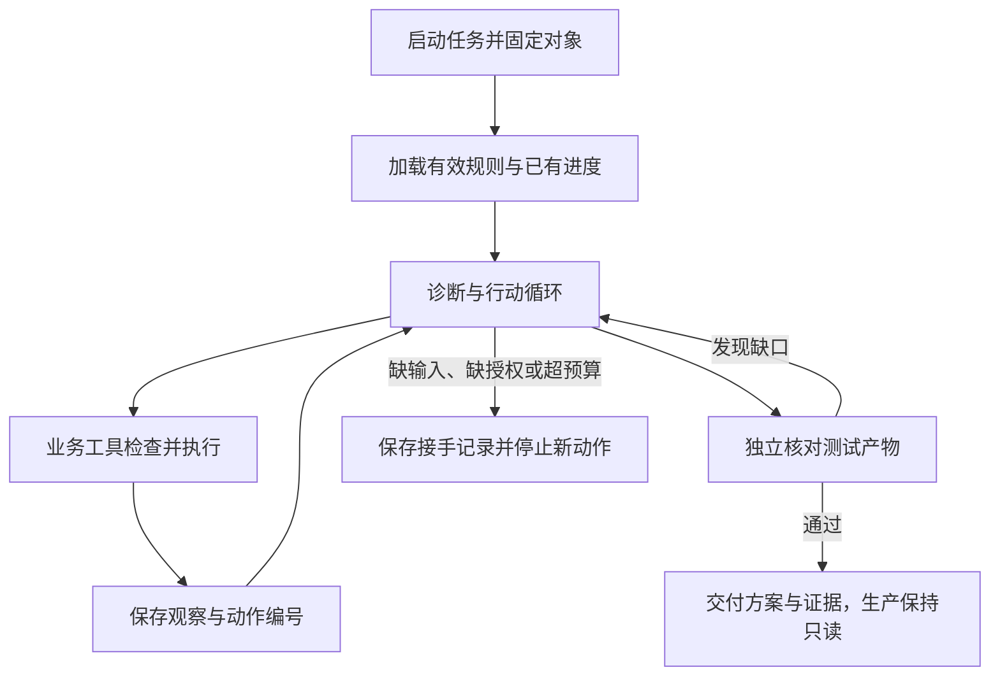

# 第十一章：从一个演示，到一个能长期工作的系统

第一次测试没有交付合格报表。`job-42` 的绿色状态骗过了助手的完成草稿，幸好验收器发现少了 10 月 16 日，把草稿留在了内部。生产环境还没有被修改，R42 的调查也没有结束。

值班工程师接着问：“明天还会有新报表。换一个人值班，这个助手能接着用吗？”

这句话改变了设计的尺度。今天可以靠一个人记住环境、日期和未完成事项；到了明天，系统必须自己找回这些依据。项目选型刚刚确定的责任，需要变成能留下来的状态。

## 先写任务契约

团队把开篇那段请求缩成一份每次都能核对的约定。下面仍是教学情境中的业务设计，不是某个框架预置的字段：

```text
目标：解释 R42 的生产运行 run-807 为什么失败，准备并验证修复方案
对象：业务日期 10 月 16 日；核对窗口 10 月 15–16 日
权限：读取必要生产资料；修复与重跑只在测试环境
已知：测试 job-42 的产物缺少 10 月 16 日，不能交付为验证通过
仍缺：E42 与配置 v6、源结构的对应证据；完整测试产物
交付：原因、方案、测试依据，以及生产尚未变更的说明
```

任务契约把“修好”拆成可判断的目标。换班的人不必重读全部对话，也能知道哪些结论已经成立，哪些只是助手想做的事。日常运行还要补上触发时间、预算和接手位置；这些决定来自应用与使用者，不能留给模型从旧消息里猜。

## 再安排一条能核查的责任链

调度组件启动新任务，运行系统加载目标、有效规则和已有进度。模型决定先查日志还是核对字段；业务工具检查对象与权限，再把实际观察交回。涉及测试修复时，执行器核对当前允许范围。最后，验收器直接读取产物，再决定能否交稿。



这是接下来要逐层完善的设计。它没有把 R42 的整套流程作为某个框架的端到端实验运行；各项目真实做了哪些工作，会在专题中沿源码和已有局部实验分别说明。

## 四种状态必须一起看

如果工程师只保存聊天记录，新会话读到了“准备测试重跑”，却不知道远端是否已经创建 `job-42`。于是，单靠对话续接仍可能重复提交。

任务状态说明准备做什么、已经做到哪里；环境状态说明服务里已经发生什么。除此之外，策略状态还要说明现在允许什么，知识状态则说明项目规则和事实是否仍有效。

这四份状态不一定需要四个数据库，却需要各自的更新依据。用户暂停修改，应该改变执行许可；文件中的时区规则生效，应该改变后续任务的规则选择；服务已经接受请求，应该留下可查询的动作编号。不能把它们都缩成一句“继续上次任务”。

## 让局部机制变得可以观察

团队此时没有理由直接相信整张设计图。它先挑出最可能出错的交接处：文件写入后，下一次输入能不能看见？暂停之后，创建动作会不会重做？子任务用完预算，协调者会收到什么？

本书已运行五组、共 31 个确定性场景，分别观察恢复、工具重试、摘要输入、委派预算与离线验收。[实验目录](../experiments/README.md)保留了输入、固定版本、模拟对象和原始结果。后面会把这些小场景放回对应困难中，而不是把所有通过记录加成一个任务成功率。

例如，R42 的日志尾部可能藏着关键线索。我们可以先不调用模型，只检查这段内容有没有进入摘要材料。这一步如果已经丢失，后面再比较摘要文笔就绕开了真正问题。反过来，即使材料完整，模型是否用对它仍需要任务层验证。

## 一次实验怎样留下可复核的记录

要研究一种改动，就固定其余条件，并让失败也有记录。任务对象、初始环境、源码版本、工具、权限和预算要能找回；每次尝试保留实际输入、动作、产物与验收依据。

对于随机生成过程，还需要重复运行，并说明样本和波动。若比较完整产品，允许它们采用各自配置；若比较一种上下文策略，就尽量只改变这项策略。结论应当对应实际改变的东西。

这里，团队选择先保留一套小而可见的记录：当前目标、规则版本、证据位置、外部动作和验收结果。代价是需要维护这些状态之间的关系；收益是当助手再次写下“已完成”，工程师终于知道该到哪里检查它。

## 从明天的第一轮请求开始

R42 还停在未完成状态，工程师已经把下一周期的时区变化写进了项目约定。明天的助手既要读到新消息，又不能把未来规则套到 10 月 16 日的历史报表上。

这次不再增加一个角色，也不急着换框架。先沿一条信息走到底：用户说了什么，文件保存了什么，模型实际获得了什么。记忆系统的设计，就从这里开始。

[上一章：把项目放在同一张问题地图上](10-project-comparisons.md) · [下一章：记忆系统：从项目比较到写入、检索与更新](15-memory-update-boundaries.md)
