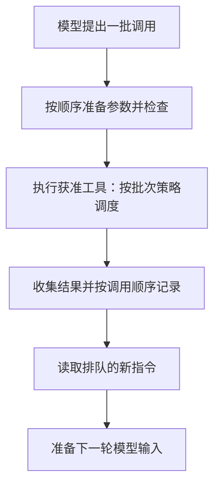

# 用户说了停，动作为什么还在发生？

本章沿 Pi 核心对象的 **两个执行入口**观察控制边界：`prompt()` 开始一次输入，`continue()` 从已有会话继续。加入新消息的队列方法、取消操作和工具回调分别承担控制职责，不把它们重复统计成模型执行入口。随后再比较 Codex 的命令与 MCP 两类执行路径，相关工具数会随注册配置变化。

想象模型在一轮回答里请求两个动作：读取配置，然后修改配置。第一个工具执行时，用户补充：“只检查，先别修改。”

我们希望系统立刻改变方向。但这句话具体进入了哪里？它修改了尚未执行的动作，还是先进入一个消息队列，等待模型下一次作决定？

这是一个情境推演。下面关于机制的结论来自固定源码，未运行这项用户插话实验。

## 新消息要经过一个生效边界

在所研究的 Pi 核心循环中，模型先产生完整消息，其中可以包含一批工具调用。运行系统执行这批调用，把结果放回会话，然后在回合边界取出排队的新指令。

即使这一批选择顺序执行，核心也不在两个工具之间读取补充指令队列（steering）。仓库中的测试专门表达了这一顺序：两个工具都执行完之后，排队的新消息才进入后续模型输入。[Pi 执行研究](../references/studies/pi-deepagents-execution.md)

于是，向模型补充指令，与停止已经安排的动作，成为两项不同的产品能力。使用者看到一个输入框，未必知道消息要等待哪个边界。

如果产品希望提供及时停止，就需要宿主发出取消信号、执行器和工具配合检查，并对已经发生的效果另行核对。Pi 有独立的取消操作；是否能够及时打断某个具体工具，还取决于工具实现。取消也不会自动让已经完成的修改消失。

## 一批工具，同时涉及三种顺序

第一种是准备顺序：找到工具、整理参数、做结构校验、运行调用前检查。Pi 的并行批次会先依原调用顺序准备这些请求，再开始并发执行。

第二种是完成顺序：不同工具耗时不同，后请求的工具可能先结束。

第三种是反馈顺序：运行系统把结果整理回消息历史。在该实现中，结果按原调用顺序交付，不直接沿工具结束先后排列。

因此，界面里看到的顺序、模型获得结果的顺序与外部动作发生的顺序，需要分别理解。研究记录给出了各阶段的源码位置。

这张图描述本次 Pi 核心路径，不代表所有 Agent 的通用调度规则。

## 并行执行与资源保护，可以分开设计

Pi 的核心默认允许并行批次，但工具可以要求整批顺序执行。其编程文件工具还在另一层保护同一路径的修改：对同一文件排队，不同文件可以继续并发。

Deep Agents 的文件中间层采用不同做法：同一模型消息中的后续修改若命中已经被修改的规范化路径，就返回冲突错误，让调用者重新安排。[文件修改机制比较](../references/studies/pi-deepagents-execution.md)

前一种选择把冲突协调放在工具执行内部；后一种选择把冲突作为新观察交给后续决策。排队不代表两个修改在语义上兼容，返回错误也不意味着模型下一次一定会正确拆分。相同的文件写入规则，更不能自动推广到任意命令行操作。

## 参数通过校验之后，责任还会转移

在 Pi 的这条管线中，参数先通过模式校验，再交给宿主的调用前钩子。钩子可以拒绝，也可以改写已经校验的对象。这个固定版本将改写后的对象直接交给工具，没有再次经过同一个模式校验；上游测试明确覆盖了这一约定。

这说明校验保证有适用位置。宿主扩展是运行代码的一部分，它改写参数时，也接过了对改写后参数负责的工作。只知道系统“使用了 JSON Schema”，还无法判断最终执行的业务请求是什么。

## Codex 把命令允许与执行限制放进不同步骤

Codex 的命令路径先解释参数、确定环境和工作目录，再计算命令策略。禁止执行的结果会在进程启动前返回；需要审批时，系统再决定由哪种审批机制处理。获准动作之后仍要选择实际执行的权限与隔离形式。

本节只跟踪一个命令入口 `exec_command`；请求结构、命令适配器、审批服务和沙箱运行设施不是额外的模型工具。MCP 则是另一条处理链，不能直接套用命令启动流程。[Codex 执行研究](../references/studies/codex-tool-execution.md)

这使一句“已经批准”需要继续展开：谁批准，批准什么范围，是否适用于这次实际执行？某些审批由自动机制完成，并不要求用户看到同一种交互。

## 记住一次允许，究竟记住了什么

Codex 的命令用户会话授权会匹配命令、工作目录、执行环境和权限等具体条件，并结合环境策略指纹。MCP 的某条会话授权路径则按服务、连接和工具身份记忆，不包含业务参数，而且只适用于指定的自动模式。

这两种记忆的单位不同。一次允许复用后，业务对象和外部状态是否仍然符合任务，需要工具与业务系统继续检查。授权缓存能够减少重复判断，但不能独自证明未来每一次操作都合适。

## 一个失败，会在不同层获得不同含义

命令启动协调器能够识别某些沙箱拒绝，并在政策允许、必要审批满足后进行有限的第二次尝试。普通工具错误不会自动进入这个分支；较晚收集输出时发现的拒绝，也不在同一个启动重试范围里。

Pi 把许多工具准备或执行错误整理成模型可读的结果，再进入下一轮。Codex 也区分可回给模型的工具错误与需要向会话上层传播的错误。错误之所以能帮助下一步，是因为运行系统安排了反馈路径。

还要分清三层成功：运行系统交付了一份工具结果，进程正常退出，业务目标真正达成。三者可以不同。收到工具返回，不能替代读取退出状态；退出状态正常，也不能替代核查报表内容。

[上一章：叫来更多 Agent，为什么还要有人收尾？](19-delegation-and-handoffs.md) · [下一章：从断点继续，为什么会再做一遍？](14-resume-and-side-effects.md)
