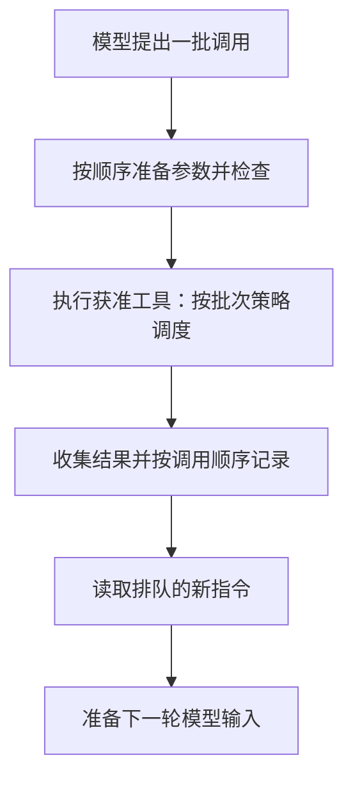
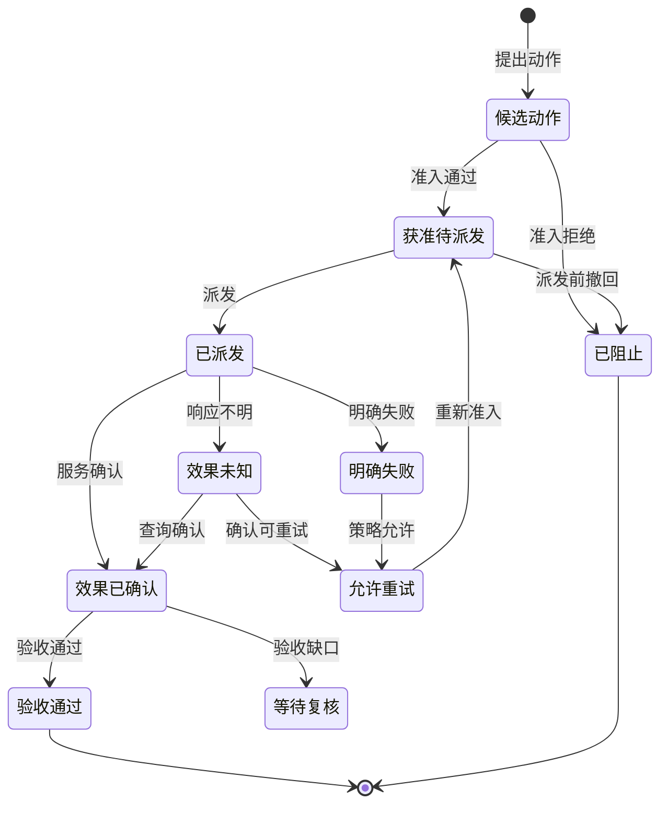
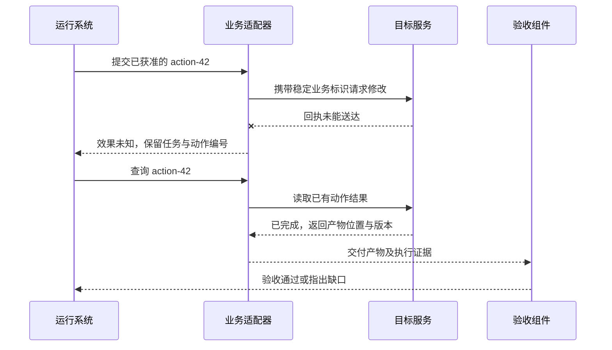

# 可靠执行系统：让动作可控、过程可恢复、结果可核查

本章统计三组有限入口：Pi 核心的两个模型执行方法，Codex 的一个命令工具，以及 LangGraph 的执行、状态观察两个运行期方法。统计限于本章追踪的路径。

协调者已经把两名研究者的材料对齐到经营日报 R42 的生产运行 `run-807`。接下来要继续核对配置 v6，并准备测试修复方案。值班工程师忽然补充：“先暂停执行，把已查到的依据发给我。”

一句暂停，落到系统里却有三种处境。候选动作可能还在队列里；请求可能刚发出去、服务尚未回话；服务也可能已经完成，只差宿主登记结果。助手若只说“已停止”，工程师仍不知道哪些事已经发生。

再遇到一次超时，问题就更明显了：显示“失败，重试”可能把已经成功的动作再做一遍；显示“未执行”又可能掩盖仍在远端运行的任务。可靠执行需要先说清动作到了哪里，再决定停止、查询还是恢复。

> [!NOTE]
> Pi 入口为 `prompt()`、`continue()`；Codex 为 `exec_command`；LangGraph 为 `invoke()`、`get_state()`，分别执行或恢复、观察状态。取消信号和队列方法属于控制接口；审批请求与恢复值承载数据；工具和业务适配器连接服务；调度循环与检查点支撑运行，不重复计数。
>
> R42 的暂停是教学设计情境，生产仍然只读。Pi、Codex 部分来自固定源码追踪；LangGraph 另有四个已运行的确定性恢复场景，没有运行这段暂停与远端超时的端到端实验。

> [!IMPORTANT]
> 新指令进入模型、执行器停止派发、远端动作停止、已有修改被补偿，是不同事件。产品界面与运行状态应说明已经确认了哪一步。

本章先比较运行系统怎样控制动作，再沿固定实现解释边界，最后把审批、恢复、预算和验收连成一套应用设计。

## 三种实现，把控制放在不同位置

Pi 与 Codex 是带执行策略的运行系统；LangGraph 是供应用组织执行的框架。比较时需要看它们把哪些决定交给了应用，不能把应用尚未配置的业务策略判成框架无法支持。

| 同一项控制问题 | Pi 的核心与编程工具路径 | Codex 的命令执行路径 | LangGraph 的图执行与恢复路径 |
| --- | --- | --- | --- |
| 动作开始前在哪里检查 | 工具查找、参数校验、调用前钩子 | 命令策略、审批与执行权限选择 | 应用把业务检查安排在节点或适配器中 |
| 补充指令何时生效 | 已排队指令在循环边界进入输入；取消另有控制路径 | 命令是否启动与后续输出收集分开处理 | 应用需要区分图的中断位置和外部动作状态 |
| 多个动作怎样协调 | 批次调度与同文件工具保护分层 | 每次调用先绑定环境、权限等执行条件 | 图调度步与节点内部动作分层 |
| 恢复意味着什么 | 按会话状态和继续条件重新进入循环 | 进程或工具结果的后续收集不等同重做命令 | 从保存状态继续，相关节点可能重新执行 |
| 外部效果由谁确认 | 工具实现与业务服务 | 执行适配器、进程与目标服务 | 应用的业务适配器及目标服务 |

Pi 的逐项依据见[本地执行研究](../references/studies/pi-deepagents-execution.md)与[固定核心源码](https://github.com/earendil-works/pi/blob/8efd314fa3d3232ce197d8d7a6a5660530b9d83e/packages/agent/src/agent-loop.ts)；Codex 见[本地执行研究](../references/studies/codex-tool-execution.md)与[固定命令适配源码](https://github.com/openai/codex/blob/5009a99dfc07830ddf7464c26f310a2b8532b55d/codex-rs/core/src/tools/handlers/unified_exec.rs)；LangGraph 见[本地恢复研究](../references/studies/langgraph-interrupt-resume.md)与[固定执行入口](https://github.com/langchain-ai/langgraph/blob/41c9c22fdc83d68a2859d0c9a2b627c8615a792f/libs/langgraph/langgraph/pregel/main.py)。

这些差异启发了一条共同设计原则：模型提出动作以后，宿主仍需要在实际执行位置控制它；运行重新开始以后，业务仍需要确认之前发生过什么。接下来把这两个位置拆开。

## 从 Pi 的调度看动作边界

### 新消息要经过一个生效边界

在所研究的 Pi 核心循环中，模型先产生完整消息，其中可以包含一批工具调用。运行系统执行这批调用，把结果放回会话，然后在回合边界取出排队的新指令。

即使这一批选择顺序执行，核心也不在两个工具之间读取补充指令队列（steering）。仓库中的测试专门表达了这一顺序：两个工具都执行完之后，排队的新消息才进入后续模型输入。[Pi 执行研究](../references/studies/pi-deepagents-execution.md)

回到工程师的“先暂停执行”，把这句话排进消息队列，只能确保模型在相应边界看见它。要拦住队列里的新动作，还需要运行控制层另行停止派发。使用者看到同一个输入框，产品却必须把这两条控制路径安排清楚。

如果产品希望提供及时停止，就需要宿主发出取消信号、执行器和工具配合检查，并对已经发生的效果另行核对。Pi 有独立的取消操作；是否能够及时打断某个具体工具，还取决于工具实现。取消也不会自动让已经完成的修改消失。

### 一批工具，同时涉及三种顺序

第一种是准备顺序：找到工具、整理参数、做结构校验、运行调用前检查。Pi 的并行批次会先依原调用顺序准备这些请求，再开始并发执行。

第二种是完成顺序：不同工具耗时不同，后请求的工具可能先结束。

第三种是反馈顺序：运行系统把结果整理回消息历史。在该实现中，结果按原调用顺序交付，不直接沿工具结束先后排列。

因此，界面里看到的顺序、模型获得结果的顺序与外部动作发生的顺序，需要分别理解。研究记录给出了各阶段的源码位置。

这张图描述本次 Pi 核心路径，不代表所有 Agent 的通用调度规则。

### 并行执行与资源保护，可以分开设计

Pi 的核心默认允许并行批次，但工具可以要求整批顺序执行。其编程文件工具还在另一层保护同一路径的修改：对同一文件排队，不同文件可以继续并发。

Deep Agents 的文件中间层采用不同做法：同一模型消息中的后续修改若命中已经被修改的规范化路径，就返回冲突错误，让调用者重新安排。[文件修改机制比较](../references/studies/pi-deepagents-execution.md)

前一种选择把冲突协调放在工具执行内部；后一种选择把冲突作为新观察交给后续决策。排队不代表两个修改在语义上兼容，返回错误也不意味着模型下一次一定会正确拆分。相同的文件写入规则，更不能自动推广到任意命令行操作。

### 参数通过校验之后，责任还会转移

在 Pi 的这条管线中，参数先通过模式校验，再交给宿主的调用前钩子。钩子可以拒绝，也可以改写已经校验的对象。这个固定版本将改写后的对象直接交给工具，没有再次经过同一个模式校验；上游测试明确覆盖了这一约定。

这说明校验保证有适用位置。宿主扩展是运行代码的一部分，它改写参数时，也接过了对改写后参数负责的工作。只知道系统“使用了 JSON Schema”，还无法判断最终执行的业务请求是什么。

## 从 Codex 的审批看动作准入

Codex 的命令路径先解释参数、确定环境和工作目录，再计算命令策略。禁止执行的结果会在进程启动前返回；需要审批时，系统再决定由哪种审批机制处理。获准动作之后仍要选择实际执行的权限与隔离形式。

本节只跟踪一个命令入口 `exec_command`；请求结构、命令适配器、审批服务和沙箱运行设施不是额外的模型工具。MCP 则是另一条处理链，不能直接套用命令启动流程。[Codex 执行研究](../references/studies/codex-tool-execution.md)

这使一句“已经批准”需要继续展开：谁批准，批准什么范围，是否适用于这次实际执行？某些审批由自动机制完成，并不要求用户看到同一种交互。

### 记住一次允许，究竟记住了什么

Codex 的命令用户会话授权会匹配命令、工作目录、执行环境和权限等具体条件，并结合环境策略指纹。MCP 的某条会话授权路径则按服务、连接和工具身份记忆，不包含业务参数，而且只适用于指定的自动模式。

这两种记忆的单位不同。一次允许复用后，业务对象和外部状态是否仍然符合任务，需要工具与业务系统继续检查。授权缓存能够减少重复判断，但不能独自证明未来每一次操作都合适。

### 一个失败，会在不同层获得不同含义

命令启动协调器能够识别某些沙箱拒绝，并在政策允许、必要审批满足后进行有限的第二次尝试。普通工具错误不会自动进入这个分支；较晚收集输出时发现的拒绝，也不在同一个启动重试范围里。

Pi 把许多工具准备或执行错误整理成模型可读的结果，再进入下一轮。Codex 也区分可回给模型的工具错误与需要向会话上层传播的错误。错误之所以能帮助下一步，是因为运行系统安排了反馈路径。

还要分清三层成功：运行系统交付了一份工具结果，进程正常退出，业务目标真正达成。三者可以不同。收到工具返回，不能替代读取退出状态；退出状态正常，也不能替代核查报表内容。

## 从 LangGraph 的恢复看业务效果

LangGraph 的检查点保存图执行状态，但没有保存任意 Python 函数的程序计数器。某个节点在中断或失败后重新执行，节点前半段已经发出的业务动作可能再次发生。

本书的四个受控场景使用同进程的内存检查点与模拟审查服务：同一节点先创建再中断，恢复后创建两条记录；把创建和等待分开，无额外故障时只创建一条；服务按稳定业务标识去重，可以接收两次请求却保留一条记录；即使拆开节点，在外部创建后、节点正常返回前注入故障，恢复仍会再次创建。[运行记录与边界](../experiments/README.md#中断与恢复) · [本地源码研究](../references/studies/langgraph-interrupt-resume.md)

这组观察把三个职责分开了：运行系统保存执行进度，业务适配器携带动作身份，目标服务确认动作效果。节点拆分能明确进度交付边界，业务幂等处理重复请求，两者需要配合。幂等指同一项逻辑操作多次提交时，目标系统按约定复用或拒绝重复效果；它并不要求网络只请求一次。

> [!NOTE]
> 检查点恢复与外部业务事务属于不同的责任范围。恢复成功可以让程序继续运行，目标服务的去重、查询或补偿才能进一步确认业务效果。

## 设计自己的执行系统：把动作提议变成受控请求

以下是一套建议设计，不是上面三个项目共同提供的默认组件。R42 助手先保留稳定任务身份，再为每项外部操作建立动作记录。只读查询也要标明是否发出和证据去向；测试写入还需要稳定业务编号与相应授权，生产写入继续被执行器阻止。

记录应说明：任务和动作分别是谁、目标对象与版本是什么、允许在哪个环境执行、依据哪一次授权、已经请求过几次、效果目前是否确定。动作记录由宿主维护；模型可以建议参数，不能靠输出“管理员已批准”直接写入审批结论。

业务适配器是运行系统接触目标服务的边界。可以把业务需要的能力表达为“读取报表状态”“提交修复”“按动作编号查询结果”，再由具体适配器接命令、HTTP 或 MCP 服务。请求对象只承载操作数据，业务接口约定可观察的含义，审批与预算设施决定能否开始。这样，换传输协议不会抹掉动作的业务身份。

### 动作前：同时核对授权、版本与额度

R42 的修复候选可以是方案 v7，但“允许在测试环境验证”没有批准任何生产修改。实际准备提交时，宿主核对的是 R42、方案 v7、测试环境与这次验证动作；工程师要求暂停后，尚未发出的动作从待派发队列撤回，不能因为此前通过过检查就继续。配置或方案变了，也要重新核对原授权是否覆盖。

这不表示读取过一次权限就能阻止所有并发变化。应用需要结合风险决定原子检查、版本比较、租约或服务端条件写入的边界。对于高代价修改，目标服务在最终提交处继续检查，能减少批准与写入之间的时间差带来的问题。

预算也在动作前检查。对整项任务设定金额或请求总量时，父任务、子任务与重试需要关联同一份受约束账本；框架里的模型轮数或图步数只约束各自计数位置。预算耗尽后的结果查询与验收，也需要预留资源。[预算机制与设计](21-execution-budgets.md)

### 动作中：给“效果未知”一个明确位置

一个可以帮助讨论的动作状态图如下。状态名表达应用已经掌握的证据，不由模型的完成措辞决定。

超时只说明本地没拿到确定结果。如果把它直接记为“未执行”，后续重试可能重复修改；如果直接记为“成功”，又可能漏掉真正的失败。`unknown` 让系统可以保存服务任务编号、停止派发新动作，先查询或交给人工处理。服务明确返回失败时，也要记录已知的部分效果，依据业务语义决定能否重试；一个失败状态本身没有证明从未发生修改。

收到暂停请求后，R42 的动作列表应显示具体变化。下面是设计示例，每行表示一种可能状态，并非同一个动作同时处于三处：

| 暂停时已取得的证据 | 宿主现在做什么 | 助手向工程师说明什么 |
| --- | --- | --- |
| 方案 v7 的测试提交尚未派发 | 从待派发队列撤回，保留候选方案 | 没有发出这次测试提交 |
| 测试请求已发出，回执未收到 | 停止新提交，按业务编号查服务状态 | 已请求停止后续动作，这次请求效果仍待核实 |
| 服务已确认测试动作完成 | 保存结果与产物位置，等待后续验收 | 动作已发生，暂停不会撤销它 |

已派发请求能否停止取决于服务提供的取消能力。已经确认的修改若需要恢复，补偿本身是新业务动作，要重新检查授权与结果，不能靠清空运行状态把它当作没有发生。

### 动作后：先记录证据，再决定重试还是继续

适配器应分别交付工具请求状态、服务动作状态与可查询的产物位置。查询已有动作结果和重新提交修改必须能被区分，否则一个“重新加载”按钮也可能变成业务重放。

下面的时序展示一种建议约定：提交与查询使用同一逻辑动作身份，服务决定是否接受幂等请求。它没有声称现有命令或任意 MCP 工具天然提供这种能力。

## 哪些证据能够支持“可靠”

可靠性不是一个开关。一个系统可能能准确停止本地派发，却不能取消远端任务；可能能恢复图状态，却仍需业务服务去重；可能权限控制正确，却生成了错误的报表。

| 希望承诺的行为 | 应观察的位置 | 不能据此直接推出 |
| --- | --- | --- |
| 用户撤回后不再派发新修改 | 队列与执行器的准入记录 | 已派发动作自动撤销 |
| 恢复不会重复产生业务效果 | 动作编号、服务去重和结果查询 | 网络只发出一次请求 |
| 子任务遵守共同预算 | 共享账本的预占与结算 | 外层轮数就是全任务成本 |
| 外部文本不能直接扩大权限 | 来源保留、宿主授权与实际服务权限 | 模型永远不会误读材料 |
| 任务交付满足要求 | 独立读取的产物与过程记录 | 运行正常退出即可通过 |

本章对照的源码和既有机制实验，可以解释这些承诺需要落在哪些位置。要验证应用实际做到了多少，还需要在固定配置下观察取消、超时、重复请求和并发更新，保存动作轨迹，并让独立验收覆盖真实业务条件。这里列出的是验证方法，没有把未运行的场景计成已验证能力。

这次暂停之后，R42 助手至少能够交代：哪些动作没有发出，哪些仍待核实，哪些已经完成但还没有通过验收。工程师允许继续时，系统再从这些记录选择下一步。可“从记录继续”会不会把早已完成的动作再做一遍？下一章用一个暂停前创建审查单的真实机制实验，继续拆解这条边界。

[上一章：协作系统：更多 Agent，怎样共同交付一份结果？](19-delegation-and-handoffs.md) · [下一章：从断点继续，为什么会再做一遍？](14-resume-and-side-effects.md)
