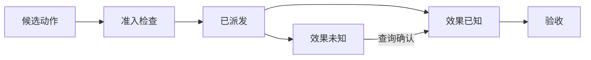

# 可靠执行系统：让动作可控、过程可恢复、结果可核查

协调者已经把研究材料对齐到经营日报 R42 的生产运行 `run-807`。还要继续核对配置 v6，准备方案 v7，在测试环境验证。值班工程师这时插话：“先暂停执行，把已经查到的依据发给我。”

这句话落到系统里，可能遇见三个位置：候选动作仍在队列；请求刚刚发出、服务没有回话；服务已经完成，本地还没登记结果。只回复“已停止”，工程师仍不知道哪些事已经发生。

可靠执行首先是一种可解释性：运行系统能够说明动作走到了哪里，并据此选择下一步。它需要把模型提出动作、宿主允许动作、服务产生效果和应用确认结果分开，不能把所有问题都交给一句“失败后重试”。

## 三种实现，把控制放在不同位置

可以把控制主要放在模型循环边界，也可以放在每次工具派发前，还可以把长任务拆成有状态的工作流。三者通常需要组合。

Pi 的核心循环安排模型与工具批次，宿主扩展在工具前参与检查；Codex 的命令路径把工作目录、执行环境、命令政策、审批和实际权限分层处理。LangGraph 与 Agent Framework 则让应用把步骤和状态交付边界写成图或工作流。前两种已有成套运行安排，后两种更便于按业务组织，但检查与验收要由应用接上。

OpenCode 进一步把会话执行与恢复归属持久化，控制谁继续一项工作；browser-use 面对页面变化，则在动作批次之间重新判断旧定位是否仍可用。它们处理的资源不同，都说明可靠性要落到实际执行位置：本地线程、文件、浏览器页面和远端业务任务，不会因为共享一个“继续”按钮就拥有相同语义。

## 从 Pi 的调度看动作边界

### 新消息要经过一个生效边界

模型一次可能产生多个工具请求。Pi 被研究的核心路径先执行这一批、收集结果，再在回合边界读取排队的新指令。即使批次选择顺序执行，也不能把消息队列想成每两个工具之间都会检查的即时刹车。

所以，“让模型知道暂停”与“停止新的工具派发”应有两条控制路径。前者改变后续输入，后者改变执行器是否还能开始动作。产品可以把它们呈现在同一个交互里，运行系统仍要分别实现。

Pi 有独立取消操作；具体工具是否及时响应，取决于实现。Agent Framework 的工作流取消会取消并等待本地迭代任务与事件任务，失败时丢弃未提交的状态。做到了本地清理，也仍要检查已经交给外部服务的请求。

### 一批工具，同时涉及三种顺序

准备顺序决定先检查哪些参数，执行完成顺序取决于耗时，反馈顺序决定模型后来怎样读到结果。这三者不必相同。

Pi 的并行批次按原顺序准备请求，完成时间可以交错，回传仍按原调用顺序组织。Hermes 的工具批次按读写安全分段，独立读取可以并行，状态变更跨越顺序屏障。它们各自用调度规则减少冲突，但规则不能证明两次修改在业务含义上兼容。

如果 R42 的配置读取必须基于分区检查结果选字段，就应保留依赖；若两次查询互不依赖，可以并发。不要只为缩短等待，把逻辑依赖伪装成独立动作。

### 参数通过校验之后，责任还会转移

在 Pi 的相关管线中，参数先校验，再交调用前钩子；钩子可以改写对象，因而也承担改写后对象的责任。Gemini CLI 的调度器在 hook 改写、重建调用后再次判断政策。Cline SDK 在准备阶段合并输入与工具政策，也为应用提供最后检查的位置。

这些选择的共同问题是：批准与校验究竟覆盖哪一份请求？如果只检查原始参数，再允许扩展把测试改成生产，先前的判断便失去对象。扩展代码属于宿主可信计算的一部分，不能像普通工具返回文本一样看待。

## 从 Codex 的审批看动作准入

动作准入，是执行器决定请求能否开始的检查。它应同时考虑任务允许范围、真实对象、当前版本、执行环境与资源额度。

Codex 的命令路径先解释环境和工作目录，再判断命令政策，需要时进入审批，之后选择实际权限与隔离形式。OpenCode 的权限服务根据动作和资源匹配规则，处理允许、拒绝与询问。AgentScope 先取得权限引擎决定，再把请求变为执行、拒绝或等待事件。不同宿主采用不同策略，执行前的位置都很关键。

“已经批准”还必须带范围。命令授权可以匹配目录、命令与权限等条件；工具会话授权也可能按服务与工具身份记忆，未必包含业务参数。减少重复询问有使用价值，但业务层仍要核对本次对象是否落在授权内。

R42 的边界是生产只读、测试验证。允许测试并没有授予生产发布权。方案变为 v7 后，要把本次测试动作与方案对应；工程师要求暂停时，尚未派发的动作从队列撤回，不能凭此前通过的检查继续执行。

## 动作中：给“效果未知”一个明确位置

服务超时，只说明本地没有取得确定结果。把它记成“未执行”，可能重复创建；把它记成“成功”，可能漏掉失败。因此，结果记录需要一个正式的未知状态。

暂停发生时，运行系统先止住新增派发，再整理已有动作：

| 已知位置 | 运行系统处理 | 可以向工程师声明什么 |
| --- | --- | --- |
| 测试提交尚未派发 | 撤出队列，保留方案 | 这次测试请求没有发出 |
| 已发出，回执不明 | 保存动作编号，查询服务 | 已停止后续派发，本次效果待核实 |
| 服务确认已完成 | 保存回执与产物，继续记录验收状态 | 动作已经发生，暂停不会撤销它 |

已派发动作只有在服务支持并确认取消后，才可称远端停止。已经完成的修改若要恢复，补偿就是新业务动作，需要新的准入与核查。清空本地状态不能改变真实世界。

浏览器场景尤其容易混淆：browser-use 的历史重放会再次执行动作，重连页面与重新提交表单不是同一件事。OpenHands 的前端 WebSocket 重连恢复的是事件观察；后端命令是否执行过，需要后端状态回答。界面恢复、运行恢复与业务恢复应分别命名。

## 从 LangGraph 的恢复看业务效果

图检查点保存哪些步骤已交付，不保存任意函数在每一行的局部执行位置。某节点再次进入时，它前半段的外部动作可能重新发生。

本书用真实 LangGraph 与内存模拟服务运行过四种安排：同节点创建后中断会产生两条记录；创建与等待拆开，在无额外故障时只有一条；服务识别稳定业务编号时，两次请求保留一条；即使拆开，外部创建后、节点返回前失败，恢复仍会创建第二条。

这把责任拆成两层：运行系统提交执行进度，服务提交业务效果。节点拆分缩小重做范围，业务幂等识别重复请求，结果查询消除未知。它们互补，不能只选一个名字就声称可靠。

OpenCode 的持久执行归属和恢复次数可以抑制失控的重启循环，但其至少一次语义仍允许重新进入工作。OpenClaw 对已有副作用或交付证据限制候选 fallback，也是在避免把“换条路径再试”变成重复效果。可靠设计先保留已经发生的事实，再寻找继续方式。

## 设计自己的执行系统：把动作提议变成受控请求

第一版不必建立庞大的调度平台。先保存稳定任务身份，再为可能产生外部效果的动作记录对象、参数摘要、环境、方案版本、授权引用、尝试编号、回执与当前状态。

模型提出参数，宿主从真实审批记录建立准入结果；业务适配器携带稳定动作身份请求服务；服务端限制资源并处理重复；验收器独立读取产物。每次重试都回到同一组对象上判断，而不是依靠“上次好像失败了”的对话记忆。

恢复也分阶段：先取回已提交的进度，再查询仍不明确的动作，最后选择未完成步骤。应用保存的是据什么继续的证据，不只是一份“当前正在处理”的文本。

对小规模只读助手，清楚的派发、取消和查询记录通常足以起步。涉及远端写入、跨日恢复或多人审批时，再增加持久动作账本和服务去重。增加这些机制的代价是状态同步与维护；收益则是每次暂停之后，用户不用猜测世界是否已经改变。

R42 现在可以清楚交代未发出、效果未知和已经完成的动作。下一章进一步追问：即使恢复记录正确，程序从一个节点重新开始时，怎样避免再创建一张审查单？

## 延伸阅读

[实现、版本与实验资料](../references/chapter-notes.md#12-action-boundaries)

[上一章：协作系统：更多 Agent，怎样共同交付一份结果？](19-delegation-and-handoffs.md) · [下一章：从断点继续，为什么会再做一遍？](14-resume-and-side-effects.md)
