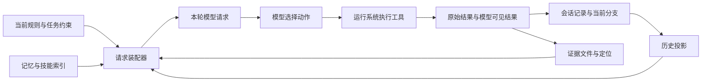
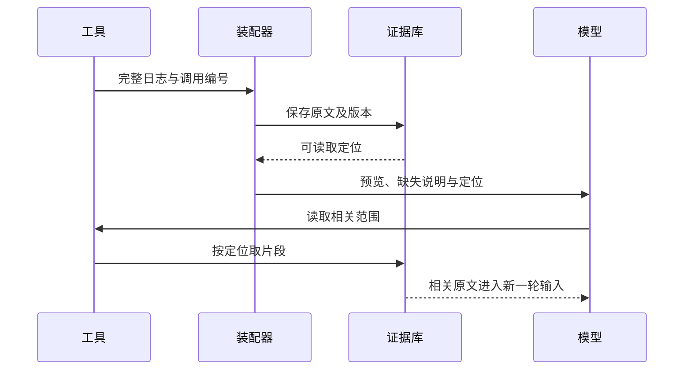

# 上下文系统：让下一步判断拿到合适的依据

本章比较三处真实入口及其范围：Pi 用于开始和继续核心执行的两个方法 `Agent.prompt(...)`、`Agent.continue()`，Deep Agents 用于装配 Agent 的一个工厂 `create_deep_agent()`。Codex 只作为工具结果处理的对照，本文不统计它的产品入口。请求消息是数据，文件后端是业务适配器，存档与检查点是基础设施，它们都不另算执行入口。

用户让报表助手排查一张报表为什么少了数据，同时强调：“只处理测试环境，先拿证据，暂时不要修改。”助手读取项目说明、查询日志、查看字段定义，很快收到几十页结果。随后用户问：“刚才那条错误对应哪个配置？”

此时，困难已经超出“模型能读多少字”。助手需要同时保住行动限制、当前问题、证据出处和下一步可用工具；还要把无关噪声放到一旁。上下文系统负责组织这些材料，模型在组织好的输入里选择动作，工具再把新观察带回来。

前一章的记忆系统关心哪些信息值得跨任务保存。本章的上下文系统关心另一件事：在这一次模型请求里，哪些信息应当以什么形式出现？长期记忆可以成为输入来源，但一段资料存进记忆库，并不意味着模型已经看到它。

## 一次请求之前，谁在整理桌面

应用开发者先选择模型、工具、规则来源、文件后端和保存方式。运行系统据此装配处理链；任务开始后，会话管理器提供当前历史，工具提供新观察，处理链在请求前选择、转换和缩短内容。模型收到的是这一次整理后的输入。

这里的“投影”指从完整记录生成用于某种用途的视图。例如，同一份排障记录，审计人员需要完整动作历史，模型下一轮则可能只需要摘要、近期消息和可回查的证据位置。投影改变当前展示，并不必然覆盖原文。



图 1 中，运行系统决定怎样组织输入，模型决定基于输入提出什么动作。工具是否允许执行，还要经过执行层的权限检查。把“禁止修改生产环境”放进上下文，有助于模型作出正确选择；真正禁止生产写入，仍须由执行器落实。

## 在同一个任务里比较三种做法

下面让三个项目面对同一类报表排障需求。这是对固定源码的机制比较，没有让三个模型跑同一任务，也不据此排名。Pi 是核心循环加编程会话，Deep Agents 是 Python 框架工厂，Codex 此处只考察 MCP 工具结果进入历史的边界；三者的比较范围不能扩成完整产品能力比较。

| 共同问题 | Pi：编程会话与核心循环 | Deep Agents：默认工厂及显式配置 | Codex：所考察的 MCP 结果路径 |
| --- | --- | --- | --- |
| 谁整理下一次输入 | 会话先生成有效历史，再经过上下文变换与模型消息转换 | 工厂装配文件、摘要等中间处理逻辑，配置决定附加 memory、skills 等 | 工具结果转换层生成模型函数输出 |
| 保存记录等于全部发送吗 | 不等于；当前分支、摘要和上下文编辑改变投影 | 不等于；文件内容、缓存和本轮系统消息有不同状态 | 不等于；原始 MCP 结果与给模型的预算化输出可不同 |
| 大结果怎样减轻负担 | 读取工具和后续摘要各有自己的限制 | 符合条件的大文本工具结果可外置到文件，返回预览与引用 | 按截断策略处理函数输出，不能据此假定自动存在完整原文回查 |
| 长期信息怎样生效 | 本章未研究长期记忆扩展 | 指定 memory 来源后加载缓存并加入系统消息；skills 常规路径先展示索引 | 本章未研究 |
| 如何确认模型实际看到什么 | 检查最终请求，不能只看会话文件 | 检查最终消息、工具清单与后端配置 | 检查转换后的函数输出，不能只看服务端返回 |

表中 Pi 与 Deep Agents 的装配、投影和缓存行为来自[执行边界研究](../references/studies/pi-deepagents-execution.md)，工具结果外置和 Codex 输出边界见[本章源码补充](../references/studies/context-system-design.md)。这些差异分别服务于可扩展性、框架默认策略和请求预算，不能压成一个“上下文更强”的分数。

### Pi：完整经历与当前可见内容分开

Pi 的会话管理器以带父子关系的追加条目记录会话。编程会话根据当前分支、压缩边界和上下文编辑生成有效历史；核心循环再依次准备请求、变换应用上下文、转换成模型协议消息并规范化。[^pi]

假设助手先查询错误配置，后来用户切回上一个分支重新检查。原来的查询仍可以留在会话树中，但当前分支的模型请求不必包含它。即使没有分支操作，历史摘要也会改变本轮看到的表示。

标准编程会话的扩展处理器会先克隆消息，再进行上下文变换，因此普通扩展改写投影，不直接改掉原始会话条目。这个保证来自上层包装；裸核心回调本身没有强制深拷贝。接入者若直接使用核心接口，仍须自行约束回调。[^projection]

这种设计让存档与输入可以独立演进，代价是排错时必须追踪两份状态。磁盘里有那条错误，能够说明记录没有消失，却不能证明下一轮模型收到了错误全文。

### Deep Agents：默认栈先决定系统怎样整理材料

Deep Agents 的开发者调用构建工厂，得到装配好的运行图。默认处理栈包含文件系统、摘要与悬空工具调用修补等机制，模型配置还可能改变工具与处理逻辑。这里的中间处理逻辑，是在请求、执行或状态更新前后插入的程序。构造参数并不等于最终发给模型的内容。[^assembly]

例如，memory 与 skills 参数默认是 `None`，相应机制按配置加入。memory 路径读取指定文件，缓存到状态，再在模型请求时放入系统消息；缓存键已经存在时，该读取路径不会再次下载。skills 常规路径则先提供索引，由模型按任务读取全文，也支持显式固定加载全文。[^memory]

回到报表任务：项目说明写入文件后，应用需要明确它何时重新加载。否则文件已经纠正字段口径，运行中会话仍可能使用旧缓存。这个问题属于信息新鲜度，不能通过增加模型窗口解决。

文件后端还决定“路径”意味着什么。默认 `StateBackend` 以图状态承载文件，不是当前电脑的目录；检查点和长期存储默认也没有自动配置。开发者若希望次日恢复后还能读取日志，必须同时选择保存与恢复方式。[^backend]

### Codex：服务返回与模型看到之间，还有一层转换

在本书固定 Codex 源码的 MCP 路径中，结果包装器将服务返回转换为函数输出，附加运行时间信息，然后按截断策略处理负载。相邻的 Code Mode 路径可以保留原始结果；不能把它与普通历史中的表示视为同一份数据。[^codex]

因此，日志服务成功返回完整根因，并不足以证明根因进入了模型输入。服务端日志确认交付，宿主输出转换确认模型可见，两者承担不同责任。这里没有据此证明所有 MCP 工具都会丢失内容，也没有证明截断后必然能回查原文。

> [!IMPORTANT]
> 排查“Agent 忘了”时，先找到那一次实际请求。再沿转换、投影、缓存和原始记录往回查，才能区分没有保存、没有选中、被裁剪和没有正确使用。

## 自己构建时，先决定什么不能只靠转述

下面是一种报表助手的设计建议，不是三个项目共有的默认实现。可以把输入按职责组织成四部分：持续约束、当前任务状态、证据定位和可整理历史。

持续约束保留环境与允许动作，由用户或当前策略更新；当前任务状态记录已经确认的事实、待解答问题和下一步；证据定位记录文件、查询编号或行范围；探索过程则允许摘要。这样安排的理由是：一条“刚才查错了表”的尝试值得留档，但不必与“只操作测试环境”争夺相同的保留优先级。

以下只是字段含义示意，不是可直接调用的框架 API：

```json
{
  "constraints": {"environment": "test", "allow_mutation": false},
  "current_question": "错误码 E42 对应哪个配置？",
  "confirmed_facts": ["失败发生在字段映射阶段"],
  "evidence": [{"ref": "artifact:log-17", "range": "840-875"}],
  "next_step": "读取映射配置，与日志中的字段名核对"
}
```

这些字段也会过期。用户允许修改之后，约束需要有明确的替换规则；旧证据对应的文件如果变化，需要版本或内容摘要；“已经确认”的事实如果只是模型猜测，则应保留为假设。结构化只是让责任更清楚，并不会自动保证内容正确。

## 预算应该留给下一步，而不是填满窗口

模型窗口需要同时容纳规则、工具定义、当前任务、近期交互、证据和输出空间。工具定义也占预算，摘要本身同样占预算。系统应先为持续约束、回答和可能的工具返回预留空间，再分配历史与证据的额度。

一个设计选择是先检查材料用途，再决定缩减方式：无需立即理解的完整日志可以外置；待核查字段保留精确原文；历史尝试可以概括；重复工具说明可以按配置减少。单纯从最旧消息开始删除，容易把早期用户限制与过时探索一并丢掉。

Deep Agents 的大结果处理提供了一个具体例子：适用工具的文本结果超过估算阈值时，可以写入后端并替换为较短表示；文件工具可用于后续分段读取。这条路径有工具排除项，也受外置配置与后端结果影响，不能当作所有结果无条件保存。[^offload]

外置降低当前输入负担，但增加了检索动作。模型必须知道哪里有材料、为何需要回查，以及怎样只读取相关片段。如果每次都把整个文件重新读入，成本只是从第一轮移到了后续轮次。



图 2 是建议的完整闭环。落地时，存储成功后才能对外宣称原文可回查；如果保存失败，运行系统应说明失败，不能返回一个看起来有效的文件位置。

## 压缩与恢复，要保持的是工作依据

材料仍然过多时，系统可以压缩历史。压缩不只是把一段长文变短：程序先选择摘要材料，摘要器生成候选表示，会话管理器提交边界，下一次请求采用新投影。每个步骤都可能改变信息。

报表助手如果只保留“已排查字段映射”，却丢掉具体字段、反例与日志范围，下一个模型便难以继续验证。一个可用摘要应交代当前目标、仍生效的限制、已确认与未确认内容、证据位置，以及未完成动作的状态。下一章会沿真实压缩实现说明这些信息在哪里丢失。

进程恢复时，也不能只恢复聊天文字。应用需要恢复任务约束、当前分支、摘要边界和证据可读性；若工具调用没有结果，要先判断协议记录是否完整，再检查外部动作是否已经发生。Deep Agents 的悬空工具修补会补充错误结果以恢复消息一致性，但不会重放工具，更不证明副作用是否发生。[^repair]

上下文恢复回答“模型可以根据什么继续”，业务恢复回答“世界现在是什么状态”。重新发送一次写入命令，不能替代查询它上次有没有成功。

## 怎样知道这套设计有效

上下文系统值得记录的首先是来源与变化：本轮使用哪些规则版本，历史投影采用哪个边界，哪些结果被外置或截断，回查位置能否读取，以及最终请求包含什么。只显示一个 token 总数，很难解释为什么模型漏掉具体事实。记录还应遵守原有访问权限，避免为了排错把敏感原文复制到更宽的日志范围。

验证也应沿链路安排。在人工构造的日志头部、中部和尾部分别放置唯一标记，检查工具返回、存档、摘要材料与最终请求中的位置；重启会话后再检查定位是否有效；修改规则文件后观察旧缓存何时失效。以上是建议的验证方法，不是本章已经运行的项目对比。

本书已经运行的 Pi 裁剪检查只验证摘要材料中的标记能否到达，没有调用模型，也没有测量任务成功率。这个边界很重要：确定的信息丢失可以用程序复现，模型会不会据此做错，还需要进一步任务实验。

上下文设计最终需要让读者回答一个具体问题：助手继续排查报表时，能否找到仍然有效的限制和支持下一步的证据，并解释它们从哪里来。接下来，我们把镜头移到最容易隐藏信息损失的位置——历史压缩。

[^pi]: [本地执行边界研究：Pi 调用链与会话树](../references/studies/pi-deepagents-execution.md) · [固定源码：核心请求准备](https://github.com/earendil-works/pi/blob/8efd314fa3d3232ce197d8d7a6a5660530b9d83e/packages/agent/src/agent-loop.ts#L175-L242) · [固定源码：会话投影](https://github.com/earendil-works/pi/blob/8efd314fa3d3232ce197d8d7a6a5660530b9d83e/packages/coding-agent/src/core/session-manager.ts#L468-L582)。
[^projection]: [本地投影与扩展研究](../references/studies/pi-deepagents-execution.md) · [固定源码：扩展克隆](https://github.com/earendil-works/pi/blob/8efd314fa3d3232ce197d8d7a6a5660530b9d83e/packages/coding-agent/src/core/extensions/runner.ts#L1301-L1365)。
[^assembly]: [本地默认装配研究](../references/studies/pi-deepagents-execution.md) · [固定源码：主栈装配](https://github.com/langchain-ai/deepagents/blob/e80fd67dfaf5ef19f11a64c5d039f18b8b0c7b27/libs/deepagents/deepagents/graph.py#L893-L975)。
[^memory]: [本地 memory 与 skills 研究](../references/studies/pi-deepagents-execution.md) · [固定源码：memory 缓存](https://github.com/langchain-ai/deepagents/blob/e80fd67dfaf5ef19f11a64c5d039f18b8b0c7b27/libs/deepagents/deepagents/middleware/memory.py#L279-L383) · [固定源码：skills 固定加载](https://github.com/langchain-ai/deepagents/blob/e80fd67dfaf5ef19f11a64c5d039f18b8b0c7b27/libs/deepagents/deepagents/middleware/skills.py#L1260-L1280)。
[^backend]: [本地后端与保存范围研究](../references/studies/pi-deepagents-execution.md) · [固定源码：默认后端](https://github.com/langchain-ai/deepagents/blob/e80fd67dfaf5ef19f11a64c5d039f18b8b0c7b27/libs/deepagents/deepagents/graph.py#L658) · [固定源码：检查点与 store 传递](https://github.com/langchain-ai/deepagents/blob/e80fd67dfaf5ef19f11a64c5d039f18b8b0c7b27/libs/deepagents/deepagents/graph.py#L995-L1007)。
[^codex]: [本地 Codex 工具执行研究](../references/studies/codex-tool-execution.md) · [固定源码：MCP 结果预算转换](https://github.com/openai/codex/blob/5009a99dfc07830ddf7464c26f310a2b8532b55d/codex-rs/core/src/tools/context.rs#L157-L213)。
[^offload]: [本地本章补充：大结果外置](../references/studies/context-system-design.md) · [固定源码：条件与外置处理](https://github.com/langchain-ai/deepagents/blob/e80fd67dfaf5ef19f11a64c5d039f18b8b0c7b27/libs/deepagents/deepagents/middleware/filesystem.py#L3500-L3569) · [固定源码：工具排除与返回路径](https://github.com/langchain-ai/deepagents/blob/e80fd67dfaf5ef19f11a64c5d039f18b8b0c7b27/libs/deepagents/deepagents/middleware/filesystem.py#L3835-L3850)。
[^repair]: [本地协议修补研究](../references/studies/pi-deepagents-execution.md) · [固定源码：修补未闭合调用](https://github.com/langchain-ai/deepagents/blob/e80fd67dfaf5ef19f11a64c5d039f18b8b0c7b27/libs/deepagents/deepagents/middleware/patch_tool_calls.py#L17-L52)。

[上一章：记忆系统：从项目比较到写入、检索与更新](15-memory-update-boundaries.md) · [下一章：上下文压缩：信息怎样在交接处丢失](18-context-compaction.md)
