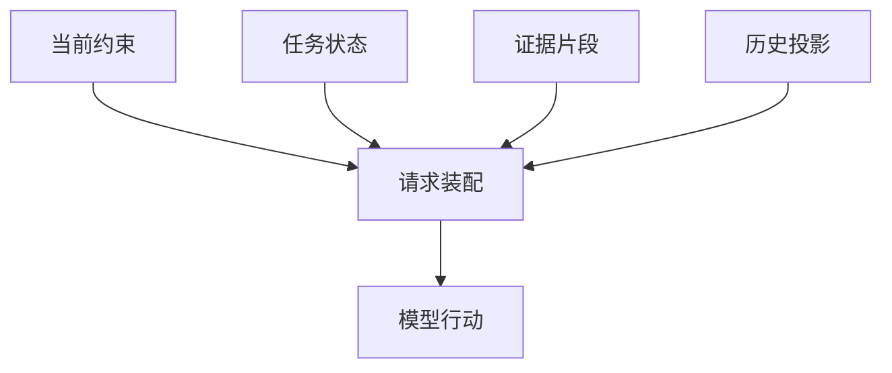

# 上下文系统：让下一步判断拿到合适的依据

时区规则已经分清：R42 属于 10 月 16 日，核对窗口是 15–16 日，继续使用上海时区。值班工程师把注意力转回排障：“run-807 的 E42 对应哪个配置？”

助手保存了规则，也读过生产日志、字段清单和项目说明。可准备回答时，它面对几十页结果：旧查询、重复说明、当前限制、待验证猜测混在一起。正确资料都在，下一轮模型却未必看得到最需要的那几项。

增加记忆没有解决这个困难。本章沿同一教学情境追问：在发出下一次模型请求之前，谁来决定哪些资料上桌，哪些留在旁边，以及哪些必须原样保留？

## 完整记录与本次输入，各有用途

完整记录服务于回查与审计，本次输入服务于下一步判断。一个调查已经做过十次查询，审计需要知道每次发生了什么；模型此刻可能只需要生产只读的限制、E42 的位置、配置 v6，以及尚待核对的源分区。

从完整记录选出某种用途所需的视图，可以称为投影。投影可以缩短、筛选和重组材料，但应让系统继续知道它来自哪里。

Pi 的会话树保留追加条目，当前分支和压缩边界决定有效历史，再经上下文变换形成模型消息。Codex 从运行记录重建窗口时，也要选择生效的压缩记录与后缀。两个例子都提醒我们：磁盘里有一条信息，不代表当前分支的模型请求里还有它。

OpenAI Agents SDK 又带来另一种边界：本地 Session 和服务管理的会话，不在同一个时点承担历史提交。输入通过检查、服务确认接受、会话保存是不同事件。保存两份相同文字，并不能自动保证两边状态一致。



这幅图里，装配程序负责选择与呈现，模型基于收到的信息提出行动，执行器再核对权限。把“禁止修改生产”写进输入能帮助模型判断，真正禁止写入仍要落实在执行层。

## 输入选择有三种位置

最直接的做法是在每次请求前整理消息。LangChain 的 Python 模型节点把消息、状态和运行信息交给请求中间层；JavaScript 装配同样通过内部图传递状态与配置。应用可以把持续约束和当前证据放进这一层，代价是必须维护处理顺序与状态同步。

PydanticAI 的历史处理器显式转换请求历史，处理后的结果也更新运行上下文的消息视图。LangGraph 的模型前处理可以提供专用的模型输入消息，而不必把所有持久消息都发出去。这类框架把选择位置交给开发者，适合业务有严格规则的系统；开发者也要为“保存了什么”与“实际发了什么”各留一份解释。

第二种做法是在资料进入历史时先处理。Deep Agents 和 CrewAI 都有受条件控制的大工具结果外置路径：原文另存，模型先收到较短表示与读取方法。这样能防止一次大日志立即塞满输入，代价是后续多一次回查，还要维护文件的可读期限。

第三种做法是在会话生命周期中维护输入来源。OpenCode 对指令来源变化保留持久事件与观察版本；Agent Framework 把提供者状态放在会话命名范围中。它们适合长期工作，但必须区分“来源改了”“当前会话采用了新版本”“模型这一轮收到了更新”三个时点。

这三种位置可以同时存在。危险在于每一层都认为下一层会保留关键事实，最后没有任何一层对此负责。

## 同一份资料，为何在两个任务里可见性不同

上下文不只是按时间排列的聊天。项目身份、当前分支、用户权限和模型接口都会影响选择。

ADK 在组装历史时区分完整历史与当前轮，还保留调用编号、分支和隔离范围。Mastra 的召回区分线程与资源，资源范围需要明确的身份。它们处理的是“这次应看到哪个范围”的问题；把所有历史混成一条字符串，会失去这些边界。

浏览器任务还有一层不同的约束。Browser Use 在每步读取当前页面和截图，更新页面适用的动作，再组装请求。旧页面里的元素索引即使完整保存，也可能已经不能用。它需要新的观察，而不仅是更大的聊天窗口。

因此，R42 的每条证据至少要带对象与位置：生产环境、run-807、业务日期、配置版本和日志范围。另一个环境里的完整日志，不能靠增加输入权重变成当前任务的证据。

## 不同材料，不该采用同一种保留方式

对下一步判断，我们可以先把材料分为四类。

持续约束回答“允许做什么”，由用户授权与当前策略维护；任务状态回答“已知什么、还缺什么”，由运行过程和检查结果更新；证据保留精确内容与定位；探索历史解释走过哪些弯路，可以有损整理。

这不是四套数据库，而是四种保留责任。一个文件也能承载它们，但压缩时必须知道哪种信息不能随意改写。

下面是一份面向 R42 的输入骨架。它是设计示意，不是实际工具输出：

```text
任务：经营日报 R42；生产运行 run-807；业务日期 10 月 16 日
范围：核对 10 月 15–16 日，按 Asia/Shanghai 解释
允许：读取必要生产日志，在测试环境验证；未经新授权不改生产
观察：artifact:log-17 第 840–875 行出现 E42，涉及字段映射
假设：配置 v6 或源分区与映射不一致，尚未确认根因
下一步：取得对应配置和源结构，逐项核对
```

“日志出现 E42”与“根因就是映射错误”必须分开。前者有出处，后者仍可能被配置或源分区证据推翻。把两句压成“已定位映射错误”，虽然省字，却改变了任务状态。

## 先为必需信息留位置，再分剩余预算

窗口还要装下工具定义、近期交互和输出空间。输入越大，不等于下一步依据越充分；重复说明也能把窗口填满。

常见的两种分配方法各有代价。按消息新旧裁剪，简单且能保留近期对话，却容易丢掉很早提出的限制。按用途分配，能优先保住约束与关键证据，但需要应用定义优先级，并处理“必须材料本身就超预算”的情况。

对于 R42，应先预留回答与工具返回空间，再放持续约束和下一步需要的精确证据。其他内容按相关性选择；放不下的日志留稳定定位，而不是静默假装已读完。

下面用 ASCII 字符演示这个分配顺序，方便看清机制。真实请求要用目标模型的计数方式，并计入工具定义、协议开销等；示例的字符数不能替代 token 计数。

```typescript
const budget = 64, reserve = 16;
const items = [
  { id: "rule", text: "PROD_READ_ONLY", required: true },
  { id: "evidence", text: "E42 log-17:840-875", required: false },
  { id: "history", text: "old-attempt ".repeat(20), required: false },
];
let used = 0;
const selected: string[] = [];
for (const item of items) {
  if (used + item.text.length > budget - reserve) {
    if (item.required) throw new Error("required input exceeds budget");
    continue;
  }
  selected.push(item.id);
  used += item.text.length;
}
console.log(`selected=${selected.join(",")}`);
console.log(`input=${used};reserved=${reserve}`);
```
```python
budget, reserve = 64, 16
items = [
    {"id": "rule", "text": "PROD_READ_ONLY", "required": True},
    {"id": "evidence", "text": "E42 log-17:840-875", "required": False},
    {"id": "history", "text": "old-attempt " * 20, "required": False},
]
used = 0
selected = []
for item in items:
    if used + len(item["text"]) > budget - reserve:
        if item["required"]:
            raise ValueError("required input exceeds budget")
        continue
    selected.append(item["id"])
    used += len(item["text"])
print(f"selected={','.join(selected)}")
print(f"input={used};reserved={reserve}")
```

示例先放必需约束，证据装得下才加入，大段旧尝试被留下。真正的应用还应记录没选中什么和原因；否则“没找到”与“找到却没放进去”会在排错时变成同一句“模型忘了”。

## 外置原文之后，要让回查真的发生

把原文放到文件里，只完成了保存。模型还需要知道何时值得读取、怎样缩小范围，以及读取失败后如何调整判断。

Goose 的过大结果可以交给临时文件，Cline SDK 可以提供会话缓存与按行读取，Deep Agents 可以经文件后端分段取回。它们在保存范围、期限和后端上不同，不能把某一路径推广成所有宿主都永久保留完整原文。

对 R42，一份几十页日志可以先保留总行数、E42 线索和 840–875 行定位。核对配置时再读取相关范围；如果片段不足，就扩大读取而不是补写想象中的错误详情。存储失效时应说明缺口，已有副作用的动作不能为了找回旧输出再做一遍。

文件外置适合大而局部使用的资料，近期确切字段适合原文保留，背景讨论适合摘要。把所有结果一律外置会增加往返，把所有结果一律常驻则会挤走后续空间。

## 恢复上下文，也要恢复它的依据

Deep Agents 的 memory 文件可缓存到图状态中，已有缓存键时不再沿同一路径下载；Letta Code 的本地记忆编译对照已提交版本；Hermes 的记忆提供者又把常驻提示、按需预取和后台同步分开。这些设计各自成立，但应用必须知道自己采用了哪一版。

进程恢复时，除了聊天文字，还要恢复当前分支、任务约束、摘要边界和证据可读性。工具调用若没有结果，需要先判断是协议记录缺失、外部任务仍在执行，还是结果回传失败。

LangGraph 与 Deep Agents 的一些修补路径可以让工具请求和结果重新配对；这种消息一致性不等于远端动作没有发生。上下文恢复回答“模型能依据什么继续”，业务恢复回答“世界已经变成什么状态”。

R42 的下一轮现在有了清楚骨架：限制不随旧尝试被删掉，观察与假设分开，大日志留有可读位置。调查继续之后，材料仍会增长；若历史整理先裁掉唯一线索，再好的骨架也接不到它。下一章就追踪这次信息在压缩中穿过的边界。

## 延伸阅读

[编程运行系统的投影、裁剪与规则加载](../references/studies/system-survey-coding.md)、[框架的请求装配与状态接口](../references/studies/system-survey-frameworks.md)、[文件后端、浏览器状态与记忆刷新](../references/studies/system-survey-systems.md)。

[上一章：记忆系统：从项目比较到写入、检索与更新](15-memory-update-boundaries.md) · [下一章：上下文压缩：信息怎样在交接处丢失](18-context-compaction.md)
