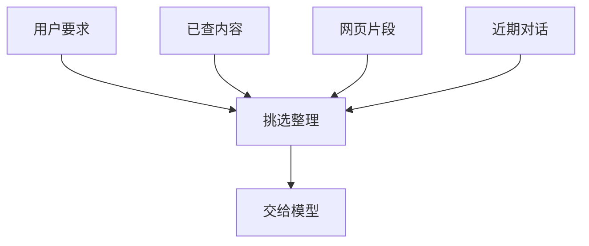

# 上下文系统：让下一步判断拿到合适的依据

杭州两天的行程草稿还缺周日返程。助手又读了几页车次和酒店介绍，用户问：“那现在能回得来吗？加上住宿、吃饭和市内交通，能控制在 1500 元以内吗？”

答案可能藏在已经读过的网页里，可模型下一次收到的材料有多长？里面是否还有“先做草稿，不订票、不订房”？还是只剩一大段酒店设施介绍？

模型每次回答时，能直接使用的是这一次收到的文字、图片和工具说明。这些材料合在一起，就是上下文。程序保存了很多资料，不代表每次都把它们发给模型。


## 保存完整聊天，和让模型重读一遍，不是一回事

为了日后回查，程序可能保存整段聊天和每次查询结果。但要补周日返程，模型此刻最需要的是出发地、目的地、周末日期、预算、已选交通与住宿，以及还没解决的返程问题。

把已经否定的十家酒店介绍重新发送一遍，可能增加费用，还会挤走当前问题。程序应保留完整记录，同时另外挑出本轮要发的材料。本次选出的材料可以比完整记录短；省下的是反复发送无关内容的空间。

Pi 会保存聊天分支：用户回到先前一步改选方案后，旧查询仍可留档，但本次回答不必继续看到被放弃分支的全部内容。Codex 重建会话时，也要根据已采用的摘要和后来消息，确定模型现在看哪一段。文件里能找到一句话，不能直接证明模型这次收到过它。

历史由谁保存，也有区别。OpenAI Agents SDK 可以使用本地 Session，也就是负责保存一段对话的对象；也能接入服务管理的会话。程序将输入交给服务、服务确认接收、本地追加记录，可能发生在不同时刻。若两边都存，就要明确何时更新，避免恢复时重复加入一段消息，或者漏掉用户的更正。



模型读完材料后提出下一步，执行工具的程序再检查是否允许。输入里提醒“不订票”有助于模型正确选择，但订票工具仍应受程序限制。

## 可以在什么时候挑材料

一种做法是在请求模型之前统一处理。LangChain 允许开发者在这一刻检查、增减消息；PydanticAI 的历史处理器也可以先整理聊天，再交给模型。LangGraph 还能为模型单独准备一份输入，不必发送全部保存记录。

对旅行助手，开发者就可以规定：每次询问模型，都保留 1500 元预算和不下单要求；正在补返程时，再附上可选车次。这样容易落实具体需求，代价是开发者要维护这些规则，防止一个处理步骤删掉另一个步骤刚加入的内容。

另一种做法是在工具返回很长内容时先处理。Deep Agents 和 CrewAI 都有符合条件时把大结果另存文件的路径。模型先看到简短说明，之后需要哪段再读。这可以避免一页酒店介绍占满输入，但会多一次读取，也要保证文件仍然可用。

还有一种做法是定期检查持续使用的说明有没有变化。OpenCode 会记录指令来源的修改，Agent Framework 为不同资料提供者分别保存会话信息。它们适合长期使用的助手，但程序还要分清：偏好文件已经改了，当前会话是否已重新读取，以及本次请求是否包含了更改。

三种方法可以一起使用。开发者需要指定谁负责保住关键要求，不能让每一步都以为下一步会处理。

## 同一段文字，也要知道是在说哪次旅行

用户可能同时讨论杭州周末游和下个月的长途旅行。把两段聊天混在一起，即使一字没删，也可能选错预算或日期。

ADK 组装请求时会区分完整历史、当前轮和不同分支，并保留工具调用的对应关系。Mastra 的记忆读取可以限定在本次对话，也可以查某个用户更广的资料。两者都帮助开发者回答：模型这次应该看到哪一部分，而不只是看到多少字。

浏览网页还会遇到更具体的变化。Browser Use 每步重新取得页面和截图，再更新当前可用动作。上一页的“第三个按钮”到了酒店详情页，可能已经是另一个按钮。保存旧截图有助于解释先前发生了什么，真正继续点击仍需要新页面。

所以，留给模型的车次不能只写“周日晚上有车”，还要保留路线、日期和出发到达时间。另一个方向或另一个周末的车次再完整，也不能解决这次返程。

## 四种内容，分别保留

先看这次任务里具体有什么。

“不订票、不订房，加入日历前先问我”是持续要求，不能因为聊得久就丢掉。“周日返程还没选”说明任务缺什么，应当一直保留到查清为止。车次时间和酒店价格需要保留原文或可回查位置。已经排除的酒店与尝试过程可以简要概括。

这不是要求建四套数据库，而是要求程序区别对待这些内容。酒店宣传语可以少放一些，用户禁止下单的要求不能一起删。

一份供模型继续工作的简短说明，可以写成这样：

```text
目标：上海去杭州玩两天，坐高铁，住一晚，总预算 1500 元。
现在只做行程草稿，不订票、不订房；加入日历前也要先问用户。
已经查过交通和住宿，但草稿缺周日返程，尚未核对完整总价。
用户喜欢安静的住处；11 月新预算不适用于这次旅行。
下一步：找合适的周日返程车次，再加总高铁往返、一晚住宿、餐饮和市内交通估算。
```

这份说明没有假装完成。“已经查过交通”不等于“往返交通都已安排”；“看到酒店价格”也不等于“入住那天确实有房”。程序若把尚未确定的部分写成已确认，后续回答就会建立在错误前提上。

## 空间不够时，先留下最需要的部分

模型一次能接收的内容有上限，通常按 token 计算。Token 是模型处理文字时使用的小片段，不一定等于一个汉字或一个单词。工具说明、聊天、网页和模型接下来的回答都要占用空间。

这里说的输入空间，与旅行的 1500 元预算是两回事。即使出游计划一分钱没超，程序仍可能因为网页太长而发不出去。

最简单的办法是删掉较早的消息，但“不订票”可能恰好在第一条。另一种办法是按用途选择：先放不能丢的用户要求和未完成事项，再放当前需要的车次，酒店长介绍留作回查。

下面两段代码展示后一种做法。为了方便看懂，它们用 ASCII 字符数模拟输入上限，并提前给回答留位置；真实应用要换成模型适用的 token 计数，还要计算工具说明等额外内容。

```typescript
const inputLimit = 96, answerReserve = 24;
const notes = [
  { name: "trip_rules", text: "TRIP_LIMIT_1500;NO_BOOKING", required: true },
  { name: "return_gap", text: "SUNDAY_RETURN_NOT_CHOSEN", required: true },
  { name: "hotel_ad", text: "hotel facilities ".repeat(20), required: false },
];
let used = 0;
const chosen: string[] = [];
for (const note of notes) {
  if (used + note.text.length > inputLimit - answerReserve) {
    if (note.required) throw new Error("required notes do not fit");
    continue;
  }
  chosen.push(note.name);
  used += note.text.length;
}
console.log(`chosen=${chosen.join(",")}`);
console.log(`notes=${used};answer_reserve=${answerReserve}`);
```
```python
input_limit, answer_reserve = 96, 24
notes = [
    {"name": "trip_rules", "text": "TRIP_LIMIT_1500;NO_BOOKING", "required": True},
    {"name": "return_gap", "text": "SUNDAY_RETURN_NOT_CHOSEN", "required": True},
    {"name": "hotel_ad", "text": "hotel facilities " * 20, "required": False},
]
used = 0
chosen = []
for note in notes:
    if used + len(note["text"]) > input_limit - answer_reserve:
        if note["required"]:
            raise ValueError("required notes do not fit")
        continue
    chosen.append(note["name"])
    used += len(note["text"])
print(f"chosen={','.join(chosen)}")
print(f"notes={used};answer_reserve={answer_reserve}")
```

程序留下旅行要求和返程缺口，跳过酒店广告。若连必要说明也放不下，就报错，让开发者继续缩减，而不是悄悄删掉用户限制。被跳过的内容还可以留在文件里，后面确实需要时再读。

## 放到文件里之后，还要能找回来

Goose 可以把过大结果交给临时文件，Cline SDK 可以提供会话缓存与按行读取，Deep Agents 也可以通过文件后端分段取回。它们的保存期限和读取方法不完全相同，不能假定一个工具给了路径，所有后续会话都永远能打开。

对旅行助手，可以保存完整酒店页，只把入住日期、房型、价格说明和文件位置发给模型。要核对取消条件时，再读取相应部分。若文件过期，助手应重新查询或说明尚未核实，不能补写自己没看到的条款。

重新读网页与重新下单也必须区别处理。前者通常只是再取资料，后者会改变外部记录。为了找回一次日历创建的返回值，程序应查询已有日程，而不是再创建一遍。

## 恢复时，要知道模型用的是哪一份

Deep Agents 的文件记忆可以保存在运行状态中，已有缓存时不再下载。Letta Code 的本地记忆按已提交的版本组装。Hermes 又分别处理常用提示、临时检索和后台同步。不同设计都能使用，但开发者必须知道用户改偏好之后，哪一步会让模型读到它。

重新启动程序时，也不能只恢复一大段聊天。还要找回这次旅行的要求、尚未解决的问题，以及已经查到内容的有效位置。若曾调用工具却没有保存结果，要先检查外部服务是否已经完成。

有些框架会补齐缺失的工具结果消息，让下一次模型请求格式合法。这只是修好了聊天记录，不证明日历里没有新增日程。模型接下来能读什么，与外部世界已经发生什么，需要分别核对。

现在，助手继续补返程时，可以同时看见 1500 元、不下单、周日返程未定和需要核对总价。接下来材料还会增长；如果程序用摘要替换旧聊天，这些要求又怎样不被改写？

## 延伸阅读

[编程运行系统怎样挑选材料、缩短输入和读取规则](../references/studies/system-survey-coding.md)、[框架的请求装配与状态接口](../references/studies/system-survey-frameworks.md)、[文件后端、浏览器状态与记忆刷新](../references/studies/system-survey-systems.md)。

[上一章：记忆系统：从项目比较到写入、检索与更新](15-memory-update-boundaries.md) · [下一章：上下文压缩：信息怎样在交接处丢失](18-context-compaction.md)
