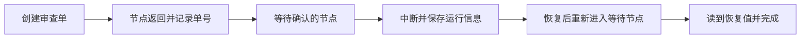
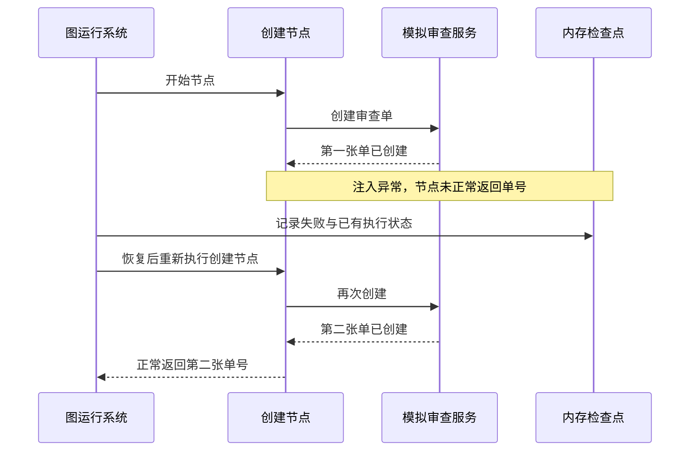

# 从断点继续，为什么会再做一遍？

本章跟踪 LangGraph 的两个运行期入口：执行或恢复，以及观察状态。构图与编译不计作运行入口。

先看本书已经运行的一个最小机制场景：助手准备好修复方案，先创建审查单，再等待使用者确认。使用者点击同意，助手继续工作。

表面上，这只是一次暂停和继续。实际运行后，服务里出现了两张审查单：暂停前一张，恢复后一张。

这次没有模型猜错参数，也没有网络重试。问题出在我们对“继续”的想象里。

## 先认清这次恢复的参与者

应用定义任务节点，图运行系统安排执行，检查点保存器记录可恢复状态。我们另写了一个模拟审查服务，记录保存在图状态之外。因此，图是否暂停与审查单是否已经存在，是两个可以分别观察的问题。

> [!NOTE]
> 实际运行入口为 `invoke()` 与 `get_state()`；首次输入、无输入重试和携带恢复值的调用，都是同一个执行入口的不同请求。`Command` 是传递恢复值的数据对象，不会自己执行节点。模拟审查服务承接业务适配职责，检查点保存器提供运行支持。
>
> 四个场景使用本地固定版本 LangGraph、同进程内存检查点与模拟审查服务，没有调用模型，也没有连接真实审查平台。下文的请求次数与记录数属于这些实验；R42 的具体审批方案另以教学情境说明。[源码研究记录](../references/studies/langgraph-interrupt-resume.md)

## 语言里的“继续”，可能隐藏两种机制

一种想象是，系统冻结了整个函数，保留每一个局部变量，恢复时从暂停位置接着执行。

LangGraph 这里采用另一种机制：恢复时重新进入被中断的节点，执行到中断调用处，再取出已提交的恢复值。其源码文档明确说明，节点从开头重新执行；多个中断的恢复值还需要与节点内部的调用次序对应。[中断定义](../references/studies/langgraph-interrupt-resume.md#节点会重新执行)

因此，“已经运行过一遍的代码”与“已经成为可恢复图状态的信息”，有时并不相同。

## 第一种安排：创建和等待都放在同一个节点

节点先向审查服务创建一张单，取得 `review-1`，然后请求使用者确认。此时函数尚未正常返回，审查单编号还只是节点内的局部结果，没有通过节点输出写进任务状态。

图暂停了，服务里的单据却已经存在。恢复时节点重新开始，再调用一次创建，得到 `review-2`，然后在等待处读到使用者给出的“同意”。

实测里，创建动作请求了两次，服务形成两条记录。暂停时的图状态只保存任务编号；恢复后的图状态最终保存第二张单的编号。[原始结果](../experiments/results/langgraph-interrupt-replay.json)

这同时暴露了另一个问题：使用者先前看到的是第一张单，代码恢复后却取得了第二张单。一句简单的“同意”没有绑定对象和版本。实验刻意省略了这层业务检查，以便看清责任：恢复值怎样关联原对象，需要应用自己设计。

## 第二种安排：先完成创建节点，再进入等待节点

我们把创建与等待拆开。创建节点正常返回，把审查单编号写入图状态；等待节点再发起中断。

恢复时，重新进入的是等待节点。它从已经保存的任务状态中取得同一个审查单编号。此处的受控实验只创建了一张单，等待节点则进入了两次。



这让节点边界成为一种设计语言：希望保存为稳定任务事实的结果，在哪里交给运行系统？希望允许重复执行的过程，放在哪个边界内？

## 第三种安排：允许重入，让业务动作识别重复

我们保留第一种节点结构，同时让审查服务根据稳定的任务标识识别重复请求。第一次创建记录，第二次返回已有记录。

实测仍然发生两次调用，但只形成一条业务记录，返回同一个审查单编号。

| 受控安排 | 创建请求次数 | 服务记录数 | 恢复后的单号 |
| --- | --- | --- | --- |
| 同一节点，无幂等处理 | 2 | 2 | 第二张单 |
| 拆分节点，无额外故障 | 1 | 1 | 原来的单 |
| 同一节点，服务识别重复 | 2 | 1 | 原来的单 |

这些数字来自一次确定性的机制运行，用于核查边界，不是模型效果、吞吐量或稳定性的统计评测。

## 拆开节点，是否就能保证只做一次？

我们增加了一次故障注入：创建节点已经写入审查服务，但尚未返回任务状态时，主动抛出异常。随后从同一线程恢复。

结果仍然创建了两张单。创建节点没有来得及完成状态交付，恢复时便再次进入它。节点边界改善了先前的中断场景，却没有消除业务写入和图状态记录之间的空隙。

本次实验用异常模拟这段失败，没有模拟操作系统崩溃；检查点保存在内存中，也不能据此推断跨进程重启的表现。结论限于这段已经执行的调用过程。



这幅图只概括第四个受控场景的动作顺序，检查点仍是同进程内存实现。它没有模拟网络回执丢失或进程崩溃；这些现象可以产生相似的业务疑问，但需要另外运行实验才能给出对应观察。

> [!IMPORTANT]
> 节点拆分帮助表达进度交付边界；服务幂等与结果查询帮助确认业务效果。设计恢复时需要同时说明这两层约定。

## 两层约定需要共同成立

运行系统需要表达执行进度：哪些步骤完成，哪些步骤仍待执行，恢复请求属于哪一次任务。

业务系统需要表达动作身份：两次请求是否指向同一项业务操作，完成结果能否查询，使用者批准的是哪个对象与哪个版本。

幂等标识也不能随意选。标识应当区分不同操作，同时让同一操作的重试保持一致。任务日期、目标对象和方案版本等信息是否属于动作身份，需要业务方决定。这个决定也会影响去重记录保留多久，以及规则更新后能否再次执行。

回到 R42 的教学情境。协调者准备的是修复方案 v7，范围限定在测试环境；审查单 `review-1` 应记录这份方案，而不只是一个“同意”按钮。应用可以把本次批准对象保存成下面的关系：

```text
任务：经营日报 R42；业务日期 2026-10-16
调查依据：生产运行 run-807；核对窗口 10 月 15–16 日
审查对象：review-1；修复方案 v7；测试环境
允许动作：按方案 v7 执行本次测试验证
持续限制：生产只读；生产修改需要新授权
```

这不是实验中已实现的审批协议。它说明恢复时应用需要核对什么：恢复值应指向 `review-1`，当前方案仍为 v7，执行环境仍为测试，且授权没有撤回。如果恢复后取得的是新单 `review-2`、方案改为 v8，或者目标变成生产，就不能把旧的“同意”搬过去。应用应重新核对授权覆盖范围，必要时针对变化取得新的批准。

幂等也要按这层身份设计。同一个 v7 测试动作恢复时沿用原业务编号；真正换成新方案时，不能为了“防重复”继续复用旧动作的成功结果。图状态交代做到哪里，审批记录交代允许做什么，服务记录交代真正发生了什么，三者对齐后才有继续的依据。

R42 现在有了一个不会任意漂移的恢复对象。但下一份日志或文档也可能带着“忽略原限制”的句子；恢复了上下文，并不代表其中每句话都可以指挥执行。下一章继续追踪外部材料怎样跨越信任边界。

[上一章：可靠执行系统：让动作可控、过程可恢复、结果可核查](12-action-boundaries.md) · [下一章：文档里的一句话，为什么变成了行动指令？](20-trust-boundaries.md)
