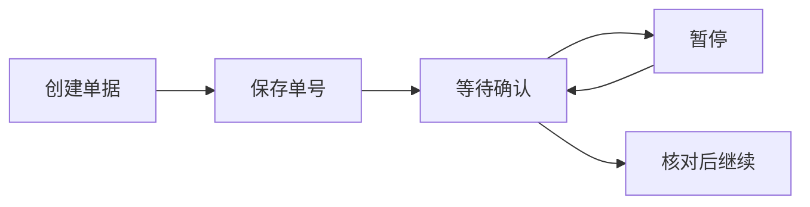
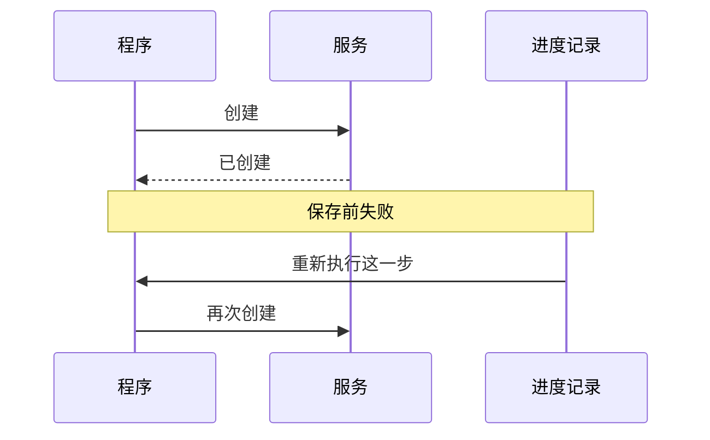

# 从断点继续，为什么会再做一遍？

旅行助手仍要遵守“先给我看，不订票订房”。用户后来允许把自己确认过的行程加入日历，中途又说过“先等等”，所以继续添加以前还要重新确认具体内容。

现在设想一个故障：用户已经重新确认，程序请求创建日程。日历服务创建成功，程序却在保存返回结果前退出。重新启动后，它只看到“还没有日程编号”，于是再创建一次。用户的日历里出现了两条一样的旅行。

重复不一定是模型判断错了。程序如何保存进度，以及服务怎样识别重复请求，同样会决定恢复的结果。这里先用旅行说明问题，再看本书已经运行的独立小实验。

## 程序的“继续”，未必从下一行开始

我们容易想象：程序在某一行暂停，就保留所有局部变量，从下一行继续。另一种常见做法是只保存已完成步骤，恢复时重新运行尚未完成的那一步。

LangGraph 的相关中断采用后一种方式。恢复会重新进入被中断的节点，从头执行，到中断处取回恢复值。节点可以理解成应用交给框架执行的一段函数；检查点保存的是它已经交回的进度，不是函数里每一个瞬间。

因此，服务已经创建一条日程，与程序已经记下这条日程，是两个时点。两者之间出了故障，就需要知道该查询还是重做。

其他系统也有不同的保存单位。Agent Framework 在工作流的一轮步骤成功后提交状态并保存检查点；CrewAI 可以依据任务输出选择恢复位置；Agno 保存暂停状态和审批后接续。名字都叫恢复，重新进入的那段工作可能不同。

## 一个独立小实验：为什么出现两张审查单

本书真实运行的四个场景使用 LangGraph、同进程内存检查点和模拟审查服务。它们创建的是小型审查单，不是旅行日历，也没有调用模型或真实审批平台。

第一种安排把创建与等待放在同一个节点。节点先创建 `review-1`，再暂停等人确认。函数没有正常返回，单号还没作为节点结果交给图保存。

恢复从节点开头执行，于是先创建 `review-2`，再到等待处取出“同意”。实验观察到两次请求、两条记录，最后图里保存第二张单号。

这还暴露了确认内容的问题：使用者原来看见的是第一张单，程序继续时拿的却是第二张。恢复值里只有一句同意，没有核对单号和内容。实验故意保留这个缺口，方便看清程序需要补什么。

## 第一种改法：先保存创建结果，再等待

把创建与等待拆成两个节点。创建节点正常返回单号，图先保存；下一节点读取同一单号，再等确认。恢复只需要重新进入等待节点。

在没有额外故障的实验中，服务只创建一张单，等待节点进入两次。这种拆分让“已经做好什么”更清楚，也减少了恢复时要重做的范围。



代价是多一个步骤和一份需要保存的数据。纯计算拆得太细，可能只增加调度成本；创建外部记录则值得认真设置保存位置。

## 第二种改法：让服务认出“还是刚才那一次”

另一种办法接受程序可能再次执行这段函数，让服务识别同一次逻辑操作。第一次创建，第二次用同一个标记请求时，返回已有记录。

这种重复请求仍只产生约定效果的性质，称为幂等。它不要求网络只发一次，而是要求服务能够处理多次发送。

本书保留创建和等待同节点的安排，让模拟服务按稳定标记识别重复，得到以下区别：

| 实验安排 | 创建请求数 | 实际记录数 | 恢复取得的单号 |
| --- | --- | --- | --- |
| 同节点，不识别重复 | 2 | 2 | 新的第二张单 |
| 拆节点，无额外故障 | 1 | 1 | 原单 |
| 同节点，服务识别重复 | 2 | 1 | 原单 |

## 只拆节点，为什么还不够

第四个场景在服务已经创建、节点还没返回时注入异常，再从同一线程恢复。即使创建和等待已经拆开，服务仍创建了两条记录。

原因是图还不知道第一张单已经存在。拆开节点解决了等待造成的重复，没有消除外部写入和本地保存之间的空隙。



这项实验用异常模拟该段失败，检查点还在同进程内存里。它没有模拟真实网络断开或操作系统崩溃，也不能证明跨进程恢复情况。

设计上，拆分步骤、服务去重和查询结果应当配合。服务不支持去重时，可以先查再创建，但查询与创建之间仍可能有竞争。既无法查证、又不能安全重复的操作，就应暂停自动恢复，请人核实。

## 日历请求要有稳定标记，也要绑定内容

回到旅行。程序为这次添加日历生成一个操作标记，之后即使重新运行，也沿用它。日历服务据此知道第二次请求仍是原来的添加。

标记还应绑定用户确认的内容。标题、开始时间或目标日历变了，就不是简单重试。用户暂停后改了时间，需要重新展示、重新确认，再安排新的操作；不能拿旧同意替新内容背书。

下面的设计示例假定程序已经核对用户确认，专门演示“服务成功，本地保存前失败”。同标记同内容返回原日程，同标记换时间则拒绝。两种语言都只在内存里运行，没有访问真实日历。

```typescript
interface CalendarEvent { id: string; content: string }
const events = new Map<string, CalendarEvent>();
function add(key: string, title: string, start: string): string {
  const content = `${title}|${start}|my-calendar`;
  const old = events.get(key);
  if (old) {
    if (old.content !== content) throw new Error("operation changed");
    return old.id;
  }
  const id = `event-${events.size + 1}`;
  events.set(key, { id, content });
  return id;
}
let savedId: string | undefined;
try {
  add("weekend-trip", "杭州两日游", "2026-10-24 09:00");
  throw new Error("failed before saving");
} catch {
  savedId = add("weekend-trip", "杭州两日游", "2026-10-24 09:00");
}
console.log(savedId);
console.log(events.size);
try { add("weekend-trip", "杭州两日游", "2026-10-24 10:00"); }
catch { console.log("operation changed"); }
```
```python
events: dict[str, tuple[str, str]] = {}

def add(key: str, title: str, start: str) -> str:
    content = f"{title}|{start}|my-calendar"
    old = events.get(key)
    if old is not None:
        if old[1] != content:
            raise ValueError("operation changed")
        return old[0]
    event_id = f"event-{len(events) + 1}"
    events[key] = (event_id, content)
    return event_id

saved_id = None
try:
    add("weekend-trip", "杭州两日游", "2026-10-24 09:00")
    raise RuntimeError("failed before saving")
except RuntimeError:
    saved_id = add("weekend-trip", "杭州两日游", "2026-10-24 09:00")
print(saved_id)
print(len(events))
try:
    add("weekend-trip", "杭州两日游", "2026-10-24 10:00")
except ValueError:
    print("operation changed")
```

真实系统不能靠重启就丢失的字典来防重复。服务应把“检查这个标记有没有用过”和“保存新日程”作为一次不能被其他请求插入的操作，例如让数据库把两步一起完成，遇到重复标记就拒绝新增。这通常需要事务与唯一约束配合：事务规定这一组修改一起成功或失败，唯一约束阻止同一个标记存两条。还要规定记录保留多久，过期后再收到旧请求怎样处理。

日历编号与操作标记也不一样。前者告诉程序创建了哪条日程，后者让程序在还没拿到日程编号时，仍能指向同一次请求。真实接口是否接受这种标记、是否支持查询，需要事先确认。

## 文件恢复、会话恢复和日历恢复不能混为一谈

Gemini CLI 可以为一些文件操作保存 Git 快照；Cline SDK 恢复工作区前先保护当前改动；Hermes 的安全恢复会参考写入记录保留用户修改。它们处理本地文件，不能顺便删除远端日历或撤销订单。

Goose 可复用已经完成的子任务输出，减少重新执行；OpenAI Agents JavaScript 在审批恢复后，会先记下工具或交接已经走到的位置，再处理可能失败的会话历史追加。它们缩小了重复范围，但没有替所有外部服务承诺只执行一次。

旅行助手恢复时，应先核对当前行程是否仍被用户确认，再查询原日历操作。确认失效就等待；原日程已存在就读回核对；结果未知就继续查证。这样，“继续”才有明确含义，不是把上一段代码再跑一遍。

## 延伸阅读

[实现、版本与实验资料](../references/chapter-notes.md#14-resume-and-side-effects)

[上一章：可靠执行系统：让动作可控、过程可恢复、结果可核查](12-action-boundaries.md) · [下一章：文档里的一句话，为什么变成了行动指令？](20-trust-boundaries.md)
