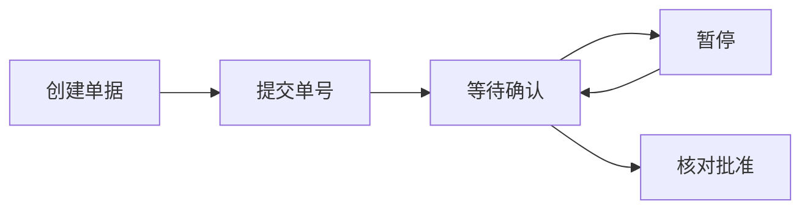
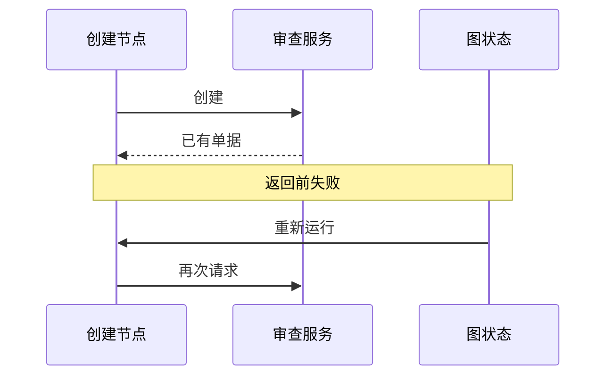

# 从断点继续，为什么会再做一遍？

先看本书实际运行的一个最小场景：助手准备修复方案，先创建审查单，再等待使用者确认。使用者点击同意，助手继续工作。

服务里却出现了两张单：暂停前一张，恢复后一张。这次没有模型猜错参数，也没有网络请求重试。问题出在我们对“继续”的想象里。

上一章把动作分成未发出、效果未知和已确认。这里再向里面走一层：运行系统确认了哪些进度？函数已经执行的部分，会不会成为恢复后的重复工作？

## 先认清这次恢复的参与者

应用定义任务节点，图运行系统安排节点执行，检查点保存器记录可恢复状态。审查服务把单据保存在图状态之外。图暂停与单据存在，是两个独立观察。

本书的四个场景使用真实 LangGraph、同进程内存检查点和进程内模拟服务，没有调用模型或真实审查平台。实验能展示恢复时的节点重入和记录次数，不能代表跨进程崩溃、网络故障或业务完成率。

## 语言里的“继续”，可能隐藏两种机制

一种想象是冻结函数的全部局部变量，恢复时从暂停那一行接着执行。另一种机制保存已经交付的状态，恢复时从某个稳定步骤重新运行。

LangGraph 的相关中断采用后一种方式：重新进入被中断节点，从头执行，到中断位置取出恢复值。多个中断按节点内次序匹配。因此，“刚才运行过”与“已经成为可恢复状态”可能相差一个节点返回。

其他系统也选择不同的稳定边界。Agent Framework 在成功的工作流 superstep 后提交状态并创建检查点；CrewAI 可以根据任务输出选择恢复位置；Agno 保存暂停状态与审批后接续运行。这些边界都能减少重复工作，关键仍是：外部动作在哪一刻变成运行系统认可的已完成步骤？

## 第一种安排：创建和等待都放在同一个节点

节点先创建 `review-1`，再中断等待确认。函数尚未正常返回，单号还在节点局部变量里，没有作为节点输出写进任务状态。

图暂停，服务已存在第一张单。恢复从节点开头再创建一次，得到 `review-2`，随后才在中断处取到“同意”。本书实验观察到两次请求、两条服务记录，恢复后的图状态保留第二张单号。

这还带来审批问题：使用者看见的是第一张单，后续代码拿到的却是第二张。一句没有绑定对象的“同意”，无法解释为什么应该批准新对象。实验刻意没补这个业务检查，才让边界更清楚。

## 第二种安排：先完成创建节点，再进入等待节点

把创建拆成独立节点，正常返回并保存单号；下一节点只读取单号和等待确认。恢复时重入等待节点，取回已保存的同一个对象。

无额外故障的受控场景只创建一张单，等待节点进入两次。这说明节点边界可以成为设计语言：需要稳定保留的结果先交付，允许重做的等待另放一处。



代价是多一个步骤与持久状态。对于纯计算，拆得过细可能只增加调度成本；对于有副作用的动作，它能把“还要重做什么”缩到更小范围。

## 第三种安排：允许重入，让业务动作识别重复

还有另一种思路：接受程序可能重入，让服务识别同一个业务动作。第一次创建，第二次返回已有单据。这种按约定避免重复效果的性质称为幂等。

本书保留第一种节点结构，让模拟服务按稳定任务标识识别重复，观察到两次请求、一条记录、同一个单号。

| 受控安排 | 创建请求数 | 服务记录数 | 恢复取得什么 |
| --- | --- | --- | --- |
| 同节点，无去重 | 2 | 2 | 第二张单 |
| 拆节点，无额外故障 | 1 | 1 | 原单 |
| 同节点，服务识别重复 | 2 | 1 | 原单 |

幂等并不要求网络只请求一次。它要求服务按明确业务身份处理多次请求，使结果仍符合约定。

## 拆开节点，是否就能保证只做一次？

我们又在创建节点写入服务之后、返回图状态之前注入异常，然后从同一线程恢复。结果仍然创建了两张单。

外部服务已提交，节点没有完成状态交付，这个空隙仍在。拆节点解决了“等待导致重入创建”的场景，没有消除“创建成功后尚未来得及登记”的故障。



因此，节点拆分与服务去重应共同考虑。前者明确进度边界，后者保护重复提交；结果查询则处理没有确定回执时的疑问。服务不能去重时，可以先查询再提交，但必须承认查询与写入之间仍可能竞争。副作用无法逆转又无法查询的操作，应收紧自动恢复，保留人工核对位置。

## 两层约定需要共同成立

运行系统记录做到了哪里；业务系统确认多次请求是否属于同一操作。动作身份必须足够稳定，也必须能区分真正的新工作。

对 R42，创建审查单可以由任务、方案 v7、测试环境组成业务身份。本次 `review-1` 批准的是那份具体方案在测试环境的验证。换成 v8，或把环境改成生产，旧批准就不再自动适用。若仍用旧去重键，新工作可能被错误地当作“已经完成”。

下面的设计示例模拟最窄的空隙：服务创建成功，图还没保存，恢复再次提交。同键同内容返回原单，同键不同内容拒绝。示例只在单进程内存里演示身份关系，真实服务需要把检查与写入放在持久化的原子操作中。

```typescript
interface Review { id: string; signature: string }
const reviews = new Map<string, Review>();
function create(key: string, plan: string, env: string): string {
  const signature = `${plan}|${env}`;
  const old = reviews.get(key);
  if (old) {
    if (old.signature !== signature) throw new Error("identity conflict");
    return old.id;
  }
  const id = `review-${reviews.size + 1}`;
  reviews.set(key, { id, signature });
  return id;
}
let checkpoint: string | undefined;
try {
  create("R42-review", "v7", "test");
  throw new Error("failed before checkpoint");
} catch {
  checkpoint = create("R42-review", "v7", "test");
}
console.log(checkpoint);
console.log(reviews.size);
try { create("R42-review", "v8", "test"); }
catch { console.log("identity conflict"); }
```
```python
reviews: dict[str, tuple[str, str]] = {}

def create(key: str, plan: str, env: str) -> str:
    signature = f"{plan}|{env}"
    old = reviews.get(key)
    if old is not None:
        if old[1] != signature:
            raise ValueError("identity conflict")
        return old[0]
    review_id = f"review-{len(reviews) + 1}"
    reviews[key] = (review_id, signature)
    return review_id

checkpoint = None
try:
    create("R42-review", "v7", "test")
    raise RuntimeError("failed before checkpoint")
except RuntimeError:
    checkpoint = create("R42-review", "v7", "test")
print(checkpoint)
print(len(reviews))
try:
    create("R42-review", "v8", "test")
except ValueError:
    print("identity conflict")
```

这个例子不应给人“加一个字典就够了”的印象。多进程要依赖数据库唯一约束、事务或服务提供的幂等接口；去重记录还需明确保留时间。过期后原请求再来如何处理，也属于协议的一部分。未知结果先查询已存在单据，比重置本地字典后重做更稳妥。

## 恢复之前，先问恢复的是哪一种东西

Gemini CLI 可以给可恢复文件操作保存 Git 快照；Cline SDK 的工作区恢复先保存当前改动，再提供本地提交或回滚；Hermes 的安全恢复根据写入记录保留用户改动。这些机制保护的是文件工作区，不能把已经发送的通知或远端数据库修改一起撤销。

Goose 复用已有的子任务成功输出，减少重新执行；OpenAI Agents JavaScript 在恢复审批后，先记录工具或交接已经推进到的继续位置，再处理可能失败的历史追加。它们都在缩小重复范围，但依赖具体记录，不能推广成任意动作恰好一次。

R42 的恢复因而有三个核对对象：图状态说明当前步骤，`review-1` 说明批准对象，服务记录说明实际效果。它们一致时继续；不一致时保留缺口并补查。恢复后的同一段上下文里还可能混入外部文档的指令，下一章继续检查哪些文字有资格影响行动。

## 延伸阅读

[实现、版本与实验资料](../references/chapter-notes.md#14-resume-and-side-effects)

[上一章：可靠执行系统：让动作可控、过程可恢复、结果可核查](12-action-boundaries.md) · [下一章：文档里的一句话，为什么变成了行动指令？](20-trust-boundaries.md)
