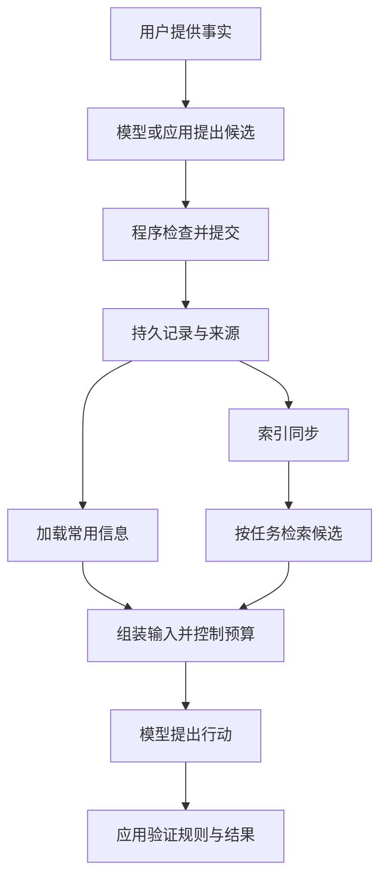
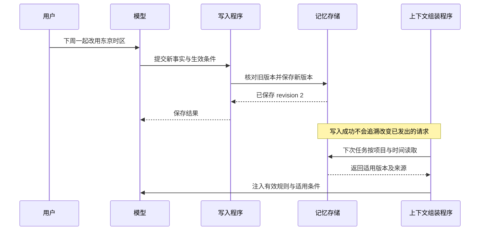

# 记忆系统：从项目比较到写入、检索与更新

本章比较三套记忆设计：Hermes 的两个模型工具入口、OpenClaw memory-core 插件的两个检索入口，以及 LangGraph Store 的三个同步读写入口。入口按调用者实际触发的操作计数。

经营日报 R42 还在排查中，值班工程师又补充了一条约定：“报表现在按上海时区计算，从下周一开始改成东京时区。”助手把新规则写进记忆文件，回复“已记住”。看起来，这件事结束了。

先预演下周一的一次新任务：助手仍按上海时区准备查询。工程师打开文件，东京时区明明就在里面。究竟是谁忘了？

更棘手的是，直接把所有“上海”替换成“东京”也会犯错：眼下正在调查的 R42 属于 10 月 16 日，仍应使用旧规则。我们既要让下一周期读到新约定，又不能让新约定改写历史任务的含义。

> [!NOTE]
> 入口范围：Hermes 的 `memory` 修改精选信息，`session_search` 查找会话；OpenClaw memory-core 的 `memory_search`、`memory_get` 负责检索，文件写入、启动加载和后台整理另沿调用链分析；LangGraph 仅展开 `put()`、`get()`、`search()` 三个同步方法，检查点只作执行状态对照。请求参数是数据，存储适配器负责读写，缓存与索引是支持设施，均不另计入口。
>
> 时区与 R42 是教学设计情境，示例中的下周一为 2026-10-19。项目机制来自固定源码；本章没有运行记忆准确率或生效时延实验。

文件里有新规则，只排除了“没有保存”这一种可能。接下来还要追问：谁决定采用它，谁把它送进这次模型输入，谁检查它适用于哪一天？

## 先把记忆放回任务里

原始聊天记录、执行检查点、长期事实与本轮上下文承担不同职责。聊天记录保留发生过什么；检查点保留执行到哪里；长期事实表达以后还应使用什么；上下文则是模型这一轮实际收到的信息。它们可以保存在同一个数据库里，却不会因此自动互相转换。

R42 恢复时，需要知道“已经查过 run-807 的哪些日志”，这是执行状态。下一周期的新任务需要知道“这个项目适用什么时区”，这是跨任务事实。模型真正发出查询前，还需要在当前输入里看见与业务日期匹配的规则。保存这些信息的地方可以相同，读取它们的理由却不同。

> [!IMPORTANT]
> 保存成功、找回成功、进入模型输入、被正确使用，是四个不同的判断。一个记忆工具返回成功，只能证明它承诺完成的那一步。



这幅图是用于比较的职责图，不表示每个项目都有完全相同的组件。它帮助我们在相同位置提问，再去看各项目把责任交给了谁。

## 三套实现，放在同一组问题下比较

Hermes 和 OpenClaw 提供带工作约定的 Agent 运行系统；LangGraph 提供应用可组合的执行与存储基础。前两者已经安排了一部分“怎样记”的策略，后者把更多策略留给应用开发者。下面比较的是收录版本的具体路径，不是所有配置下的能力排名。

| 比较维度 | Hermes | OpenClaw | LangGraph |
| --- | --- | --- | --- |
| 主要保存什么 | 精选长期信息、用户资料；历史会话另存 | 工作区资料、长期事实与日记；可建立检索索引 | 应用定义的跨线程键值记录；执行检查点另有职责 |
| 谁决定写入 | 模型调用 `memory` 提交增加、修改或删除 | 日常模型通过文件工具写入；维护路径另组织整理 | 应用决定何时调用 Store，保存哪些业务字段 |
| 谁把信息交给模型 | 提示组装读取记忆快照；历史通过搜索工具返回 | 启动加载器筛选文件；启用的插件按需检索 | 应用读取 Store 后，自行组织模型输入 |
| 更新后的关键边界 | 普通写盘与提示快照刷新分开 | 文件、索引与注入副本需要分别观察 | 写入记录与应用下次读取、组装输入分开 |
| 应用仍需解决什么 | 新事实是否准确、旧规则何时失效 | 来源与范围是否合适、索引和上下文采用哪个版本 | 事实提炼、更新规则、权限、读取时机与输入预算 |

Hermes 与 OpenClaw 的逐项依据见[本地研究记录](../references/studies/openclaw-hermes-memory.md)，对应固定版本分别为 [Hermes e31c674](https://github.com/NousResearch/hermes-agent/tree/e31c674f7c523070f48f3baad0650c2fdd7ef6e5) 与 [OpenClaw ec38f53](https://github.com/openclaw/openclaw/tree/ec38f535d3d5de9e087d834fe58e6190852fcb2a)。OpenClaw 的检索与整理结论限定在所研究的 memory-core 插件路径，不能推广成所有宿主配置的默认行为。

LangGraph 的职责划分依据[本地 Store 定义](../langgraph/libs/checkpoint/langgraph/store/base/__init__.py)与[固定源码](https://github.com/langchain-ai/langgraph/blob/41c9c22fdc83d68a2859d0c9a2b627c8615a792f/libs/checkpoint/langgraph/store/base/__init__.py)，以及[本地检查点定义](../langgraph/libs/checkpoint/langgraph/checkpoint/base/__init__.py)与[固定源码](https://github.com/langchain-ai/langgraph/blob/41c9c22fdc83d68a2859d0c9a2b627c8615a792f/libs/checkpoint/langgraph/checkpoint/base/__init__.py)。Store 支持命名空间、键值数据和可选的向量搜索；接口提供这种可能，不等于每个具体后端都开启了语义检索或具备相同持久化能力。

三种选择背后是不同的责任分配：小而常用的信息可以预先进入输入，大量材料可以按需检索，特殊业务可以把策略保留在应用层。接下来先看这些策略在真实实现中怎样发生。

## LangGraph：存储接口怎样接入自己的业务

在框架中，应用先决定要保存哪条事实，再调用存储接口。存储实现负责读写，应用把读取结果组织成模型输入。调用链是：业务逻辑 → Store 的读写方法 → 具体存储后端 → 应用筛选与组装 → 模型请求。框架没有替应用决定什么值得记住。

这里真正由调用方使用的是 `put()`、`get()` 和 `search()`；namespace、key 和 value 是请求数据。`BaseStore` 定义可替换的存储契约，具体 Store 实现作为适配器连接后端。项目权限与事实有效期由应用策略处理；返回的记录对象承载值和元数据，不承担业务判断。此处的 Store 是基础设施接口，报表业务自己的“保存规则、读取有效规则”仍可以由业务适配层包装。

下面仅展示精确写入与读取的最小关系。假设 `store` 已由应用配置好，调用者也已通过项目权限检查：

```python
namespace = ("analytics", "daily-report")
store.put(namespace, "timezone-v2", {
    "value": "Asia/Tokyo", "effective_from": "2026-10-19"
})
record = store.get(namespace, "timezone-v2")
if record is not None:
    rule_text = (f"自 {record.value['effective_from']} 起，"
                 f"本项目报表使用时区：{record.value['value']}")
    # 应用把 rule_text 放入下一次模型请求。
```

这段示意保留生效日期，但没有实现多版本选择与冲突处理；它只说明“数据已经保存”和“应用真正使用数据”之间还隔着调用方逻辑。按需搜索则调用 `search()`，自然语言查询的能力取决于具体后端与索引配置。[本地方法定义](../langgraph/libs/checkpoint/langgraph/store/base/__init__.py#L756-L905) · [固定源码](https://github.com/langchain-ai/langgraph/blob/41c9c22fdc83d68a2859d0c9a2b627c8615a792f/libs/checkpoint/langgraph/store/base/__init__.py#L756-L905)

## 一份信息可以拥有多个生效时间

首先是持久写入时间：文件或数据库发生改变。然后是缓存刷新时间：运行对象或索引采用了新版本。再之后，是模型请求组装时间：选定内容进入本轮输入。

模型最终是否按照它行动，还要由任务结果检查。文本已经在输入里，也可能被误解、忽略，或与别的规则产生冲突。

把开场中的情况摊开，会得到下面的对照。它是设计情境中的状态示意，不是项目运行截图。

| 观察位置 | 可能看见的内容 | 能回答的问题 |
| --- | --- | --- |
| 旧记录 v1 | 上海时区，10 月 19 日之前适用 | R42 的业务日期 10 月 16 日该用什么 |
| 新记录 v2 | 东京时区，自 10 月 19 日生效 | 下一周期的新任务该用什么 |
| 当前请求的旧快照 | 仍只有“上海时区” | 新规则是否进入这次输入 |
| 正确组装的新任务输入 | 东京时区、适用日期、来源与版本 | 模型据什么选择查询参数 |

这里其实有两个时钟：记录何时传播到模型，规则何时适用于业务。缓存刷新解决前一个问题，生效日期解决后一个问题。只修好其中一个，仍可能查询错误的数据。

## Hermes 让写入与提示缓存采用不同节奏

在所研究的实现中，存储对象加载文件，形成可编辑内容和一份用于系统提示的快照。普通修改可以更新可编辑内容并写盘，但不立即重写那份快照；模型请求还可以继续使用缓存系统提示。

这种安排把稳定前缀的刷新交给运行系统：每次记忆写入都已落盘，提示前缀却可以继续沿用。它带来的直接设计代价是信息新鲜度需要单独处理；缓存收益有多大，则还需要测量。

后续的一个普通在线压缩提交路径会明确使提示缓存失效、重读文件并重新组装。因此，冻结快照有自己的有效边界：**普通写入不保证立即改变记忆前缀，明确的重建边界可以让新内容生效。**

后台压缩代理另有保留原前缀的分支，避免其缩减的工具与上下文覆盖在线会话。因此，排障时要找到具体的重建路径，而不能只等一个“压缩完成”的提示。

在用户刚纠正规则的那次对话里，模型还可能从用户消息和工具反馈读到新内容。真正能暴露这条记忆路径的，是不再重复原话的新任务。

## 重启进程、新建会话、改变记忆范围，是三件事

Hermes 可以为已有逻辑会话恢复保存的提示内容。因此，重新建立运行对象不必然意味着重新建立整个会话。

配置范围（profile）则决定默认读取哪一组文件与会话数据库。这里的 profile 表示用户配置范围，和[上下文专题](13-context-and-defaults.md)中的模型运行配置承担不同职责。当前历史搜索还允许显式指定另一个 profile 的只读查询；默认目录范围不能直接当作禁止所有跨范围读取的安全沙箱。

| 生命周期或范围 | 解决的问题 | 需要额外确认的事 |
| --- | --- | --- |
| 进程与运行对象 | 这次程序从哪里开始执行 | 是否恢复旧会话与旧提示 |
| 逻辑会话 | 对话如何连续、哪些状态延续 | 何时刷新缓存或重新加载 |
| profile 与项目范围 | 默认读写哪组资料 | 显式跨范围访问是否被允许 |
| 事实有效期 | 某条规则何时适用 | 更新与失效有没有被表达 |

把这些时间和范围混在一起，容易让“重启试试”变成没有依据的修复方法。

## 精选记忆的编辑，需要比写文件更多的约定

Hermes 的公开记忆工具在这份快照中接受增加、局部修改和删除。内部保留的其他方法，不代表模型仍有相同的公开操作入口。

局部修改需要唯一匹配；写入要处理文件锁、磁盘重读、内容漂移和限额。批次编辑先验证最终状态，再整体提交，避免只应用前半批。容量不足会把整理要求返回给调用者，而不是凭存储层自己猜测应该删掉哪条事实。

这些机制让“改哪一段、能否提交”更加明确。它们仍不能证明新偏好真实、归纳正确，或者已经获得用户长期授权。语义判断与写入一致性属于不同责任。

## Markdown 和数据库，可以一起服务记忆

Hermes 的精选 Markdown 面向较小、常用的信息；会话搜索另外使用数据库中的历史材料。OpenClaw 的文件记忆也可以由插件建立数据库、全文或向量索引。

文件适合查看和修订，索引适合从较大资料集中寻找候选。两者可以保存同一知识的不同表示，不需要把它们放在互斥阵营里。

写文件、索引同步、查询命中与结果进入模型，是不同事件。检索没命中时，应当检查这些边界，而不能立刻断定信息没有保存。

## OpenClaw 在加载时继续作选择

OpenClaw 的启动上下文加载路径会在后续解析时重新核对文件内容和来源；但文件仍要经过会话范围与预算筛选，已发出的模型请求也不会被追溯修改。

长文件可以在注入副本中被裁剪，原文件仍保留。用户信息还有单独预算与处理规则。某些群组、定时任务和子 Agent 路径采用不同的文件清单。于是，同一份正确文件在不同场景中，也可能形成不同的可见上下文。

这要求我们同时检查来源与用途。来源分类有助于限制材料自动进入常驻上下文的路径，但不构成对每条陈述真实性的证明；它还具有默认与回退行为，需要按实现说明。

## 后台整理时，模型也可以只提议一部分事情

OpenClaw 的一条深度记忆整理（deep）路径，先选择合格候选，再让可选模型提出增加、合并或替代等操作。模型选择候选与操作，宿主根据候选原文构造待写入的正文。

提交前，宿主继续检查来源、旧条目匹配、替代关系、项目范围和文件预算，并确认目标文件是否已被别人修改。若生成计划期间文件变化，旧计划不能无条件覆盖新内容；不同回退路径仍有各自边界。

这把记忆整理拆成了两个层次：模型提供判断，程序控制哪些材料可以提交以及怎样提交。结构更受约束，也仍然可能保留错误的候选事实。内容是否值得相信，不能只靠文件写入过程证明。

## 从比较走向设计：先确定记忆的单位

下面开始是本书提出的设计方法，不是上面三个项目共同采用的数据结构。

假设我们要为报表排障 Agent 增加跨任务记忆。最简单的实现是每次把用户的话追加到文件。这个方法保留了证据，却没有回答下一次应该使用哪一条。随着项目和用户增多，系统需要把“发生过的对话”和“当前适用的事实”分开处理。

一条可更新的事实至少需要回答：它属于谁，描述哪个对象，依据来自哪里，何时适用，替代哪一条旧记录。记录可以采用下面的形状：

```json
{
  "id": "report-timezone-v2",
  "scope": { "team": "analytics", "project": "daily-report" },
  "subject": "report.timezone",
  "value": "Asia/Tokyo",
  "effective_from": "2026-10-19",
  "source": { "kind": "user_correction", "message_id": "msg-42" },
  "supersedes": "report-timezone-v1",
  "revision": 2
}
```

这里的日期是情境里的示例值，来源标识用于回查原话。`supersedes` 表达新旧关系，但旧记录是否立即失效，还要结合生效时间判断：业务日期早于下周一的报表仍适用旧时区，即使它在下周一之后才重跑。项目范围也只是数据，应用必须先检查调用者是否有权访问这个项目，再允许读写；增加一个 namespace 字段本身不会建立权限隔离。

### 写入：让模型提议，让程序控制提交

模型适合从对话里找出可能长期有用的信息，但它也可能把一次临时请求归纳成永久偏好。应用应先区分“只用于这次任务”与“以后也适用”，再决定候选能否进入长期区。

写入程序负责核对对象范围、原记录版本、内容长度与提交结果。时区纠正应当针对同一项目的同一事实更新；如果别人已经更新了该记录，旧版本的提议就需要重新读取和判断。Hermes 的锁与重读、OpenClaw 整理路径的前像检查，分别展示了程序怎样约束修改过程。[实现依据](../references/studies/openclaw-hermes-memory.md)

这一层仍无法凭版本号判断事实是否正确。来源含糊或影响较大的长期规则，可以由应用要求确认或延后采用，具体策略取决于业务代价。

### 读取：把常驻信息与按需材料分开

项目身份、少量稳定规则可以进入有界的常驻区域；历史讨论与大量细节更适合按任务查找。选择取决于使用频率、资料规模和输入预算。Hermes 的精选记忆与会话数据库、OpenClaw 的文件加载与插件检索，都说明这两条路径可以并存。[实现依据](../references/studies/openclaw-hermes-memory.md)

检索时，应用先确定可访问范围，再根据任务对象和业务日期选择适用记录。相似度回答“这段材料与问题多像”，无法单独回答“这条规则现在是否生效”。需要精确遵循的时区规则，可以先按项目与事实键读取，再用搜索补充背景。

### 组装：记录模型这一轮实际看见了什么

上下文组装程序把候选记录变成可供模型阅读的输入，并控制总量。它应当保留适用条件和来源，避免只留下“东京时区”四个字，却丢掉项目和生效时间。

为了定位问题，应用可以给每轮请求保留一份记忆使用清单：候选记录及版本、筛选原因、最终采用的片段、被预算排除的内容。清单可以保存标识与摘要，是否保存原文由数据管理要求决定。这样才能分清“没找到”“找到了但没放入”“已经放入但模型没遵循”。



这是建议实现的调用链。Hermes 的实际快照刷新、OpenClaw 的实际加载路径各有前述条件，不能把这幅设计图当作两者的运行记录。

### 维护：整理和遗忘也必须经过更新规则

资料不断增加之后，可以按使用频率、有效期与重复程度组织整理。模型可以提出合并建议，程序继续检查来源、替代关系和当前版本。后台计划从旧快照出发，就不能无条件覆盖别人刚写入的新事实。

删除也要沿传播链考虑：权威记录被删除之后，索引、提示缓存和历史衍生信息如何处理？哪些历史必须保留审计，哪些不应继续参与推理？这些是应用需要明确的策略，不能由“文件已经删掉”推断全部副本都已失效。

## 三种需求，怎样选第一版设计

比较完机制，开发者仍要做决定。下面的选择基于数据规模、协作方式和故障代价，不是三个项目的效果排名。

如果是个人小助手，稳定偏好只有少量、用户也希望直接修改文件，可以先采用“精选文件 + 有界常驻加载”。文件保留来源和生效条件，每次新任务按明确边界加载；历史会话另查。它接近 Hermes 精选记忆所展示的分工，成本是常驻内容挤占输入，文件增长后还要整理。此时不必先建设复杂的向量索引，但必须知道更新何时生效。

如果是多人共享的项目资料，第一优先级应是权限、来源与版本。可以把可审阅文件或业务数据库作为权威记录，再按需建立索引。OpenClaw 的文件与索引组合提供机制参照，但团队应用还须落实成员权限和冲突策略。检索负责找候选，精确业务键和有效期负责选规则；索引延迟、并发修订与过期资料会成为维护成本。把所有人的资料塞进一个常驻文件，会让这些问题更难分辨。

如果是跨日执行的长任务，先将“记住业务规则”和“恢复做到哪里”分开。应用可以用 Store 一类接口维护带版本的项目事实，用检查点保存已完成动作及结果引用；恢复时按任务业务日期读取规则。LangGraph 的 Store 与检查点分工适合说明这条边界，具体持久化仍要选择后端。开发者因此承担更多组装工作，却能避免把一次摘要或一条长期偏好当作完整恢复记录。

对本书的 R42，我会先选第三种分工：10 月 16 日的时区作为任务依据保留，新规则另存未来有效版本；日志查询进度留在执行状态里。它比覆盖一行文本麻烦一些，但下周一到来时，两个任务不必争抢同一个“当前时区”。

## 怎样知道这套记忆真的有用

写入工具的成功率只覆盖存储动作。对于报表任务，更贴近目的的判断是：一个不含原始纠正文本的新任务，能否获得正确项目、正确时间下的有效规则，并用它完成查询。

| 要观察的情境 | 应检查的证据 | 它能区分什么 |
| --- | --- | --- |
| 新任务不重复用户原话 | 持久记录、读取结果、实际输入 | 跨任务记忆与当前对话提示 |
| 新旧规则有不同生效时间 | 版本关系、任务时间、选中记录 | 只追加与正确处理更新 |
| 两个项目使用不同时区 | 访问范围、检索范围、查询参数 | 相关性与项目隔离 |
| 记录更新但索引尚未同步 | 记录版本、索引版本、取回内容 | 存储成功与检索新鲜度 |
| 候选过多、输入预算有限 | 筛选清单、最终输入、执行结果 | 检索命中与真正使用 |

这张表是一组验证思路，本章没有执行这些记忆效果实验。即使输入中出现正确规则，也要继续检查模型生成的查询与最终报表；记忆链正确和任务完成属于相连的两层验收。

现在，R42 与未来任务可以各用适用的时区规则，写入、传播与业务生效也有了各自的检查位置。但工程师眼下问的仍是：“run-807 的 E42 到底对应哪个配置？”助手已经保存规则，也读到了大量材料，下一次模型请求究竟该留下哪些？下一章沿这条问题进入上下文系统。

[上一章：从一个演示，到一个能长期工作的系统](11-design-and-experiments.md) · [下一章：上下文系统：让下一步判断拿到合适的依据](13-context-and-defaults.md)
