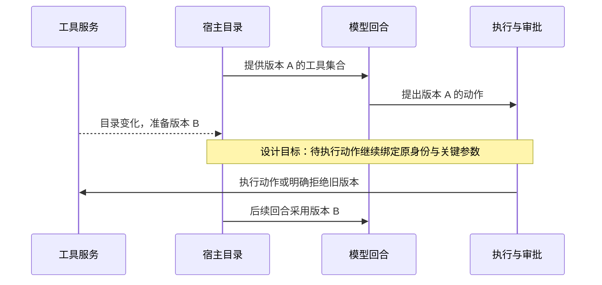

# 工具与 MCP 系统：怎样让 Agent 可靠地接触外部世界？

本章按模型可调用的工具统计入口：Goose 常规路径有 N 个扩展工具，Cline SDK 路径有 M 个保留工具；数量由目录和宿主策略决定。Goose 可选代码模式另有三个发现与执行入口。

助手已经把长日志保存在外部资料中，也知道应当继续读取失败附近的片段。现在它要读取经营日报 R42 的 `artifact:log-17`，核对生产运行 `run-807`，再把修复方案放到测试环境验证。值班工程师给出的边界很清楚：生产只读，测试验证。

麻烦出在下一步。日志服务和报表服务都提供 `search`，模型看到了两个相似名称；重跑工具的参数完全合法，却能指向生产；日志返回成功，关键的 E42 错误又在预览之外。服务连接通了，每一步仍可能走错。

这一章沿用这组教学情境，追问宿主怎样把“可以调用”组织成“这次应该这样调用”。模型提出动作，宿主检查身份与授权，业务服务执行，宿主把可核对的结果带回。我们比较 Goose 与 Cline SDK 的实现，再为 R42 助手作出选择。

> [!NOTE]
> 入口统计只包含模型能够点名调用的工具，不含目录管理器、请求对象、业务适配器和缓存。模型名称与参数组成请求数据；Port（端口）是宿主要求的业务适配契约，具体适配器实现契约并连接服务；连接池、协议客户端与缓存提供运行支持。一个适配器可以承接多个工具。代码模式也可能保留其他工具，三个入口不代表整个会话的工具总数。

## 服务提供能力，宿主组织一次行动

MCP 是模型上下文协议，用来约定宿主与服务交换能力和调用结果的方式。在本章追踪的工具路径中，服务公布工具名称、说明与参数结构，客户端列举工具，再发送调用请求。协议交换不会替宿主完成整项报表排障任务。

宿主是连接模型与外部能力的运行程序。Goose 是具体 Agent 应用，Cline SDK 则提供可嵌入应用的运行组织能力；这里比较两者已经核对的工具生命周期，不把 Cline 的 VSCode 宿主实现全部算成 SDK 默认行为。LangGraph 在下一章作为工具节点的框架案例出现，回答的是节点如何派发和返回，不与整个应用作功能排名。[比较范围与固定版本](../references/studies/goose-cline-mcp.md)

一次工具调用经过这样的责任转移：模型根据当前目录提出名称和参数；宿主确认工具身份、校验输入与权限；业务适配器把请求交给对应服务；服务执行后，宿主整理结果，外层运行循环决定继续推理、等待还是结束。

## 先比较宿主怎样组织工具

以下对照限定于仓库固定快照：Goose `59e588d`，Cline `b549ceb`。它比较实现选择，不代表产品总体能力或性能。

| 同一个设计问题 | Goose 已核对路径 | Cline SDK 已核对路径 |
| --- | --- | --- |
| 模型如何得到工具 | 常规逐工具暴露；可选 Code Mode 逐步发现 | 策略筛选后逐个构造模型工具，模型前 hook 可调整请求 |
| 名称如何找到执行者 | 扩展前缀与目录映射，调用持有目录快照 | 规范化名称，调用闭包保留服务名与原始工具名 |
| 谁决定执行权限 | 宿主审批模式、用户规则；部分模式消费只读提示 | 宿主政策和审批回调；工具 hook 还可影响输入和策略 |
| 过大结果怎样交付 | 超阈值文本写临时文件，返回位置 | 会话缓存保存结果，提供预览和按行读取位置 |
| 目录变化怎样影响调用 | 版本与作用域使缓存失效，租约保持调用归属 | 目录有 TTL；当前 Agent 工具表何时重建仍需另核对 |
| 业务失败怎样进入观察 | 区分调用错误与服务业务错误 | 抛出异常有外层错误标记；服务业务错误可能留在输出对象内 |

这些差别直接影响排障过程：逐步发现让模型先寻找日志能力，直接暴露让模型立即填写查询参数；缓存让模型得到日志入口，但下一步仍需要真的读取；相同的服务错误在不同包装链中，也可能以不同外层状态出现。对照依据与源码定位见 [本地研究](../references/studies/goose-cline-mcp.md)，下文沿任务解释这些选择。

## 第一关：找到工具，也找对执行者

日志服务和报表服务都可能发布一个叫 `search` 的工具。模型只看到同名条目，就无法稳定区分搜索日志还是搜索报表。宿主需要给能力一个在当前目录内唯一的身份，并保存它通向哪个服务。

Goose 常规路径加上扩展归属前缀，保存模型名称到服务原名的映射。Cline SDK 也使用服务与工具的组合名称，遇到不兼容字符或过长名称时清理、截短并添加哈希片段；实际调用使用闭包保留的服务名与原始工具名，不靠重新拆字符串猜归属。[^identity]

为 R42 助手选择最直接的做法：把模型看到的 `logs_search` 与服务身份、原始工具名、目录版本一起登记。模型名负责选择，注册记录负责路由。碰撞时拒绝注册并报出冲突，需要管理员修正目录；这比静默改名多了一步配置工作，却让审计记录中的每次查询都有确定归属。

工具说明还承担判断边界的职责。`rerun_report` 的说明至少要告诉模型它重跑哪个环境、是否产生新任务、返回的是最终产物还是排队回执。参数结构可以检查日期是否符合格式，却不能证明这就是用户想修复的日期。前者由校验器检查，后者要结合用户目标和当前证据判断。

## 第二关：工具定义和结果各有一份预算

排障助手可能连接数百个工具。工具尚未执行，名称、说明和参数结构已经占据模型输入。宿主可以先按任务范围过滤目录，也可以提供发现入口，让模型需要时再取详细结构。

Goose 可选 Code Mode 采用后一种方向：先列函数名称与简要说明，再取特定函数的完整结构，最后通过 JavaScript 调用能力。它有编译特性和扩展配置条件，也会保留部分其他工具，不能据此说所有 Goose 会话都只暴露三个入口。Cline SDK 已核对主线则把筛选后的工具逐个转换给模型；存在扩展点不等于默认已经采用同样的按需发现方式。[^discovery]

R42 助手只需要日志查询、配置读取、测试提交和状态查询时，可以先给出筛选后的完整目录，减少发现往返。接入能力增长到数百项时，再采用按任务发现，并保留已选工具的详细结构。前者消耗更多初始输入，后者需要处理“尚未找到工具”的中间状态；这是成本位置的选择，本书未作二者的 token、延迟与成功率对照实验。

调用后的日志体积是另一份预算。Goose 可以把过大文本块写到临时文件；Cline SDK 可以保存到会话缓存，交给模型预览和分段读取地址。后者有容量与清理规则，不能当成长久不失效的记录。[^large]

> [!IMPORTANT]
> “结果已经外置”只说明完整内容有一个读取位置。只有后续读取发生，并且所需证据进入当前判断，才能说助手检查过那部分内容。预览里没有错误，不足以推出整份日志没有错误。

R42 的结果摘要应保留生产环境、`run-807`、业务日期 10 月 16 日、核对窗口 15–16 日、总行数与读取位置。预览可以帮助定位，判断依据要落到 `artifact:log-17` 第 840–875 行；那里出现的 E42 还要与配置 v6 和源分区核对，暂时只是字段映射问题的线索。宿主为分段读取增加了一次往返，却保住了可追查的原文。需要长期留存的任务回执和产物标识另存业务记录，临时缓存过期时不靠重新执行写操作找回结果。

## 第三关：参数有效之后，谁允许动作发生

查询日志和重跑生产报表都能符合参数结构，但后者会改变外部状态。宿主必须区分“模型提出了合法请求”和“这次请求得到执行授权”。

Goose 的智能审批模式会采用服务提供的只读提示，并结合显式用户权限作决定。提示来自服务自己的声明，没有验证服务实现确实只读。Cline SDK 已核对的转换链没有把同一组 MCP 注解带入工具描述，执行由宿主工具政策与审批回调组织；具体 UI 是否询问用户还取决于应用传入的配置。[^approval]

这给自己的实现留下两个明确分工。业务服务负责真正执行权限约束，确保调用者只能访问相应环境和数据；宿主负责在任务层确认动作是否符合用户授权，并给出必要的确认信息。模型可以建议重跑，不能通过把参数写成“只读”就改变服务动作的性质。

在 R42 任务里，宿主直接把生产写入排除出可执行范围，允许读取必要生产日志，并仅向测试环境提交验证任务。少暴露一个生产重跑入口，会降低临场操作的灵活性，却让“生产只读”成为执行约束。后续确实需要生产修改时，新的授权应明确目标、日期、环境与预期副作用；测试权限不能自动延伸到生产。

## 第四关：服务变了，正在进行的调用怎么办

排障期间，管理员可能升级 MCP 服务，增加工具或修改目录。通知到达客户端、目录缓存刷新、Agent 注册表重建、下一轮模型看见新工具，是四个不同时间点。

Goose 用版本与会话作用域判断缓存是否有效，一次推理准备持有相应扩展租约中的目录。这样，后续目录变化与正在使用的身份映射可以分开处理。Cline SDK 的目录缓存有 TTL，但仅凭 TTL 不能证明当前 Agent 工具对象已经自动替换；同仓库 VSCode 宿主另有变化通知实现，也不能直接填补 SDK 路径的证明空白。[^refresh]

图中是从实现观察提炼的设计目标，并非对所有宿主的统一承诺。应用可以固定旧版本完成调用，也可以拒绝已经失效的工具并让模型重新选择；关键是不能悄悄换执行者。对于报表重跑这样的动作，记录工具身份、输入与目录版本，也能解释事后看到的回执究竟来自哪次决定。

## 第五关：把可验证的结果带回来

工具返回并不等于报表修复。宿主可能收到传输错误，可能收到服务明确拒绝，也可能正常收到“任务已接收”。Goose 已核对路径区分调用错误与服务业务错误；Cline SDK 的服务业务错误可以留在输出对象中，而没有自动提升为同一个外层错误标记。这意味着错误统计需要先确认读取的是哪一层。[^result]

自己构建系统时，可以把结果分成已拒绝、已提交、执行中、已完成和效果未知等状态，并保留业务动作编号。运行循环按状态决定下一步：已提交就查询状态，效果未知就先核实，已完成就检查产物。模型看到的自然语言摘要应与这些证据一致。

R42 助手到这里终于能把正确请求交给正确服务：生产日志只读，测试验证单独提交，证据原文仍可访问。但测试服务返回 `job-42` 的排队回执时，助手还不能说修复成立。下一章从这张回执继续，借实际运行的工具节点实验观察：错误交给模型、异常抛给运行系统、整批重试，会分别把任务带到哪里。

## 怎样判断这套工具系统真的可用

验证应沿完整链条留下证据。目录测试发布同名工具和超长名称，核对模型看到的名字与服务实际收到的调用；授权测试让审批拒绝，核对服务没有开始执行；大结果测试把关键错误放在预览之外，核对助手是否继续读取；目录变更测试记录四个生效时点，核对待执行动作没有改换归属。

对有副作用的报表重跑，还应让服务执行成功后丢失响应，观察宿主是否先查询动作状态，而非立即重做。最后独立检查报表产物，才知道助手是否完成用户目标。这些是本章提出的验证方法，尚未作为 Goose/Cline 的真实服务对照实验运行；已有事实来自固定源码链，已有运行证据则在下一章单独说明。

这五关给 R42 助手确定了行动的身份、输入范围、授权与证据去向。剩下的难题发生在调用之后：工具已经准确返回，业务任务仍可能没有完成。

[^identity]: [本地 Goose 目录映射](../goose/crates/goose/src/agents/extension_manager/lease.rs#L118-L166) · [固定源码](https://github.com/aaif-goose/goose/blob/59e588dfd941ae129f2938deb7acf9f80b6edd02/crates/goose/src/agents/extension_manager/lease.rs#L118-L166)；[本地 Cline 转换](../cline/sdk/packages/core/src/extensions/mcp/tools.ts#L16-L48) · [固定源码](https://github.com/cline/cline/blob/b549ceb4bb4247284c975f6d6ca0979decec097c/sdk/packages/core/src/extensions/mcp/tools.ts#L16-L48)。名称规范化定位见 [研究记录第 6 节](../references/studies/goose-cline-mcp.md#6-cline-sdk-为每个服务工具建立一个独立模型入口)。
[^discovery]: [本地 Goose 工具准备](../goose/crates/goose/src/agents/reply_parts.rs#L184-L219) · [固定源码](https://github.com/aaif-goose/goose/blob/59e588dfd941ae129f2938deb7acf9f80b6edd02/crates/goose/src/agents/reply_parts.rs#L184-L219)；[本地 Cline 模型请求](../cline/sdk/packages/agents/src/agent-runtime.ts#L1670-L1712) · [固定源码](https://github.com/cline/cline/blob/b549ceb4bb4247284c975f6d6ca0979decec097c/sdk/packages/agents/src/agent-runtime.ts#L1670-L1712)。
[^large]: [本地 Goose 大结果处理](../goose/crates/goose/src/agents/large_response_handler.rs#L5-L76) · [固定源码](https://github.com/aaif-goose/goose/blob/59e588dfd941ae129f2938deb7acf9f80b6edd02/crates/goose/src/agents/large_response_handler.rs#L5-L76)；[本地 Cline 结果缓存](../cline/sdk/packages/core/src/session/services/tool-result-cache.ts#L17-L83) · [固定源码](https://github.com/cline/cline/blob/b549ceb4bb4247284c975f6d6ca0979decec097c/sdk/packages/core/src/session/services/tool-result-cache.ts#L17-L83)。预览与读取链见 [研究记录第 11 节](../references/studies/goose-cline-mcp.md#11-cline-sdk-的过大结果处理使用会话缓存与缩小工具目录分开)。
[^approval]: [本地 Goose 审批](../goose/crates/goose/src/permission/permission_inspector.rs#L159-L194) · [固定源码](https://github.com/aaif-goose/goose/blob/59e588dfd941ae129f2938deb7acf9f80b6edd02/crates/goose/src/permission/permission_inspector.rs#L159-L194)；[本地 Cline 执行政策](../cline/sdk/packages/agents/src/agent-runtime.ts#L2436-L2540) · [固定源码](https://github.com/cline/cline/blob/b549ceb4bb4247284c975f6d6ca0979decec097c/sdk/packages/agents/src/agent-runtime.ts#L2436-L2540)。注解字段边界见 [研究记录第 9 节](../references/studies/goose-cline-mcp.md#9-cline-sdk-的这一转换链未把-mcp-注解带入工具对象)。
[^refresh]: [本地 Goose 缓存](../goose/crates/goose/src/agents/extension_manager/mod.rs#L269-L298) · [固定源码](https://github.com/aaif-goose/goose/blob/59e588dfd941ae129f2938deb7acf9f80b6edd02/crates/goose/src/agents/extension_manager/mod.rs#L269-L298)；[本地 Cline 目录缓存](../cline/sdk/packages/core/src/extensions/mcp/manager.ts#L144-L165) · [固定源码](https://github.com/cline/cline/blob/b549ceb4bb4247284c975f6d6ca0979decec097c/sdk/packages/core/src/extensions/mcp/manager.ts#L144-L165)。租约与 VSCode 旁证见 [研究记录第 2、12 节](../references/studies/goose-cline-mcp.md)。
[^result]: [本地 Goose 结果整理](../goose/crates/goose/src/agents/state_machine/ops_toolcalling.rs#L1071-L1105) · [固定源码](https://github.com/aaif-goose/goose/blob/59e588dfd941ae129f2938deb7acf9f80b6edd02/crates/goose/src/agents/state_machine/ops_toolcalling.rs#L1071-L1105)；[本地 Cline 返回包装](../cline/sdk/packages/agents/src/agent-runtime.ts#L2554-L2595) · [固定源码](https://github.com/cline/cline/blob/b549ceb4bb4247284c975f6d6ca0979decec097c/sdk/packages/agents/src/agent-runtime.ts#L2554-L2595)。服务业务错误传递的静态推导见 [研究记录第 10 节](../references/studies/goose-cline-mcp.md#10-cline-sdk-区分抛出的调用错误与结果内容里的业务错误)。

[上一章：上下文压缩：信息怎样在交接处丢失](18-context-compaction.md) · [下一章：工具返回了，任务为什么还没有完成？](17-tool-results-and-retries.md)
