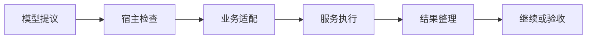

# 工具与 MCP 系统：怎样让 Agent 可靠地接触外部世界？

助手已经知道该读取经营日报 R42 的哪段日志：生产运行 `run-807`，`artifact:log-17` 第 840–875 行。它也记得值班工程师的边界：生产只读，测试验证。

现在把日志服务和报表服务接进来。两个服务都发布了 `search`；提交工具接受合法的日期，却允许参数指向生产；日志返回正常，E42 又恰好不在预览里。连接成功以后，错误仍然可能沿着每一次行动发生。

工具系统的核心问题，是让一次模型提议经过可以解释的过程，成为适当的业务请求。为此，我们需要同时安排能力发现、调用身份、参数与权限、执行过程，以及结果交付。MCP 解决其中的协议交换：服务怎样声明工具，客户端怎样调用并接收结果。宿主负责把这些交换组织成一次任务。

## 服务提供能力，宿主组织一次行动

模型读取工具说明，提出名称和参数；宿主找到实际执行者，检查请求；业务适配器把请求交给服务；服务产生效果，宿主整理结果，再由运行循环安排下一步。适配器是把应用需要的能力连接到命令、HTTP 或 MCP 的那层代码。请求对象只承载数据，目录、缓存和连接池支撑运行。



从不同项目可以看到几种组织方式。Goose 在应用里管理扩展目录、调用映射与审批；Cline SDK 把运行器、工具政策和 MCP 转换分层，嵌入方可以提供自己的策略。LangGraph 的工具节点主要处理派发和消息返回，应用用图安排后续步骤。AutoGen 把实际能力交给 Workbench，Agent 根据它列出的工具名称分派请求。Smolagents 则让工具与受管理的子 Agent 进入同一个名称表，代码执行还可以组合多次调用。

这些方式不是从弱到强的排列。成套宿主减少应用接线，却带来默认策略与配置需要理解；较薄的执行器便于业务定制，应用也要补齐授权、保存与验收。选择时应问：哪部分责任希望沿用，哪部分必须由自己的系统决定？

## 第一关：找到工具，也找对执行者

同名 `search` 只是最容易看见的身份冲突。名称被截短、服务热更新、审批等待期间重建目录，都可能让“当时选择的工具”与“现在执行的工具”分开。

Goose 使用扩展归属和映射；Cline SDK 规范化组合名称，并在调用闭包里保留服务名与原始工具名。后者不靠执行时重新拆字符串猜服务。OpenAI Agents SDK 的 MCP 转换也专门处理名称和工具包装；其 JavaScript 恢复路径还会在重新执行前核对原工具调用的接收者连续性。

对 R42，注册项可以同时保存模型名称、服务身份、原始名称与目录版本。模型选择 `logs_search`，执行器使用那一条注册记录。目录冲突在注册时拒绝，旧版本失效时明确要求重新选择。代价是热更新不再完全透明，收益是一次批准不会悄悄换成另一个执行者。

工具说明也参与选择。测试提交工具要说清楚环境、业务日期、是否产生任务，以及返回回执还是产物。结构校验只能确认日期格式，无法证明模型选对了 10 月 15–16 日核对窗口。

## 第二关：工具定义和结果各有一份预算

工具没有执行，名称、说明和参数结构已经占用输入。常见的第一种设计是把筛选后的详细目录直接交给模型；第二种设计先给索引，再按需取完整说明。

Goose 的可选代码模式采用逐步发现。LlamaIndex 的 AgentWorkflow 也可以先按当前问题检索工具，再交给 Agent。直接暴露适合小而稳定的目录：R42 初版只需要读取日志、配置、分区和测试状态，少一次发现往返通常更容易理解。接入数百项能力后，分层发现能减少初始负担，代价是模型还要完成“找到合适工具”这段工作，宿主必须让发现失败可以诊断。

调用结果是另一份预算。Goose 可以把过大的文本写到临时文件；Cline SDK 可以放进会话缓存，返回预览和分段读取位置。Deep Agents 也有按条件外置大结果的文件路径。外置成功以后，模型得到的是取回证据的入口，还要真的读取相关部分。

R42 的预览至少应交代以下差别：

| 返回给模型的内容 | 它能支持什么判断 | 仍需什么 |
| --- | --- | --- |
| “查询成功” | 服务完成了查询接口约定 | 查询了哪次运行、是否截断 |
| 预览中没有 E42 | 这段预览未出现 E42 | 读取实际失败附近片段 |
| 日志定位与 840–875 行原文 | 目标运行存在具体错误线索 | 核对配置 v6 与源分区 |

稳定证据不能只存在于会过期的临时缓存。长期任务应保存业务回执和必要原文，分段读取用于节约当前输入；缓存过期后重新提交一次报表，已经变成另一项业务动作。

## 第三关：参数有效之后，谁允许动作发生

“模型看不到生产写入工具”是一层限制，“执行器拒绝生产写入”是另一层限制。前者减少选错的机会；后者在模型、扩展或目录配置出现偏差时仍守住边界。真实服务还需要用凭证与资源权限限制效果。

Gemini CLI 的调度器在调用前 hook 改参数并重建请求后，再执行政策判断。Cline SDK 也在准备链里合并 hook 与工具政策。Pi 的扩展点更轻：调用前可以阻断或改写，扩展因而接过改写后参数的责任。这些例子共同提醒我们，检查位置要靠近最终请求；检查原参数后再任意改写，会让原来的保证失去对象。

AgentScope 则把允许、拒绝、等待确认和外部执行转成不同的运行状态。Agno 为需要确认的工具保存有编号的暂停与审批状态。审批因此可以由宿主接续，而不用让模型从一句“用户应该同意了”猜测权限。它们仍需要应用配置，不能把存在审批机制理解成所有工具默认弹窗。

下面用一个设计示例，把最小调用链写完整。注册表只公布日志读取与测试提交；执行器再检查环境、方案和授权。业务函数在示例里返回受控回执。两种语言表达同一约定，实际系统应把业务函数换成真正的适配器。

```typescript
interface Request {
  tool: string; env: string; plan: string; task: string;
}
interface Reply { state: string; ref: string }
const approved = new Set(["R42|v7|test"]); // 宿主从审批记录建立
const registry = new Map<string, (r: Request) => Reply>([
  ["logs_read", () => ({ state: "read", ref: "artifact:log-17" })],
  ["test_submit", () => ({ state: "accepted", ref: "pending-job" })],
]);
function dispatch(r: Request): Reply {
  const execute = registry.get(r.tool);
  if (!execute) throw new Error("unknown tool");
  if (r.task !== "R42") throw new Error("wrong task");
  if (r.tool === "logs_read") {
    if (r.env !== "production") throw new Error("wrong evidence scope");
  } else {
    if (r.env !== "test" ||
        !approved.has(`${r.task}|${r.plan}|${r.env}`))
      throw new Error("outside approval");
  }
  return execute(r);
}
const request: Request = {
  tool: "test_submit", env: "test", plan: "v7", task: "R42",
};
const reply = dispatch(request);
console.log(reply.state, reply.ref);
```
```python
from dataclasses import dataclass

@dataclass(frozen=True)
class Request:
    tool: str
    env: str
    plan: str
    task: str

approved = {("R42", "v7", "test")}  # 宿主从审批记录建立

def dispatch(request: Request) -> dict[str, str]:
    registry = {
        "logs_read": lambda: {"state": "read", "ref": "artifact:log-17"},
        "test_submit": lambda: {"state": "accepted", "ref": "pending-job"},
    }
    execute = registry.get(request.tool)
    if execute is None:
        raise ValueError("unknown tool")
    if request.task != "R42":
        raise ValueError("wrong task")
    if request.tool == "logs_read":
        if request.env != "production":
            raise ValueError("wrong evidence scope")
    elif (request.env != "test" or
          (request.task, request.plan, request.env) not in approved):
        raise PermissionError("outside approval")
    return execute()

request = Request("test_submit", "test", "v7", "R42")
reply = dispatch(request)
print(reply["state"], reply["ref"])
```

这里的批准集合由宿主核对审批记录后建立，不来自模型参数。请求只能说明想做什么，不能为自己加入批准记录。示例凸显调用边界，没有实现用户认证、服务端权限或完整参数解析；真实应用还应把日期窗口、单次动作身份与授权有效期纳入准入。

## 第四关：服务变了，正在进行的调用怎么办

服务发出变化通知、客户端更新目录、Agent 重建工具对象、下一轮模型看见新工具，是不同的时间点。

Goose 用版本、作用域和扩展租约组织目录；Cline SDK 的目录缓存有自己的有效期，但缓存过期本身不能证明当前 Agent 工具表已经替换。面对待审批请求，可以固定原版本执行，也可以因版本失效而拒绝并重新选择。两种方案都合理，差别在于是否允许旧能力继续服务；共同要求是不要静默改变执行者或关键参数。

浏览器工具还有更短的有效期。browser-use 先观察页面再生成动作，页面变化后会停止继续执行旧动作序列。一个按钮索引依赖刚才那张页面，不能像稳定业务 API 一样无限复用。工具身份需要与它赖以成立的世界状态一起检查。

## 第五关：把可验证的结果带回来

服务正常响应可以表示已拒绝、已接收、执行中或已完成。工具系统应保留这种业务状态与动作编号，让运行循环知道应等待、补查还是验收。把所有响应都压成一段“工具执行成功”，会抹掉最有用的下一步依据。

R42 现在能把读取送到正确日志服务，把生产修改挡在执行器外，也能取回 E42 的原文。但已有测试 `job-42` 虽然绿色，仍没有通过日期完整性验收。下一章从这份准确返回的结果继续：工具做完自己承诺的事，为什么任务依然没有完成？

## 延伸阅读

[实现、版本与研究资料](../references/chapter-notes.md#16-mcp-host-differences)

[上一章：上下文压缩：信息怎样在交接处丢失](18-context-compaction.md) · [下一章：工具返回了，任务为什么还没有完成？](17-tool-results-and-retries.md)
