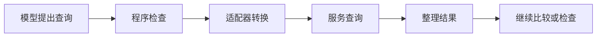

# 工具与 MCP 系统：怎样让 Agent 可靠地接触外部世界？

这次旅行还停在草稿阶段：从上海到杭州玩两天，坐高铁、住一晚，总预算 1500 元，包含往返高铁、一晚住宿、餐饮和市内交通估算。助手要继续查交通和住宿，不能订票、订房。

接上查询服务以后，新的问题来了。火车服务和酒店服务都提供一个叫 `search` 的工具；酒店服务还附带下单工具；网页返回很长，模型只看见开头的宣传，没有看到房间在本周末不可订。

“能够调用”离“用对工具”还差几步。运行程序要让模型找对能力，检查这次请求是否符合用户要求，把请求交给正确服务，再把足够判断的结果送回来。MCP 负责约定工具怎样公布、请求怎样发送、结果怎样返回；这些决定仍由应用和服务共同完成。

## 服务提供能力，运行程序安排这次调用

模型根据工具说明提出“查询周日杭州回上海的车次”。运行程序检查日期与操作种类，找到实际的查询函数；查询函数访问铁路信息服务，把车次和时间带回来。程序再安排模型继续比较，或检查行程是否已经完整。

这里的查询函数通常还要做一层转换：把模型填写的字段，变成已有服务接受的格式，再把返回结果整理回来。这层代码称为业务适配器。工具名称和参数是请求数据；连接、缓存等组件帮助调用运行，不负责决定用户想去哪里。



不同项目把这几步放在不同位置。Goose 管理扩展目录、调用映射与审批；Cline SDK 把运行器、工具政策和 MCP 转换分层，开发者可以提供自己的检查。LangGraph 的工具节点主要负责分派请求和返回消息，之后做什么由应用写的图决定。AutoGen 则通过 Workbench 列出和调用工具。

这些不是同一种产品的功能排名。采用现成运行程序，少写一些接线代码，也要理解它的默认做法；采用较薄的框架，更容易按业务安排过程，也要主动补上权限与结果检查。

## 先让名字指向确定的执行者

如果两个服务都叫 `search`，模型可能选错。程序也不能在执行时仅凭一个短名字猜服务。

Goose 给工具名称加上所属扩展的标识，并保存对应关系；Cline SDK 将服务名与工具名组合成适合模型使用的名字，调用函数里仍保留服务名和原始工具名。即使展示名称被截短，程序仍知道应把请求发给谁。OpenAI Agents SDK 在恢复等待审批的调用时，还会检查原请求是否仍交给同一执行者。

旅行助手可以公开 `train_search` 和 `hotel_search`，同时保存各自对应的服务。注册时发现重名就报错，比静默替换更容易排查。服务更新后，如果旧请求已经不能安全执行，就让模型重新选择；不要让等着批准的“查询”悄悄变成另一项动作。

工具说明也要写清楚。一项酒店查询应该说明返回的是参考价格、可订房型还是已经锁定的房间。参数里有一个合法日期，不代表它就是这次周末；“查询成功”也不能证明价格包含了全部费用。

## 工具多了，要不要一次全给模型

一种做法把筛选后的详细工具清单直接发给模型。旅行助手只有车次、酒店和地图几项查询时，这样容易理解，也少一次寻找工具的往返。

另一种做法先提供简短目录，需要时再取得完整说明。Goose 的可选代码模式提供逐步发现；LlamaIndex 的工作流也可以先按问题检索工具。接入几百项能力时，这能减少最初的输入，但模型需要先找路，程序还要处理“没有找到合适工具”的情况。

Smolagents 还允许用代码组合调用。例如，把几个候选酒店的查询写成一个循环。这样可以减少模型逐次发请求的次数，也增加代码执行、错误定位和限制访问范围的工作。代码能调用哪些函数，应由程序配置，不能由生成的代码自行扩大。

这次只做行程草稿，第一版可以保留少量明确的读取工具，不需要先建设庞大的发现系统。等接入范围变大，再根据选择错误和输入成本调整。

## 只让模型看见查询，还不够

不公布下单工具，能减少误选；执行时再拒绝下单，能防止模型或扩展绕过清单。服务账号本身若也只有查询能力，就多了一层实际限制。

Gemini CLI 允许在执行前插入一段检查代码，这类扩展位置称为钩子。钩子可以改参数，程序随后重新判断权限。Cline SDK 也在准备阶段合并参数与工具政策。Pi 的拦截扩展较轻，扩展改写参数后也接过了相应责任。这些实现提醒我们：检查要面对最后真正执行的请求。先批准一个日期，再允许代码随意换日期，原来的检查就失去了作用。

AgentScope 会把允许、拒绝、等待确认分别记成运行状态；Agno 为需要确认的工具保存暂停和审批。这些机制让程序知道自己是在执行还是等人决定，并不表示每个工具默认都需要询问。

下面是一个可运行的设计示例。它没有连接旅游平台，只展示两层限制：注册表里只有查询工具，日期也必须符合本次旅行。两种语言对查询返回相同结果，对下单请求都明确拒绝。

```typescript
interface Request { tool: string; start: string; end: string }
interface Reply { state: string; ref: string }
const tools = new Map<string, () => Reply>([
  ["train_search", () => ({ state: "found", ref: "train-options" })],
  ["hotel_search", () => ({ state: "found", ref: "hotel-options" })],
]);
function dispatch(request: Request): Reply {
  const execute = tools.get(request.tool);
  if (!execute) throw new Error("blocked:booking");
  if (request.start !== "2026-10-24" || request.end !== "2026-10-25")
    throw new Error("wrong travel dates");
  return execute();
}
const query = {
  tool: "train_search", start: "2026-10-24", end: "2026-10-25",
};
const result = dispatch(query);
console.log(`${result.state} ${result.ref}`);
try {
  dispatch({ ...query, tool: "book_hotel" });
} catch (error) {
  if (error instanceof Error) console.log(error.message);
}
```
```python
from dataclasses import dataclass

@dataclass(frozen=True)
class Request:
    tool: str
    start: str
    end: str

def dispatch(request: Request) -> dict[str, str]:
    tools = {
        "train_search": lambda: {"state": "found", "ref": "train-options"},
        "hotel_search": lambda: {"state": "found", "ref": "hotel-options"},
    }
    execute = tools.get(request.tool)
    if execute is None:
        raise PermissionError("blocked:booking")
    if (request.start, request.end) != ("2026-10-24", "2026-10-25"):
        raise ValueError("wrong travel dates")
    return execute()

query = Request("train_search", "2026-10-24", "2026-10-25")
result = dispatch(query)
print(f"{result['state']} {result['ref']}")
try:
    dispatch(Request("book_hotel", query.start, query.end))
except PermissionError as error:
    print(error)
```

示例里的工具清单来自程序，不由模型修改。真正接服务时，还要检查出发地、目的地、账号权限与服务返回值。用户允许查询，也不意味着工具可以替用户接受一个付款条款。

## 结果太长，要保留原文和读取方法

酒店页面可能先讲设施和优惠，最后才列周末加价或不可取消条件。只读预览，模型很容易做出不完整比较。

Goose 可以把过大的文本放到临时文件；Cline SDK 可以保存到会话缓存，给模型预览和按行读取方法；Deep Agents 也有满足条件后外置大结果的路径。它们减少本次输入的长度，同时增加后续读取和保存期限管理。

| 模型拿到什么 | 已经知道什么 | 还要做什么 |
| --- | --- | --- |
| “酒店查询成功” | 查询接口结束了 | 查看具体房型、日期与费用 |
| 页面开头的预览 | 看见部分介绍 | 读取可订情况和附加条件 |
| 本周末房型与完整费用 | 有了比较依据 | 加上往返高铁、餐饮和市内交通估算，核对 1500 元 |

外置不是自动读完。程序应告诉模型哪些部分没有展示、怎样取得；模型真正读取后，才能说检查过。缓存过期时应报告资料缺失，不能靠下单一次来“找回”酒店结果。

## 世界变了，旧动作也可能失效

服务发布新工具后，客户端更新目录、Agent 重建工具表、下一轮模型看到变化，可能不在同一时刻。Goose 按会话和目录版本管理工具，并让本次调用保留相应扩展；Cline SDK 的目录缓存有有效期，但缓存到期本身不代表所有旧工具对象已经替换。

浏览器变化更快。browser-use 先看页面再生成动作，页面变化后会中止继续使用旧动作序列。刚才的“第三个按钮”，到了新页面可能已经是“立即付款”。遇到变化，重新观察比盲用旧位置更重要。

工具系统至此能保证查询交给正确服务，不允许下单，并把必要资料取回来。下一件事仍要单独处理：查询结束、行程文件生成，都不能证明草稿已经包含周日返程。工具准确返回以后，程序还要检查用户真正要求的内容。

## 延伸阅读

[实现、版本与研究资料](../references/chapter-notes.md#16-mcp-host-differences)

[上一章：上下文压缩：信息怎样在交接处丢失](18-context-compaction.md) · [下一章：工具返回了，任务为什么还没有完成？](17-tool-results-and-retries.md)
