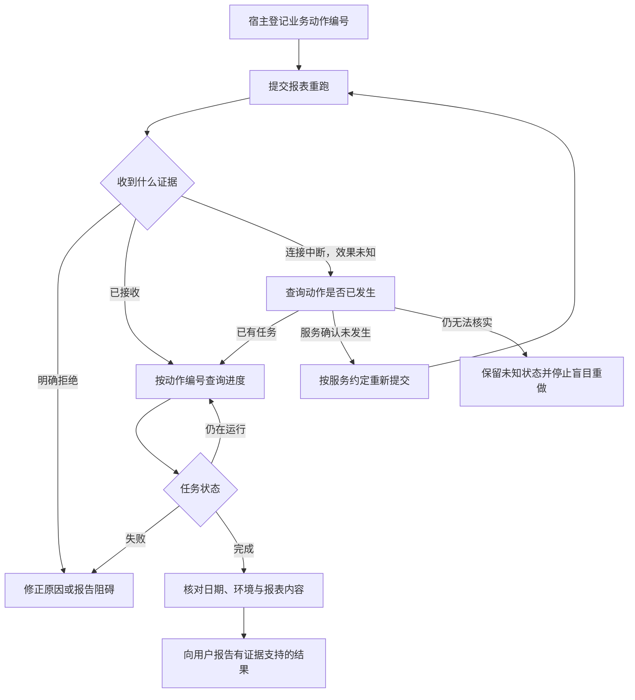

# 工具返回了，任务为什么还没有完成？

本章观察 LangGraph 工具节点的两个执行入口：同步提交与异步提交。请求消息、业务函数和返回消息不另计入口。

上一章的宿主已经守住“生产只读，测试验证”的边界。现在回看第一次验证：助手提交经营日报 R42 的测试重跑，工具很快返回“请求已接收”，编号是 `job-42`。完成草稿随即写下：“报表已经修复。”

验收器把这句话拦了下来。稍后的任务状态虽然显示绿色，产物却少了 10 月 16 日，仍然没有通过验证。第九章留下的缺口，正是在这里被过早跳过了。

工具没有撒谎。它准确说明了“已接收”，运行系统却把它当成了“已完成”。这段教学情境暴露的错误，与工具能否正常调用是两件事。

> [!NOTE]
> 两个节点入口分别是 `invoke` 与 `ainvoke`。`AIMessage.tool_calls` 是调用数据；应用提供的业务函数负责接入外部服务，相当于业务适配器；消息包装器、执行器和外层图负责运行支持。下文既有实验经由编译图的同步入口驱动节点，没有运行异步或远程模型，也没有连接真实报表服务。

## 一条结果，至少回答三个不同的问题

协议交换是否正常，说明调用双方能否传递请求和响应。工具执行是否正常，说明执行器是否按照接口约定结束。业务目标是否实现，需要检查外部任务与产物。

三者可以同时成功，也可以在不同位置分开。一份格式正确的响应可以携带业务错误；一个正常退出的函数可以返回排队编号；一个被包装器判定为失败的结果，也可能对应一项已经发生的外部写入。

因此，`success` 必须连着它的主语读：是请求被接收、函数正常返回，还是报表的数据已经核对完毕？把主语省略，后续决策就会失去依据。

在固定版本的 LangChain Core 中，工具包装器先按正常完成处理业务函数的返回内容，不会因为字符串里写了“失败”就自动改成错误状态。带调用编号的请求可以被包装为 `ToolMessage`；普通参数调用又可能直接得到原内容。这个差异来自输入与包装方式，不能只看返回值像不像 JSON。[^status]

## 谁把工具结果交给下一轮

模型产生工具名称和参数。运行系统把这些请求交给工具节点，节点按名称找到工具包装器；包装器校验输入，调用应用提供的业务函数，再整理返回值。真正访问报表平台的是业务函数接入的服务，线程池只安排执行。

工具节点只负责这一段派发与返回。下一轮推理、等待与验收仍由外层图和应用安排。[^chain]

工具节点返回消息，并不意味着它自己完成了下一次模型请求。外层程序还要决定怎样消费返回值、是否再次询问模型，以及是否已经满足结束条件。实验中把节点接到图的终点，恰好可以观察这种边界：图能结束，但业务检查仍可能失败。[^chain]

## 同一种失败，在不同运行层怎样表示

上一章的 Goose 与 Cline SDK 对照展示了宿主包装结果的选择，这里的 LangGraph 则展示可嵌入应用的工具节点怎样处理异常。三者不能作为完整产品排名，但可以比较“下一位决策者实际收到什么”。

| 路径 | 已核对的输出行为 | 下一位决策者需要注意什么 |
| --- | --- | --- |
| Goose 宿主 | 调用错误与服务业务错误进入工具回复，保留差别 | 有回复仍需判断业务目标是否达成 |
| Cline SDK 包装链 | 抛出异常有外层错误；服务业务错误可能留在输出内 | 只统计外层错误会漏掉内容中的业务失败 |
| LangGraph 工具节点 | 异常可抛给图，也可按配置转换为错误消息 | 配置决定控制层还是模型获得处理机会 |

前两行来自 [固定版本的宿主研究](../references/studies/goose-cline-mcp.md)，第三行沿下文源码和运行记录展开。表中没有哪一行自动提供业务事务；它们首先决定失败如何跨过运行边界。

## 错误是交给模型，还是交给调用者

工具参数缺少必填字段时，业务函数通常还没有开始；报表服务写入后连接中断时，业务效果却可能已经发生。两种失败不应使用同一个重试理由。

固定快照的 `ToolNode` 默认处理器只把一种工具调用异常转换成错误消息，其余异常继续抛出。实际参数缺失场景会被转换；业务函数主动抛出的普通 `RuntimeError` 默认中断节点。将 `handle_tool_errors` 设为 `True`，普通执行异常可以成为 `status="error"` 的工具消息。图中断等控制信号仍有专门的透传路径。[^errors]

这个配置改变了后续由谁处理问题。异常抛出时，图或应用的运行控制层需要处理；错误消息返回时，外层可以把失败作为观察交给模型。后者让模型有机会改参数、换工具或解释阻碍，但错误消息本身没有安排这些动作。

还要核对错误在哪里生成。请求一个未注册工具，在这份实现里会直接得到错误消息，即便关闭节点异常转换也一样。单个工具自己的错误处理又可能先于节点执行。一个叫“关闭错误处理”的选项，不能替代对具体分支的阅读。[^errors]

## 部分动作已经成功，整批调用仍可能失败

把“错误就重试”作为补救似乎很自然。先看一个更小、能够确定性运行的场景：一批里安排两个动作，先创建审查单，再检查审查服务。第一步完成写入，第二步抛错。我们要观察的是：节点报错以后，第一步留下的记录还在不在。

标准同步节点先取得整批工具结果，再合并输出。批次中的异常向外抛出时，节点没有正常交付完整结果集合；这段流程也没有向业务系统发起共同回滚。异步路径同样需要先等待批次，但并发时序还要另行观察。[^batch]

本书实际运行了这个场景，设置同步派发的并发度为 1，使动作顺序确定。审查服务是进程内模拟对象，保存在图状态之外，没有真实网络或数据库事务。

| 配置 | 外部新建记录 | 节点结果 |
| --- | --- | --- |
| 默认错误处理 | 1 | 业务异常向外抛出 |
| 普通异常转成消息 | 1 | 返回一条成功消息和一条错误消息 |
| 默认处理，显式按该异常重试节点 | 2 | 第二次批次完成 |
| 异常转消息，同时配置节点重试 | 1 | 返回错误消息，没有因该错误触发节点重试 |

结果来自 [实际脚本与记录](../experiments/README.md#工具错误批次重试与图步数)。这些数字只描述受控场景，不能推成一般并发顺序或框架性能结论。

第三行推翻了一个容易接受的补救方案：节点重试成功了，外部记录却多了一份。运行控制层重试整个节点，重新进入创建逻辑，先前成功的动作也再次发生。框架清理本次执行的待交付状态，外部服务里的审查单仍然保留。[^retry]

第四种配置则说明另一个方向。异常已经被转换成普通返回，按异常触发的节点重试就没有看到那个异常。把错误变得“可解释”，同时改变了恢复路径。

## 重试之前，先确认重做的范围

工具内部可能重试一次网络请求，节点可能重试整批工具，图恢复又可能重新进入一个节点。这几个范围需要分开记录。

对读操作，重新查询有时只增加成本。对写操作，调用者需要稳定的业务动作标识、结果查询与重复请求处理。模型的一次工具调用编号负责配对消息，不天然等于远端服务识别重复动作的业务编号。[^identity]

而且“没有拿到成功结果”仍可能是未知状态：请求也许没送达，也许已成功但响应丢了。只把它压成一个失败布尔值，会让后续只能猜测该不该重做。

一种应用设计是把提交、运行与确认分别表示。例如，提交接口返回动作编号与当前状态；查询接口凭编号取得运行状态；完成后，验收组件检查对应产物。这里的三个责任可以由不同接口或同一服务承载，并不是额外规定一套框架 API。

回到 `job-42`，宿主需要让相邻的三条记录保持各自含义：

| 已取得的证据 | 助手现在可以报告什么 | 下一步由谁做什么 |
| --- | --- | --- |
| 测试提交接口返回 `job-42` | 测试任务已接收 | 运行循环按编号查询状态 |
| 状态接口返回执行完成 | 测试任务执行结束 | 验收器核对 10 月 15–16 日、测试环境、配置与产物 |
| 验收记录确认目标满足 | 测试验证通过 | 助手交付验证依据，保持生产只读边界 |

三行是修正后的业务推进约定。第一次测试 `job-42` 没有通过最后一行的检查，后续修正要登记新任务，再重新验收。等待期间，助手如实报告“已提交，正在等待”；取得后一行证据，才推进到后一种声明。

## 给报表重跑设计一条可恢复的执行链

如果我们自己实现报表助手，可以先把写入动作与结果查询拆开。用户的任务标识用来关联整次修复；业务动作编号标识一次重跑；工具调用编号只配对模型消息。服务是否接受稳定业务编号、是否去重、去重保留多久，需要由服务接口约定，宿主不能凭一个 JSON 字段创造幂等性。幂等性指同一业务请求重复提交仍只产生约定的一份效果。

下面是设计示意，不是 LangGraph 默认实现，也不是已运行实验：

等待环节需要截止时间、查询间隔和次数预算，避免模型不断查询造成另一种失控。状态查询失败不应自动变成重新提交；验收失败也要先判断是产物错误、日期错误还是数据源问题，再选择下一步。

对于批量工具，宿主还应记下每个动作的结果。如果两个动作中一个已成功，恢复可以从未完成动作继续；业务系统支持事务时，也可以由业务服务统一提交与回滚。框架把节点重新执行一次，并不能替代这些业务选择。

## 对后续决策有用的结果

工具返回最好能区分：明确成功、明确拒绝、仍在执行，以及结果尚不确定。它还需要保留动作编号、可查证的产物位置和适用范围。哪些异常适合暴露给模型、哪些只进入运行日志，由应用按业务与信息边界决定。

错误细节也不是越多越好。一个模型无法处理的完整堆栈会占用上下文；一条过于笼统的“请重试”又可能掩盖已经发生的副作用。合适的反馈应帮助下一位决策者选择可执行的下一步。

> [!TIP]
> 让错误消息回答“已经发生了什么、还有什么不确定、下一步能查什么”。一条没有动作编号的“请重试”，会把关键判断重新交给模型猜测。

验证这样的设计，可以在提交前拒绝、提交后丢响应、轮询中断和验收失败四个位置注入故障，分别检查服务动作次数、保存的业务编号、模型得到的状态以及最终产物。这里提出的是应用验证方法；本章已经运行的证据仅限前文进程内同步节点实验，没有验证真实报表服务的去重或网络故障行为。

现在，R42 助手知道 `job-42` 执行结束却未通过产物验收，知道异常后先核实动作，也知道节点重试可能重复创建审查记录。但日志和数据的核对还可以分给不同研究者：如果两人各自返回“完成”，谁来确认他们调查的是同一件事？下一章把单次工具结果的边界扩展到 Agent 之间的交付。

[^status]: [本地默认状态与结果包装](../langchain/libs/core/langchain_core/tools/base.py#L1084-L1135) · [固定源码](https://github.com/langchain-ai/langchain/blob/bd5b134d876ef47858beef27bd29c81eeda03293/libs/core/langchain_core/tools/base.py#L1084-L1135)；[有无调用编号的返回差异](https://github.com/langchain-ai/langchain/blob/bd5b134d876ef47858beef27bd29c81eeda03293/libs/core/langchain_core/tools/base.py#L1390-L1426)。
[^chain]: [本地工具节点](../langgraph/libs/prebuilt/langgraph/prebuilt/tool_node.py#L751-L928) · [固定源码](https://github.com/langchain-ai/langgraph/blob/41c9c22fdc83d68a2859d0c9a2b627c8615a792f/libs/prebuilt/langgraph/prebuilt/tool_node.py#L751-L928)；入口与适配关系详见 [研究记录](../references/studies/tool-results-and-retries.md#先数入口再解释谁调用谁)。
[^errors]: [本地默认处理器](../langgraph/libs/prebuilt/langgraph/prebuilt/tool_node.py#L391-L399) · [固定源码](https://github.com/langchain-ai/langgraph/blob/41c9c22fdc83d68a2859d0c9a2b627c8615a792f/libs/prebuilt/langgraph/prebuilt/tool_node.py#L391-L399)；[特殊错误与转换](https://github.com/langchain-ai/langgraph/blob/41c9c22fdc83d68a2859d0c9a2b627c8615a792f/libs/prebuilt/langgraph/prebuilt/tool_node.py#L949-L1029)；[未知工具名](https://github.com/langchain-ai/langgraph/blob/41c9c22fdc83d68a2859d0c9a2b627c8615a792f/libs/prebuilt/langgraph/prebuilt/tool_node.py#L1302-L1313)。
[^batch]: [本地批次执行与合并](../langgraph/libs/prebuilt/langgraph/prebuilt/tool_node.py#L827-L895) · [固定源码](https://github.com/langchain-ai/langgraph/blob/41c9c22fdc83d68a2859d0c9a2b627c8615a792f/libs/prebuilt/langgraph/prebuilt/tool_node.py#L827-L895)。
[^retry]: [本地重试策略](../langgraph/libs/langgraph/langgraph/_internal/_retry.py) · [固定源码](https://github.com/langchain-ai/langgraph/blob/41c9c22fdc83d68a2859d0c9a2b627c8615a792f/libs/langgraph/langgraph/_internal/_retry.py#L1-L28)；节点重入与待交付状态清理见 [重试研究](../references/studies/tool-results-and-retries.md)。
[^identity]: [本地工具消息定义](../langchain/libs/core/langchain_core/messages/tool.py#L26-L82) · [固定源码](https://github.com/langchain-ai/langchain/blob/bd5b134d876ef47858beef27bd29c81eeda03293/libs/core/langchain_core/messages/tool.py#L26-L82)；业务动作标识与恢复见 [执行恢复专题](14-resume-and-side-effects.md)。

[上一章：工具与 MCP 系统：怎样让 Agent 可靠地接触外部世界？](16-mcp-host-differences.md) · [下一章：协作系统：更多 Agent，怎样共同交付一份结果？](19-delegation-and-handoffs.md)
