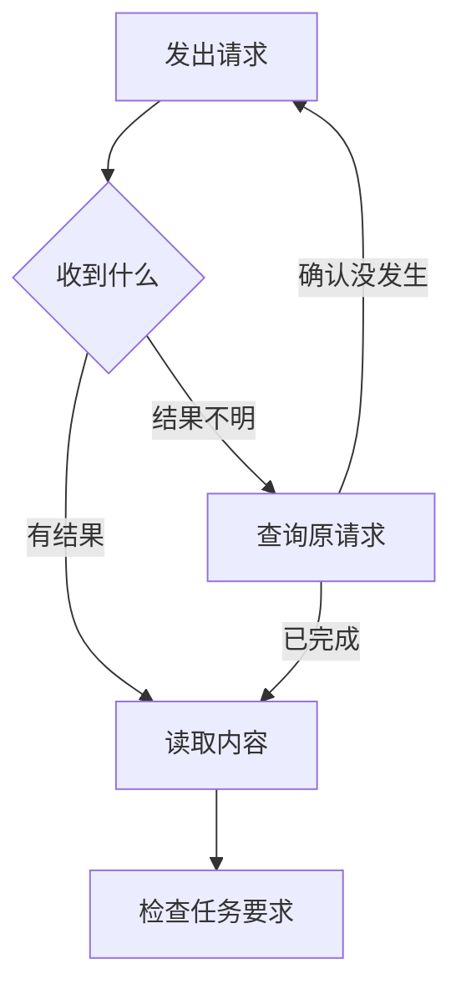

# 工具返回了，任务为什么还没有完成？

旅行助手生成了一份漂亮的行程草稿，工具也返回“文件已生成”。检查程序打开文件，却发现只有周六去杭州的高铁，没有周日回上海的安排。这份草稿因此没有发给用户。

工具没有撒谎。它承诺生成文件，文件确实生成了；助手却差点把“文件生成”读成“两天旅行安排完整”。这次任务仍然要求往返高铁、一晚住宿，连同餐饮和市内交通估算控制在 1500 元以内，而且不能下单。

理解工具结果，首先要问清楚：成功的到底是哪件事？另一个同样重要的问题是，没收到成功消息时，能否断定动作没有发生？

## 把三种“成功”分开

一次调用至少有三层结果。请求和响应是否正常传过来，是通信结果；函数是否按约定返回，是工具结果；生成的行程是否满足要求，是任务结果。

| 收到的消息 | 可以确认什么 | 还不能确认什么 |
| --- | --- | --- |
| “查询请求已接收” | 服务接到了请求 | 已查到可用车次 |
| “行程文件已生成” | 已经有文件 | 包含周日返程、费用不超支 |
| 行程内容通过逐项检查 | 已满足这些检查项 | 已获准订票、订房 |

程序最好保留这些区别。用一个没有解释的 `success` 字段表示全部结果，下一步就只能猜。

LangChain Core 的工具包装会先按正常返回处理函数内容。即使返回字符串写着“没有找到房间”，程序也不会仅凭这句话自动标成执行错误。LangGraph 的 JavaScript 工具节点同样可以把普通返回包装成成功消息。这里的成功是调用正常结束，找没找到合适酒店还要读内容。

因此，酒店工具应明确表达“没有符合日期的房间”，行程生成器应明确表达“文件已生成，内容尚待检查”。越接近业务含义的结果，越能帮助下一位处理者选择。

## 工具返回以后，谁还要继续做事

模型提出查询，运行程序把请求交给工具，工具访问服务后返回结果。工具节点负责把结果整理成消息；外层程序还要决定继续查房间、补返程，还是进入检查。

若开发者把工具节点接到流程终点，文件生成后流程就会结束。这种安排适合“生成一个文件”的任务，却不够承担“做一份完整旅行计划”。结束位置应由任务要求决定。

不同框架会在不同地方停下。AutoGen 可以在工具迭代结束后返回工具摘要，也可以按配置继续反思；CAMEL 可以把外部工具请求交回调用者，等待外部处理。它们都提供了接续位置，应用不能仅因函数返回了，就认定用户的事情完成了。

## 错误交给模型，还是交给程序

日期写错时，可以把错误交给模型，让它重新填写。服务连接短暂失败时，程序可能按固定策略稍后重试。没有付款权限时，则应直接阻止，不能让模型不断换说法。

这对应两种常见安排。一种把异常抛给调用程序，由程序暂停、重试或转人工；另一种把异常转成工具消息，让模型根据这条观察再想办法。

LangGraph Python 在本书快照中的默认处理器，只转换特定的工具调用异常，普通业务运行错误会中断节点；显式配置后，可以转换更广的异常。JavaScript 工具节点的默认转换范围不同，流程中断仍会继续向外传递。相似配置名不保证两个语言版本行为相同。

Pydantic AI 的 MCP 适配会区分让模型修正、把工具标为失败、直接报错等处理。Mastra 对授权拒绝保留运行失败，不把它变成让模型继续试的普通工具错误。区别在于：谁有能力解决这个问题，下一次尝试是否仍然合适。

错误转成消息以后，程序可能看不见原异常；异常一直向外抛，模型又可能不知道需要改什么。开发者应先决定由谁处理，再决定返回形式。

## 整批重试，可能把成功的动作再做一遍

“遇到错误就重试”看起来很方便。要看清它会重做什么，可以先离开旅行案例，观察本书已经运行的一个小实验。

实验用真实同步工具节点，安排两个动作：先在模拟服务创建审查单，再检查服务。创建成功，检查抛错。它采用单工作线程、进程内模拟服务，没有连接旅行平台或真实审查系统。

| 处理安排 | 创建的记录数 | 节点最后怎样结束 |
| --- | --- | --- |
| 默认处理 | 1 | 抛出业务异常 |
| 将普通异常转成消息 | 1 | 返回一条成功、一条错误 |
| 抛异常后重试整个节点 | 2 | 第二次批次完成 |
| 转成错误消息，同时配置异常重试 | 1 | 返回消息，没有触发该异常重试 |

第三行说明，重试成功也可能多做事。程序重试的是整个节点，所以第一步创建再次发生。图里的临时结果被清理，不会顺便删除模拟服务中已经创建的记录。

第四行则说明，异常已经变成消息，按异常触发的重试就没有看到它。两种处理不是仅仅改变错误显示，而是改变后续怎样运行。

这项实验验证了重试范围与外部记录的关系，没有测量真实模型的表现。它仍足以提醒我们：先决定允许重复哪一部分，再决定试几次。

## 不确定有没有发生，先查询

重复查酒店通常只多一次等待；重复创建订单或发送消息，可能多出真正的外部影响。这种会改变文件、订单、日历等内容的动作，称为有副作用的动作。

调用者没有拿到结果，可能是请求未到，也可能是服务已完成但响应丢了。后一种情况不能靠“再做一次”消除疑问。

应用应保存一个能向服务查询的操作标记。它用来说明“我要查的是刚才那一次”，而不是新发起一次。若服务已经有结果，就继续读取；若服务明确说明没有发生，再按约定重试；查不清时保留未知状态。

Agno 的整次运行重试与工具调用限制分别存在；OpenCode 的恢复允许一段工作再次进入。它们处理各自的运行过程，业务服务仍须说明怎样识别重复动作。一个工具消息编号用来配对模型请求和返回，不会自动成为服务识别重复的标记。

## 等待也要有下一步

服务返回排队编号时，助手可以说“请求已提交，正在等结果”。程序记录编号、下次查询时间和停止等待的条件。没有必要用“已经做好”来填补等待。

AgentScope 对等待确认、外部执行和已有结果分别记录；Agno 保存暂停运行与审批；OpenAI Agents SDK 可以保留中断后的运行位置。开发者仍要接上查询服务、设置等待期限，并解释超过期限后怎么办。

查询状态失败，不应自动变成重新提交。内容检查失败，也要针对缺口继续。旅行草稿缺周日返程，应补查返程和重新计算费用，不能再次生成同一份缺项文件后继续报告成功。

## 结果要帮助下一位处理者做决定

一条有用的反馈应说明：已经发生什么、还不知道什么、下一步能查什么。完整堆栈可以保存在运行日志里，模型更需要“这家酒店本周末无房，请选其他候选”这样的业务信息。

第一次草稿现在可以被准确记录为：“已生成但未通过检查；缺周日返程；尚未发送给用户，也没有订票订房。”下一位助手能从这个缺口继续，不必重头调查，也不能把它误当作完成。

如果交通和住宿分别由两名助手调查，返回结果还要带清楚日期、人数和费用。下一章继续看：两个人都说查完了，怎样才能合成同一份完整行程？

## 延伸阅读

[实现、版本与实验资料](../references/chapter-notes.md#17-tool-results-and-retries)

[上一章：工具与 MCP 系统：怎样让 Agent 可靠地接触外部世界？](16-mcp-host-differences.md) · [下一章：协作系统：更多 Agent，怎样共同交付一份结果？](19-delegation-and-handoffs.md)
