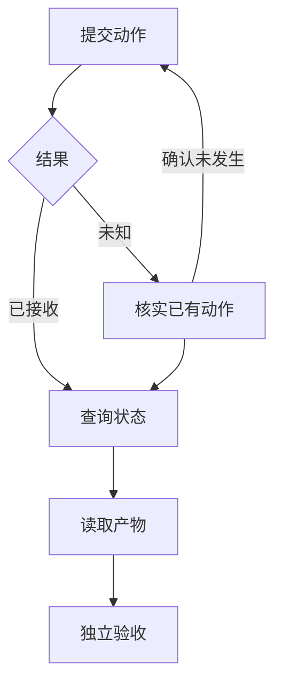

# 工具返回了，任务为什么还没有完成？

测试任务 `job-42` 已经返回绿色。助手的草稿写着：“经营日报 R42 已修复。”验收程序却发现，产物没有覆盖要求核对的 10 月 15–16 日窗口，16 日仍然缺失。这句话被拦在发送之前。

工具没有撒谎。绿色准确表达了任务进程按约定结束，草稿却把它提升成了业务目标已经满足。上一章保证请求交给合适的执行者；这一章要保证返回的信息没有在下一次判断中被过度解释。

更困难的情况发生在返回之前：服务已经完成写入，本地却只收到超时。此时，重试可能补上一个没有发生的动作，也可能把一个已经发生的动作再做一遍。结果系统必须同时解释成功的范围和未知的范围。

## 一条结果，至少回答三个不同的问题

第一，通信有没有完成：双方是否成功交换请求与响应。第二，工具有没有按接口约定结束：函数是否返回、进程是否退出、服务是否接收。第三，用户要求有没有实现：产物的对象、时间窗口、环境和内容是否正确。

| 实际取得的结果 | 可以确认什么 | 还不能确认什么 |
| --- | --- | --- |
| 提交返回一个任务编号 | 服务接收了请求 | 已执行、已生成产物 |
| 状态显示绿色 | 该任务按执行约定结束 | R42 的目标窗口完整 |
| 产物覆盖 15–16 日并通过检查 | 本次测试满足相应条件 | 已获准发布生产 |

结果必须带着它的主语。`success` 若不说明是请求、函数还是验收成功，就会让下一位决策者猜测。

在 LangChain Core 的工具包装里，正常返回的内容首先按正常结束处理；字符串写着“失败”不会自动把包装状态改为错误。LangGraph JavaScript 工具节点也会把普通返回包装成成功消息，异常才按配置进入错误分支。服务因此应提供明确的业务状态，宿主也要读取正确层次。

## 谁把工具结果交给下一轮

模型提出名称与参数，工具节点找到包装器，包装器检查输入并调用业务函数。业务适配器访问报表平台后返回观察，节点把观察变成消息。之后，外层运行循环决定是否继续询问模型、等待远端任务或进入验收。

单个工具节点并不需要拥有整个任务的结束权。把它接到图的终点，图就能在工具返回后结束；若这时尚未检查日期窗口，图结束与用户目标仍然脱节。

这个边界也存在于不同的 Agent 组织中。AutoGen 的 AssistantAgent 可以在工具迭代结束后返回摘要，是否进一步反思取决于配置；CAMEL 会把外部工具请求留给调用方处理，退出内部循环并不表示外部执行完成。LlamaIndex 的工作流汇聚结果后，仍需要决定继续、交接或结束。理解这些差别，比统计“用了几次工具”更能解释任务停在哪里。

## 同一种失败，在不同运行层怎样表示

一种安排是把异常抛给运行控制层：节点失败，图决定是否重试、暂停或报告阻碍。另一种安排是把错误变成工具消息：运行继续，模型有机会修正参数、换方法或解释失败。

LangGraph Python 在本书快照中的默认节点处理器，只转换特定的工具调用异常；业务函数主动抛出的普通运行错误会中断节点。显式开启更广的错误转换后，普通异常也可以成为错误消息。JavaScript 工具节点的默认转换范围不同，图中断仍透传。比较时要看处理分支，不能把两个语言版本的同名配置当作完全等价。

Pydantic AI 的 MCP 适配进一步区分几种失败行为：请求模型修正、将工具标为失败，或者把错误交给调用者。Mastra 则对细粒度授权拒绝保留硬失败，不把它降级成让模型反复尝试的普通工具错误。这是重要选择：参数拼错可以修，资源拒绝不应靠换一种措辞绕过去。

反馈越容易被模型消费，控制层看到的异常就可能越少；反馈越集中于控制层，模型就越需要一个明确的失败观察。设计应先决定谁有资格处理这类问题，再选错误表示。

## 部分动作已经成功，整批调用仍可能失败

“有错就重试”看起来能处理返回问题。先看一个本书实际运行的小场景：一批里安排两个动作，先创建审查单，再检查审查服务。前者完成写入，后者抛错。我们想知道，整批失败后，成功的那张单会怎样。

实验使用同步工具节点、单工作线程与进程内模拟服务，动作顺序固定，没有连接真实审查平台。得到的差别很直观：

| 处理安排 | 新建记录数 | 运行层看见的结果 |
| --- | --- | --- |
| 默认错误处理 | 1 | 业务异常抛出 |
| 普通异常转工具消息 | 1 | 一条成功、一条错误 |
| 抛异常，再按该异常重试整个节点 | 2 | 第二次批次完成 |
| 错误转消息，同时配置异常重试 | 1 | 返回错误消息，不触发该异常重试 |

第三行推翻了简单的补救方案：重试后节点成功，外部记录却多了一份。重试范围是整个节点，先前成功的创建也重新进入了。图清除本次待交付的状态，模拟服务中的记录仍然存在。

第四行展示相反方向。异常已变成普通返回，按异常触发的重试就没有看到它。让错误变得“可解释”，同时改变了恢复路径。

这组实验验证的是控制与副作用边界，不是模型在真实业务里犯错的概率。它已经足以说明：在决定重试次数之前，需要先画清被重复执行的范围。

## 重试之前，先确认重做的范围

工具内部可能重试一条网络请求，节点可能重试一批工具，整个 Agent 的重试又可能重新经过输入处理、钩子和多段执行。Agno 的运行尝试循环与单工具调用限额分别存在，正说明它们不是同一个边界。OpenCode 的恢复实现明确采用至少一次的继续语义，应用因此必须容纳一段工作被再次进入的可能。

对读操作，重复通常增加成本；对写操作，还可能增加业务记录。模型调用编号用来配对消息，业务动作编号用来让远端识别同一次逻辑操作。两个编号应当关联，但各自承担不同职责。

结果不明确时，先查业务编号。已经存在任务就继续观察它；服务明确证实没有发生，才按约定再次提交；仍查不清就保留未知状态。超时没有足够信息支持“肯定没执行”。

## 给报表重跑设计一条可恢复的执行链

R42 的测试路径应把提交、状态查询与产物验收分开。它们可以由不同接口承担，也可以由同一服务提供，但运行记录必须能区分。

查询还需截止时间和次数预算。状态查询失败不应该触发重新提交；产物验收失败也要先判断缺口。`job-42` 缺少 16 日，说明需要修正方案和输入范围，再安排新的测试，而不是把同一绿色回执读第二遍。

等待必须成为正式状态。AgentScope 对等待确认、外部执行与已有结果分别记录；Agno 保存暂停运行与审批；OpenAI SDK 保存中断后的运行位置。它们提供了安排等待的位置。应用仍应记录远端动作编号，以及下一次从哪里查询，避免界面断线后把等待误读成未执行。

## 对后续决策有用的结果

一份有用的错误反馈至少说明已经发生什么、还有什么不确定、下一步可以查询什么。完整堆栈可以进入运行日志；模型需要的是能支持选择的业务信息。反过来，只有“请重试”而没有动作编号，会把关键判断重新交给模型猜测。

R42 的记录现在可以如实写成：“`job-42` 执行结束，日期完整性验收未通过；16 日数据缺失；生产尚未修改。”这段话比“失败”更长，却让后续修复、协作和资源分配都有了起点。

接下来，把日志、配置和源数据交给不同研究者时，同样的原则还要跨 Agent 成立：局部过程返回了，不表示总任务已经完成。

## 延伸阅读

[实现、版本与实验资料](../references/chapter-notes.md#17-tool-results-and-retries)

[上一章：工具与 MCP 系统：怎样让 Agent 可靠地接触外部世界？](16-mcp-host-differences.md) · [下一章：协作系统：更多 Agent，怎样共同交付一份结果？](19-delegation-and-handoffs.md)
