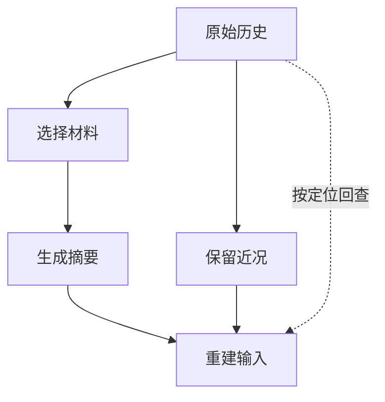

# 上下文压缩：信息怎样在交接处丢失

R42 的日志有了稳定定位，助手也知道要用配置 v6 和源分区核对 E42。调查继续，历史渐渐接近预算，会话提示：“上下文已压缩。”

可下一轮里，助手只记得“查过字段映射”，说不清线索在哪里，还提出了超出“生产只读，测试验证”的动作。第一反应很自然：是不是摘要模型太差？

本书的一个小实验把问题推到了模型之前：在 Pi 所考察的默认路径里，一条工具结果只取前 2,000 个字符串单位送进摘要材料。把唯一标记放在后面，它连摘要模型的输入都进不去。此时，更换摘要模型无法从这份材料中找回已被移除的标记。

R42 的失误是教学情境。这个裁剪检查则真实调用了固定源码的序列化函数，输入为人工 ASCII 消息，没有生成摘要，也没有调用模型。它让我们能把“材料确定丢了”与“模型是否因此做错”分开讨论。

## 压缩不是一个动作，而是四次选择

一次历史整理通常经过原始记录、摘要材料、摘要产物和下一轮输入。原文保存发生过什么；准备程序选择摘要器能看什么；摘要器决定如何转述；会话管理器再把摘要与保留消息装进请求。



每条箭头都可能缩小材料。问“摘要里为什么没有 E42”，先要检查 E42 是否送进了摘要材料；问“模型为什么不用摘要里的限制”，还要检查摘要是否进入了最终请求。

保存完整原文能提供补救条件，但图中的回查虚线需要另外实现。系统不会因为磁盘上还有原文，就自动知道什么时候去读。

## 一个被位置改变的实验结果

Pi 的默认摘要序列化器对每条工具结果设置长度限制：保留前 2,000 个字符串单位，附上截断提示。普通用户与助手正文不走相同的工具结果截断分支。这不是 2,000 tokens，也不是整个摘要请求的总长度上限。

本书直接调用真实序列化函数，构造了四种输入。为避免安装全部模型提供方依赖，加载器只把一个包再导出指向其原本源文件，没有替换被观察的函数。

先看第一种输入。下面将连续字符缩写成数量说明，标记与截断提示来自保存的结果：

```text
一条工具结果的原文：
  x × 2200 + ONLY_TEST_ENVIRONMENT

进入摘要材料的内容：
  [Tool result]: x × 2000

  [... 221 more characters truncated]

标记在原文中出现 1 次，在摘要材料中出现 0 次。
```

`ONLY_TEST_ENVIRONMENT` 是探测位置的 ASCII 标记，不是 R42 完整的授权规则。221 是这条人工输入被移除的长度，不代表真实日志通常会丢多少。

| 只改变一个条件 | 标记进入摘要材料吗 |
| --- | --- |
| 标记在长工具结果末尾 | 没有 |
| 标记移到同样长的工具结果开头 | 有 |
| 保持末尾位置，但改成用户消息 | 有 |
| 分成两条各自较短的工具结果，总长超过 2,000 | 两条标记都有 |

前两行把原因缩小到位置，第三行再缩小到消息类型，最后一行说明限制按条生效。问题已经从“模型记性不好”变成“这一类工具结果怎样被转为摘要材料”。

这个检查没有证明真实任务必然忘记某个事实：同一信息可能还存在于别的消息中。但如果关键线索只在被移除的尾部，摘要器就不能从这份材料中忠实摘出它。修复首先应发生在提取、选择或回查路径上。

## 不同系统，保护的是不同东西

“支持压缩”不足以比较设计。要看系统什么时候触发，优先留下什么，哪些材料可以重新取得。

Pi 的准备过程同时考虑近期保留目标与工具请求/结果的结构关系。切点不能随意落在一个无法解释的工具组中；长回合又可能让早先用户指令进入摘要范围。结构合法与业务含义保真，是两项不同的要求。扩展还可以取消压缩或提供自己的结果，因此这里讨论的是内置默认路径。

Gemini CLI 的相应路径保护最近几轮工具结果，对文件、搜索等可检索材料另有折叠豁免。这让“刚取得的观察”得到不同待遇，代价是需要维护哪些工具适合怎样处理。它与一律保留最近 N 条消息，并不是同一种策略。

Aider 的历史整理倾向保留较近尾部，摘要旧前缀，并对交给摘要器的头部设置输入边界，必要时继续整理。对于编辑对话，这能保留最近反馈；最早的长期限制若没有独立保存，仍可能依赖摘要传递。

Goose 会结合窗口比例与尚未计入上次用量的工具内容估算压力，还允许提供方声明自己管理上下文。它提醒我们：服务报告的 usage 可能落后于新工具结果，触发点不能只机械读取上一条数字。

框架则常把策略作为可配置处理层。LangChain JavaScript 的摘要触发可组合消息数、token 数和窗口比例；同一条件中的要求要共同满足，不同条件之间可以择一触发。Deep Agents 根据模型资料装配摘要策略。这里的便利是可以适配模型，代价是配置者必须知道资料是否完整，以及默认工厂到底安排了什么。

| 设计选择 | 首先保护什么 | 需要承担的代价 |
| --- | --- | --- |
| 近期历史保留原文 | 最近交互与反馈 | 早期约束可能进入转述 |
| 工具组保持完整 | 调用与结果可对应 | 一个大组可能挤占更多空间 |
| 按工具类别处理 | 观察与可回查材料的差别 | 分类错误会丢关键线索 |
| 旧前缀转摘要 | 当前轮保留较多细节 | 多次整理可能累积语义损失 |
| 外置原文并留定位 | 精确证据可再读取 | 增加存储、读取与失效处理 |

这张表比较的是可组合的设计选择，不是项目排名。一个运行系统可以同时使用其中几种。

## 摘要输出也需要预算，但不能拿它修复缺失输入

Qwen Code 的一条摘要路径先估计已精简输入，再从模型窗口扣除这些输入和安全余量，决定摘要输出额度。触发预算、材料预算与生成预算分开，避免“为了压缩历史”而发出输入加输出额度已经超过模型窗口的摘要请求。

Browser Use 的消息整理会把先前的压缩记忆、行动历史与可选读取状态送给摘要器，并明确要求没有成功确认的步骤保留为进行中。这样的提示有助于表达目标，但仍要通过输入与结果检查验证，不能只凭提示词就宣称完成状态必然正确。

LlamaIndex 的活动消息队列与记忆块提供了另一种分工：超出短期配额后，旧消息可以归档并交给相应块，读取时再按优先级组装。它处理的是不同记忆表示的生命周期，不能把一次队列 flush 自动称为已经生成了忠实摘要。

由此也能看清一个常见误区：摘要更短，只说明表示缩小。它没有说明摘要器读到了全部关键输入，也没有说明生成后的约束仍然完整。

## 多次压缩，会把遗漏变成“已知事实”

长任务可能反复整理。上一份摘要进入下一次摘要材料时，早期原文通常不会全部展开。

第一次把“未经新授权不能改生产”缩成“讨论过生产配置”，第二次看到的可能只有后一句。第一次把“映射不一致仍待核实”缩成“已定位映射错误”，后续模型就可能沿着错误结论继续工作。

因此，持续生效的限制和业务状态应有独立表达。摘要可以概括探索过程，执行器仍依据当前权限判断能否动作；已确认事实必须有证据，假设必须带未决状态。

回到 R42，一个可继续工作的交接摘要可以是：

```text
目标：调查 R42 的生产运行 run-807，准备修复并在测试环境验证。
范围：业务日期 10 月 16 日；核对窗口 15–16 日；使用上海时区。
限制：生产只读；修改生产需要新的授权。
观察：log-17 第 840–875 行出现 E42，涉及字段映射。
待核实：配置 v6、源结构与分区是否一致，尚未确认根因。
下一步：读取对应配置与源分区，核对后再准备测试方案。
```

它没有保留全部聊天，却保住了继续判断的抓手。文字再精简，也不能把“尚未确认”悄悄删掉。

## 回查原文，不能顺手重做动作

Pi 的持久会话能够保留压缩前条目，调用者可以按会话、分支和工具调用编号定位旧结果。若读取工具最初就没返回文件尾部，回查聊天仍补不齐那些字节，此时需要重新读取原文件的相关范围。

Cline SDK 的结果缓存也能提供同次调用的文本副本，过期时返回缺失，而不是自动重做业务工具。文本副本不一定等同原始传输的全部字节，但比“再执行一次看看”更适合恢复证据。

对 R42，读取已有日志片段可以重复；创建测试任务或审查单就应先查询原动作状态。为了找回旧返回值再做一遍写入，会把信息恢复问题变成副作用重复问题。

## 生成、提交、刷新是三次不同的成功

候选摘要生成之后，运行系统还要检查覆盖范围、提交边界，并重建后续请求。Pi 的手动压缩路径先追加压缩条目，再刷新上下文和发完成事件；后一步报错，不代表前面的追加没有发生。

Hermes 的普通在线压缩还可能刷新系统前缀、记忆和工具说明，后台路径又有保留前缀的例外。因此，压缩前后行为变化可能来自旧事实被省略，也可能来自新规则终于被加载。只对比聊天摘要，会漏掉第二种原因。

一个可恢复的应用设计，应把候选生成与状态提交分开：候选带来源范围与版本，检查后提交，后续请求只采用已提交版本。检查可以核对限制、证据定位和消息关联是否存在；语义是否忠实，仍需要具体反例与任务观察。

R42 穿过历史整理之后，应当还知道自己调查哪次运行、哪些线索尚未证实，以及去哪里取得原文。下一章沿这个读取动作继续：模型提出查配置或提交测试，工具系统怎样保证请求交给正确执行者，并把可核查的结果带回来？

## 延伸阅读

[Pi 摘要材料裁剪的脚本与四场景记录](../experiments/README.md#摘要模型读取前的裁剪)、[压缩机制研究](../references/studies/context-compaction.md)、[各运行系统的裁剪与阈值](../references/studies/system-survey-coding.md)、[框架与其他运行系统的输入处理](../references/studies/system-survey-systems.md)。这些资料保留版本与实验边界；本文没有新增模型效果实验。

[上一章：上下文系统：让下一步判断拿到合适的依据](13-context-and-defaults.md) · [下一章：工具与 MCP 系统：怎样让 Agent 可靠地接触外部世界？](16-mcp-host-differences.md)
