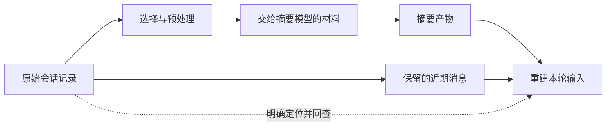
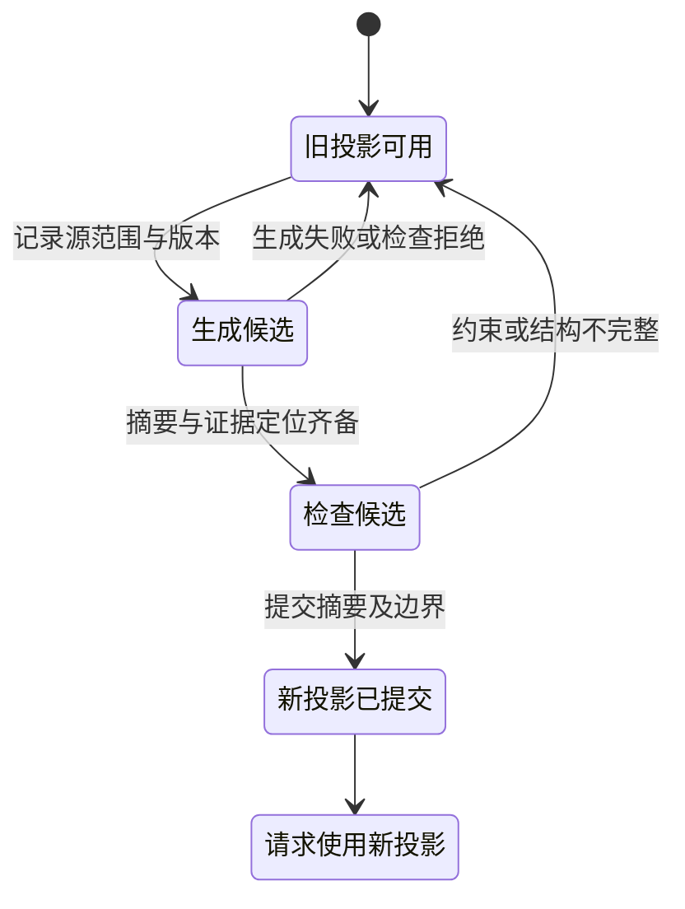

# 上下文压缩：信息怎样在交接处丢失

本章统计两个协调压缩的真实入口：Pi 中由宿主主动调用的会话压缩入口，以及 Hermes 的本地压缩协调入口。Pi 自动触发属于会话内部另一条调用路径；Deep Agents 只比较摘要工厂配置，不另数为压缩执行入口。准备数据、摘要生成器与存储组件不另计。

报表助手读完一段很长的日志，根因出现在末尾。用户又补充了一句：“只处理测试环境。”随后，界面提示上下文已经压缩。

助手仍记得正在排查报表，却找不到那条根因，也开始讨论修改生产配置。

很容易把问题归结为摘要模型不够好。但如果根因在摘要模型读取之前就被裁掉了，继续更换模型并没有触及这一次信息丢失的位置。

## 压缩之前，运行系统已经做了选择

一次压缩至少经过四个位置：原始记录、被选中的摘要材料、生成的摘要、下一次模型请求。它们不是同一份东西。

原始记录保存发生过什么。准备组件按预算和消息结构，选出哪些历史交给摘要器、哪些近期消息保留原样。摘要器依据收到的材料生成较短表示。会话管理器提交新的压缩边界，之后的请求再据此组装输入。

当事实消失时，需要沿这条链逐段定位：它是否被记录，是否入选摘要材料，是否出现在摘要里，最后是否进入实际请求。只比较压缩前后的总长度，看不到这些差别。

图中最后一条虚线需要单独实现。保存了原文，不会让它自动回到下一轮输入。

## 先比较压缩承担了哪些职责

主章比较了整个上下文系统，这里把镜头收窄到同一情境：历史已接近预算，助手仍要保住“只处理测试环境”和错误出处。Pi、Hermes 与 Deep Agents 都提供压缩相关机制，但默认配置和协调范围不同。下面比较程序的职责，没有把三个项目配置成同一模型后运行排障。

| 同一问题 | Pi 默认编程会话路径 | Hermes 本地协调路径 | Deep Agents 默认摘要工厂 |
| --- | --- | --- | --- |
| 谁决定何时整理历史 | 会话依据预算自动判断，也允许宿主主动压缩 | 协调器综合输入预算、输出预留及运行限制 | 工厂按模型 profile 配置触发与保留阈值 |
| 谁决定摘要器能读什么 | 准备组件选择历史，序列化器进一步处理消息 | 内容引擎处理协调器交给它的上下文 | 摘要中间层参与消息处理，不能仅从工厂阈值推断全部材料选择 |
| 压缩是否可能改变规则来源 | 本文不据历史压缩推导规则文件必然刷新 | 所考察在线路径还可能刷新系统前缀、记忆和工具说明 | memory 有独立缓存语义，不能把摘要触发当作刷新保证 |
| 哪项证据已经运行 | 人工工具结果的摘要材料裁剪检查 | 本文仅源码阅读 | 本文仅源码阅读 |

Pi 与 Hermes 的依据见本章对应源码注释。Deep Agents 工厂在有模型输入上限时配置占比触发和保留目标，没有该信息时回退到固定阈值；其具体默认值与范围见[本地装配研究](../references/studies/pi-deepagents-execution.md)及[固定源码](https://github.com/langchain-ai/deepagents/blob/e80fd67dfaf5ef19f11a64c5d039f18b8b0c7b27/libs/deepagents/deepagents/middleware/summarization.py#L265-L300)。这张表提示一个取舍：默认工厂能减少应用接线，但模型资料是否完整、规则缓存是否新鲜，仍需要分别检查。

> [!NOTE]
> 压缩阈值只是开始整理的条件。它没有说明错误日志尾部会不会进入摘要材料，也没有说明用户限制会不会原样保留。

## Pi 先保持执行结构，再缩短历史

在本书固定的 Pi 快照中，宿主主动压缩使用 `AgentSession.compact(...)`。CLI、RPC 等表面形式可以进入这个方法；内部默认摘要函数负责生成内容，会话管理器负责追加记录与重建上下文，二者不是同层的新入口。默认流程也允许扩展取消压缩或提供自定义结果，因此研究内置路径时必须保留这个条件。[^entry]

准备组件要同时处理两种预算：什么时候启动压缩，以及近期历史尽量保留多少。前者为后续生成腾出空间，后者决定哪些消息暂时不需要转述。它们都不等于承诺保留全部关键事实。

消息结构还限制切点。工具结果要与前面的工具请求保持可解释的关系，不能随意把结果当成独立起点。一个完整工具组很大时，近期保留目标可能被突破。结构完整解决的是请求是否合法、结果能否对应，不会自动证明业务约束都保真。[^selection]

特别要小心“最近发生的事一定保留原文”这种概括。一个很长的回合可以被切开，当前用户指令可能进入需要总结的前半段。系统继续保留近期工具消息，不等于那条用户限制仍按原字句进入模型。[^selection]

## 一个在模型读取前就发生的丢失

Pi 的默认摘要序列化器对每条工具结果设置了长度限制：只取前 2,000 个字符串单位，随后附上截断提示。用户与助手的普通正文不走这条相同的工具结果截断分支。这里使用的是字符串长度，并不是 2,000 tokens。[^truncate]

本书直接调用固定快照中的真实序列化函数做了四个检查。为避免安装整个模型提供方依赖，加载器把一个包再导出指向其原本的源文件；没有替换或重写被观察的函数。输入全部是人工构造的 ASCII 消息，没有生成摘要，也没有调用模型。

| 输入位置 | 标记是否进入摘要材料 |
| --- | --- |
| 长工具结果末尾 | 没有进入 |
| 同样长的工具结果开头 | 进入 |
| 长用户消息末尾 | 进入 |
| 两条各自较短的工具结果，总长度超过 2,000 | 两条中的标记都进入 |

完整输入、实际序列化结果和源文件摘要见 [Pi 摘要输入实验](../experiments/README.md#摘要模型读取前的裁剪)。最后一行说明这是每条工具结果的限制，不能把它解释成整个摘要请求的总长度限制。

这个检查证明的是一条确定的信息路径：特定位置的标记没有送达摘要材料。它没有证明真实任务必然忘记该事实。模型还可能从其他消息读到同一信息，摘要过程也有更多输入。但如果某条事实只存在于那段已移除的尾部，摘要器就无法从这份材料中忠实摘出它。

改进方向因此也不同：可以让工具提取相关片段，可以在裁剪前搬运关键信息，也可以为原文保留稳定定位。仅提高摘要文字的流畅程度，没有直接修复这条缺失路径。

## 摘要会继续成为下一轮摘要的材料

长期任务可能压缩不止一次。新的压缩会接收上一份摘要与后来的消息；已经被摘要覆盖的全部早期原文，不会因此自动重新展开。这样节约了输入，也意味着早期遗漏或错误转述可能沿摘要继续传递。[^summary]

“用户要求暂不修改生产配置”如果被简化成“已经讨论环境配置”，下一次整理可能只看到后一句。后来的摘要未必知道自己丢掉的是一项行动限制。

一种应用设计是把持续生效的约束与一般工作叙述分开保存：适用环境、允许动作、规则生效时间由明确字段和执行检查承载；背景、假设与尝试过程可以有损整理。这样做增加了结构维护成本，但能让部分关键状态不依赖多次自由转述。

这不是说摘要应当代替授权记录。相反，模型输入里的限制帮助它选择动作，执行器仍要依据当前规则判断动作能否发生。[信任边界专题](20-trust-boundaries.md) 会继续区分这两层责任。

## 原文回查，需要一条走得通的路径

Pi 的持久会话可以保留压缩前的原条目。调用者能取得实际会话文件，按消息条目与工具调用编号定位结果，再提取需要的片段；导出当前分支也与导出压缩投影不同。导出一个分支，不等于得到整个会话树的全部旁支。[^archive]

这里至少还缺三个决定：什么迹象触发回查，回查哪次调用，取回的片段怎样进入后续请求。模型说“我好像记得”，没有完成其中任何一个步骤。

还要区分工具原始结果与更早的业务原文。如果读取工具自己就截断了文件，保存的会话只包含那次实际返回的部分。找回会话记录不会凭空补齐从未进入记录的字节；此时可能需要对原文件做有范围的再次读取。[^archive]

对有副作用的动作，尤其不能为了找回一份旧结果就重做动作。查询已有结果、读取已保存副本和重新生成一次，具有不同业务含义。

## Hermes 让压缩与运行信息刷新相遇

Hermes 的对照范围是一个本地压缩协调入口 `compress_context(...)`，底层内容引擎是它调用的组件。本文没有穷尽网关、原生提供方压缩或全部后台路径。

这条实现的触发不只是达到一个百分比：可用输入预算会扣除输出预留，运行路径还考虑是否启用、冷却期、尝试预算与使用量依据。比较两个项目时，抄出两个阈值并不能说明它们会在同样时点压缩。[^hermes]

更有意思的是提交附近的责任变化。普通在线压缩路径可以重建系统前缀，重新读取记忆，并尝试刷新工具说明；保留已注入前缀的后台路径又有例外。因此，压缩既可能改变历史表示，也可能让运行会话读到更新的信息。[^refresh]

这使“压缩前后行为变了”的原因更复杂：可能是旧事实被省略，也可能是新规则终于被加载。要定位原因，需要同时保存消息变化与前缀变化。

## 一次压缩是否生效，不能只看提示文字

在 Pi 被核对的默认手动路径里，摘要通过检查后，会先追加压缩条目，再刷新上下文和发出完成事件。后续步骤报错，不能反推前面的追加一定没有发生。反过来，摘要生成失败也不能被当作一份完整摘要来提交。[^commit]

因此，观察位置应该落在状态变化上：选中了哪些条目，生成了什么候选摘要，是否追加了压缩记录，最终请求采用了哪个边界。用户看见的提示是过程的一部分，不是全部过程。

## 自己设计时，把摘要生成与状态提交分开

以下是一种应用设计，不是这些项目共同具备的事务保证。可以先在旧上下文上构造候选摘要，并保留它所覆盖的条目范围；检查通过后，再把摘要、范围与版本一起提交。后续请求只读取已提交版本。这样，候选生成失败时仍能使用旧投影；提交成功后界面通知失败，也能从持久状态判断实际采用了哪一版。

图 2 的检查可以确认约束字段、消息关联和证据引用是否存在，却不能仅靠字段齐全证明摘要忠实。用户说“暂时不能改生产”，候选摘要写成“之后修改生产”，即使结构完全合法，含义仍然错了。高风险约束适合由应用保留原始状态和执行检查；摘要负责帮助模型理解，不能独自改变允许动作。

对报表任务，比较有用的候选摘要应说明：仍在测试环境取证，已确认哪个错误，哪个根因仍是假设，日志保存在什么位置，还有哪次查询没完成。它比“已经进行了多轮排障”更长一些，却为下一步节省了重新猜测与重复查询。

验证候选时，也要覆盖连续压缩。第一次遗漏的否定词可能在第二次成为既定事实；第一次正确保存的文件位置，也可能在重启后失效。因此可以追踪约束保留、事实出处可读、假设是否被误写成结论，以及未完成动作是否被误写成成功。这里给出的是验证目标，未声称本书已经跑完这些任务实验。

> [!IMPORTANT]
> 摘要更短只说明表示变小。持续约束仍然有效、证据能够回查、执行状态没有被改写，才说明任务有条件继续。

经过压缩，Agent 需要保住继续做事的依据。下一章转向取得新依据与执行动作的工具系统：模型能够看到一个工具之后，运行系统还要怎样处理参数、权限、结果和失败？等这些责任清楚了，我们再在协作专题中讨论如何把任务交给另一个 Agent。

[^entry]: [本地主动入口](../pi/packages/coding-agent/src/core/agent-session.ts#L2779-L2810) · [固定源码](https://github.com/earendil-works/pi/blob/8efd314fa3d3232ce197d8d7a6a5660530b9d83e/packages/coding-agent/src/core/agent-session.ts#L2779-L2810)；[扩展与提交顺序](https://github.com/earendil-works/pi/blob/8efd314fa3d3232ce197d8d7a6a5660530b9d83e/packages/coding-agent/src/core/agent-session.ts#L2807-L2880)。
[^selection]: [本地压缩准备](../pi/packages/coding-agent/src/core/compaction/compaction.ts) · [完整研究与切点分析](../references/studies/context-compaction.md)；[默认预算与触发](https://github.com/earendil-works/pi/blob/8efd314fa3d3232ce197d8d7a6a5660530b9d83e/packages/coding-agent/src/core/compaction/compaction.ts#L120-L130)。
[^truncate]: [本地序列化器](../pi/packages/coding-agent/src/core/compaction/utils.ts#L93-L155) · [固定源码](https://github.com/earendil-works/pi/blob/8efd314fa3d3232ce197d8d7a6a5660530b9d83e/packages/coding-agent/src/core/compaction/utils.ts#L93-L155)。
[^summary]: [本地历史与旧摘要选择](../pi/packages/coding-agent/src/core/compaction/compaction.ts#L867-L899) · [固定源码](https://github.com/earendil-works/pi/blob/8efd314fa3d3232ce197d8d7a6a5660530b9d83e/packages/coding-agent/src/core/compaction/compaction.ts#L867-L899)；[摘要更新要求](https://github.com/earendil-works/pi/blob/8efd314fa3d3232ce197d8d7a6a5660530b9d83e/packages/coding-agent/src/core/compaction/compaction.ts#L540-L579)。
[^archive]: [本地会话文件路径](../pi/packages/coding-agent/src/core/session-manager.ts#L1156-L1158) · [固定源码](https://github.com/earendil-works/pi/blob/8efd314fa3d3232ce197d8d7a6a5660530b9d83e/packages/coding-agent/src/core/session-manager.ts#L1156-L1158)；[当前分支导出](https://github.com/earendil-works/pi/blob/8efd314fa3d3232ce197d8d7a6a5660530b9d83e/packages/coding-agent/src/core/session-export.ts#L8-L44)；[读取工具自身的限制](https://github.com/earendil-works/pi/blob/8efd314fa3d3232ce197d8d7a6a5660530b9d83e/packages/coding-agent/src/core/tools/read.ts#L86-L96)。
[^hermes]: [本地压缩入口](../hermes-agent/agent/conversation_compression.py#L4045-L4079) · [固定源码](https://github.com/NousResearch/hermes-agent/blob/e31c674f7c523070f48f3baad0650c2fdd7ef6e5/agent/conversation_compression.py#L4045-L4079)；[预算推导](https://github.com/NousResearch/hermes-agent/blob/e31c674f7c523070f48f3baad0650c2fdd7ef6e5/agent/context_compressor.py#L2749-L2807)。
[^refresh]: [本地前缀刷新](../hermes-agent/agent/conversation_compression.py#L3081-L3125) · [固定源码](https://github.com/NousResearch/hermes-agent/blob/e31c674f7c523070f48f3baad0650c2fdd7ef6e5/agent/conversation_compression.py#L3081-L3125)；[提交前调用](https://github.com/NousResearch/hermes-agent/blob/e31c674f7c523070f48f3baad0650c2fdd7ef6e5/agent/conversation_compression.py#L4252-L4265)。
[^commit]: [本地追加与刷新](../pi/packages/coding-agent/src/core/agent-session.ts#L2845-L2880) · [固定源码](https://github.com/earendil-works/pi/blob/8efd314fa3d3232ce197d8d7a6a5660530b9d83e/packages/coding-agent/src/core/agent-session.ts#L2845-L2880)；适用条件见 [压缩研究](../references/studies/context-compaction.md)。

[上一章：上下文系统：让下一步判断拿到合适的依据](13-context-and-defaults.md) · [下一章：工具与 MCP 系统：怎样让 Agent 可靠地接触外部世界？](16-mcp-host-differences.md)
