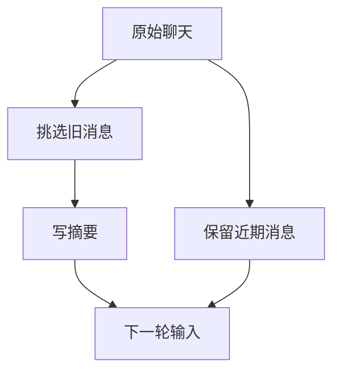

# 上下文压缩：信息怎样在交接处丢失

助手还在补杭州行程的周日返程。它已经读过不少车次和酒店网页，聊天越来越长，于是程序先把旧内容整理成摘要。

下一轮回答里，助手记得“安排杭州两日游”，却不再提 1500 元，也开始建议直接订房。用户明明说过“不下单”，为什么摘要之后反而忘了？

很容易先怀疑摘要模型。本书的一个小实验却发现：有些内容在送给摘要模型之前就已经被删掉。模型没读到，再会总结也无法忠实保留它。

旅行中的失误是虚构教学情境。下面的实验则真实调用了 Pi 的程序，用人工文字检查摘要会收到什么，没有查询旅游信息，也没有调用模型生成摘要。

## 先看摘要模型到底收到了什么

聊天很长时，程序通常不会把所有原文原封不动地交给摘要模型。它先选择较早的消息，再整理成适合输入的文字；摘要生成后，还要与保留的近期消息一起，组成下一轮请求。



因此，排查“不下单为什么消失了”，可以按顺序看：原始聊天里有没有，送给摘要模型的材料里有没有，生成的摘要里有没有，下一轮是否真的带上了摘要。

只比较摘要前后有多少字，分不清问题发生在哪一步。

## 一条长结果，只换个位置，结论就变了

在 Pi 所考察的默认路径中，程序会把工具返回的文字转成摘要材料。每条工具结果只取前 2,000 个字符串单位，随后加上截断提示。这里不是 2,000 tokens；实验全用普通 ASCII 字符，因此可以直接按字符位置观察。

本书在一条长工具结果的末尾放了一个特殊标记，再检查转换后的文字。下面把连续的 `x` 缩写为数量，标记和提示保留实验原样：

```text
一条工具结果的原文：
  x × 2200 + ONLY_TEST_ENVIRONMENT

进入摘要材料的内容：
  [Tool result]: x × 2000

  [... 221 more characters truncated]

标记在原文中出现 1 次，在摘要材料中出现 0 次。
```

`ONLY_TEST_ENVIRONMENT` 是实验用来探测位置的标记，与旅行任务没有关系。221 是这一条人工输入被删掉的长度，不能推成真实网页通常会删多少。

接着只改位置或消息类型，得到四个结果：

| 输入怎样改变 | 标记进入摘要材料吗 |
| --- | --- |
| 放在长工具结果末尾 | 没有 |
| 移到同样长的工具结果开头 | 有 |
| 仍放末尾，但改成用户消息 | 有 |
| 分成两条各自较短的工具结果，总长超过 2,000 | 两条标记都有 |

这说明限制针对每条工具结果，普通用户消息不走相同的裁剪分支。它不能证明所有真实任务都会忘记一句话，因为别的消息里可能还有同样内容；但如果关键事实只在被删掉的尾部，摘要模型就无法从这份材料中读到。

换成旅行问题，可以想象酒店页面末尾才写着“所选入住日无房”。如果程序只留下前半段设施介绍，之后把它总结得再流畅，也不会自动知道房间不可用。这个例子说明后果，不是本书对酒店网页的实测。

## 要保留最近的话，还是保留完整的一次查询

不同系统作出的选择，往往取决于它希望先避免哪种错误。

Pi 会尽量让工具请求和结果保持对应。例如，“查询周日返程”与查回来的车次若被拆散，留下的结果就可能无法解释。这样做能保住消息结构，但一次查询很长时，也会占掉更多空间。很早提出的用户要求仍可能进入需要摘要的部分；格式完整不等于意思一定保留。

Gemini CLI 的相应路径会保护最近几轮工具结果，对文件、搜索等材料还有不同的处理规则。它让刚取得的内容不那么快被改写，代价是程序需要正确区分工具类型。

Aider 更偏向保留近期对话，把较早部分交给摘要；交给摘要模型的文字本身也有长度控制，必要时继续整理。它有助于保留最新编辑反馈，但如果长期限制只出现在最早几轮，就仍依赖摘要保存。

旅行助手可以采用类似取舍：近期查到的返程车次保留原文，已排除酒店的讨论写成摘要，而“不订票、不订房”单独保存，每次都带上。不要让这句用户要求与酒店宣传语争夺同一个裁剪名额。

| 做法 | 好处 | 容易遗漏什么 |
| --- | --- | --- |
| 留最近消息 | 最新问题和反馈较完整 | 很早提出的要求 |
| 请求与结果一起留 | 能看懂查了什么、返回什么 | 大结果挤掉其他内容 |
| 按工具类别处理 | 区别对待网页、文件与动作 | 工具分类不准确的情况 |
| 旧聊天写摘要 | 为当前任务腾出空间 | 否定词、条件和未完成事项 |
| 原文另存，需要时读 | 能重新核对精确条款 | 文件过期或模型没去读取 |

这些方法可以组合，没有一种只凭名字就能保证不丢信息。

## 什么时候开始整理，也需要计算

等模型拒绝了超长输入才整理，可能已经来不及完成当前一步；过早整理，又会反复改写仍有用的细节。

Goose 估算是否需要压缩时，会考虑模型窗口和配置比例，也补计尚未反映在上次用量中的工具内容。刚收到一大页酒店信息，不能因为上一次报告的 token 数还低，就认为现在仍然放得下。

框架通常让开发者配置触发条件。LangChain 的 JavaScript 摘要中间层可以结合消息数、token 数和窗口比例；同一组条件要一起满足，不同组可以任选一组触发。Deep Agents 则会根据模型资料安排摘要策略。便于配置的同时，开发者也得知道模型资料缺失时会怎样处理。

摘要本身也占空间。Qwen Code 的一条路径先估计已经精简的输入，再留出安全余量，计算还能让摘要模型生成多少文字。否则为了把聊天变短，反而发出了输入加预留输出已经超限的请求。

这里计算的是模型输入和输出的容量，与旅行的 1500 元无关。

## 多次总结，会把“不确定”变成“已经确定”

长任务会整理不止一次。第二次摘要时，模型可能只看到第一份摘要，而没有重读所有早期聊天。

如果第一次把“看过交通，但周日返程还没选”缩成“交通已安排”，下一次就可能把返程当成完成。如果把“不订房”缩成“讨论过住宿”，后续回答也难以找回被删掉的否定词。

所以，摘要不能只写“做了很多查询”。它需要说明还有什么没做，以及哪些要求仍然有效。一份可继续使用的旅行摘要，可以是：

```text
用户要从上海去杭州玩两天，坐高铁、住一晚，总预算 1500 元。
只做草稿，不订票、不订房；加入日历前也要先问用户。
用户喜欢安静住处。
已经查过交通和酒店，但草稿仍缺周日返程，完整总价还没核对。
下一步先找返程车次，再把高铁往返、一晚住宿、餐饮和市内交通估算一起核对。
```

这仍然比全部网页短，却没有把缺口抹掉。11 月的新预算也不能被简写成“用户预算现在是 2000 元”，否则本次任务会被悄悄改掉。

Browser Use 的摘要提示会要求没有成功确认的步骤保留为进行中。这是有帮助的要求，但是否真的保住意思，还要看实际输入和摘要，不能仅凭提示词就认定模型必然遵守。

LlamaIndex 则能把较早聊天归档，再交给不同记忆块处理，读取时重新组合。把消息移到另一处保存，和准确概括消息内容，也是两件事。

## 需要细节时，重新读资料，不要重新做动作

Pi 的持久会话可以保留压缩前的条目。程序能按原来的查询找到结果，再取需要的一段。但如果工具最初就没返回网页末尾，翻聊天仍看不到那部分，只能再次读取原网页。

Cline SDK 可以从会话缓存读取同次调用留下的文本副本；过期时返回缺失，不自动重新执行原工具。这对恢复资料很有用，也避免把“找回结果”误做成“再做一次”。

旅行助手可以重新查询车次，也可以再读一次酒店条款。但用户批准加入日历之后，如果服务已经创建日程，只是返回值没保存，就要先查已有日程，不能为了重新得到回答再建一条。

## 写好摘要、保存摘要、让下轮采用，是三步

摘要模型返回一段文字之后，运行程序还要保存它，并决定后续从哪里继续读取。

Pi 的手动压缩路径先追加压缩记录，再更新上下文和发出完成提示。如果最后发提示失败，不能反过来认定摘要没保存。恢复时应检查记录，而不是凭界面有没有显示“完成”猜测。

Hermes 的普通在线压缩还可能重新加载系统提示、记忆与工具说明，后台路径又有保留旧提示的例外。因此，压缩后助手忽然采用新偏好，可能是摘要写得不同，也可能是这次终于重读了偏好文件。

开发者可以先生成一份待检查摘要，保留它替代了哪些旧消息；检查关键要求和未完成事项后，再保存为下一轮采用的版本。结构检查能发现“返程缺口这一项不见了”，至于一句话有没有把意思说反，仍需用具体例子核对。

聊天整理之后，助手应当仍知道这次只做 1500 元的行程草稿，周日返程还要补，不能订票订房。下一章继续讨论：当它决定重新查询车次时，工具系统怎样把请求交给正确服务，并把能核实的结果带回来？

## 延伸阅读

[Pi 摘要材料裁剪的脚本与四场景记录](../experiments/README.md#摘要模型读取前的裁剪)、[压缩机制研究](../references/studies/context-compaction.md)、[各运行系统的裁剪与阈值](../references/studies/system-survey-coding.md)、[框架与其他运行系统的输入处理](../references/studies/system-survey-systems.md)。这些资料保留版本与实验边界；本文没有新增模型效果实验。

[上一章：上下文系统：让下一步判断拿到合适的依据](13-context-and-defaults.md) · [下一章：工具与 MCP 系统：怎样让 Agent 可靠地接触外部世界？](16-mcp-host-differences.md)
