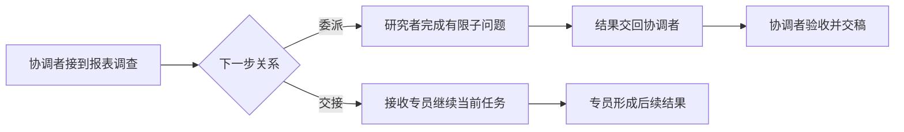
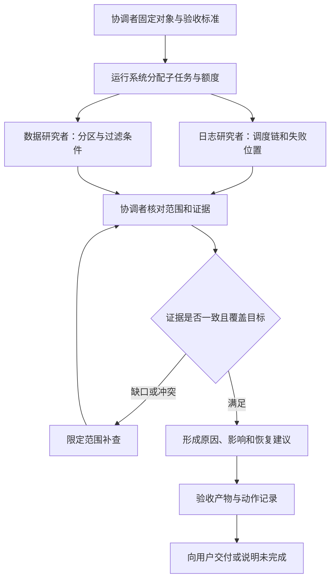
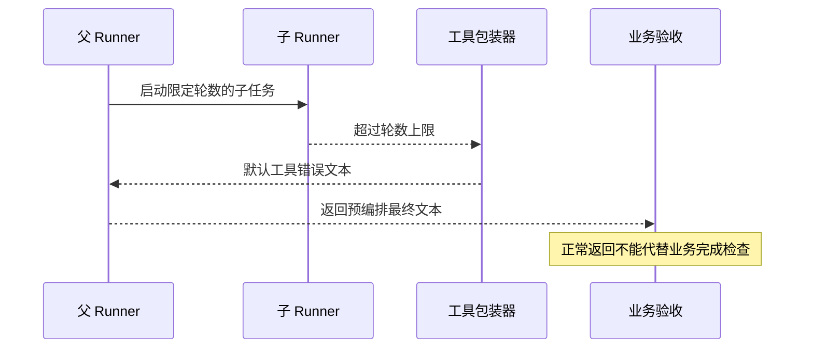

# 协作系统：更多 Agent，怎样共同交付一份结果？

本章比较三条协作路径：OpenAI Agents SDK 的工具式委派与交接，以及 Deep Agents 的默认子代理工具。统计应用启动方式时，SDK 有异步、同步、流式三个实际运行入口；委派和交接是运行中的组织方式。Deep Agents 本章只追踪一个模型可调用的 `task` 入口，不把内部同步、异步函数算成两个工具，也不概括其全部协作能力。[^entry]

用户要一份报表故障调查：确认昨晚的报表为什么为空，列出受影响范围，并说明能否重新生成。协调者请日志研究者找失败原因，请数据研究者核对分区。两人都回复“已完成”，一个认为任务没有启动，另一个却根据已经生成的报表判断数据正常。

矛盾未必来自谁推理较差。日志研究者查的是生产环境，数据研究者打开的是预发报表；两人各自完成了一个问题，却没有共同完成用户的问题。协作系统要解决的，就是从多个局部过程回到同一份可验收交付物。

## 先确定谁还要回来收稿

协调者负责理解用户目标、安排工作、消解冲突和交稿；执行者负责约定范围内的子问题；运行系统负责启动、传递消息、等待结果和处理运行状态；业务服务负责实际查询或修改报表。这些责任可以由同一个 Agent 承担，也可以分开，不能因为给执行者起了“审查专家”的名字，就认为检查已经发生。

工具式委派像请研究者提交一份调查材料：子过程结束，结果回到协调者，协调者继续承担总任务。交接像把当前案件转给专员：后续决策者改变，原协调者不会因为曾经发起工作就自动回来收稿。



图中的“验收”是应用要安排的业务步骤。框架把工具结果送回来，只提供了安排这一步的位置，不保证父模型一定核查，更不保证核查正确。

在 SDK 中，应用把起始 Agent、输入和配置交给 `Runner`；模型提出工具调用，执行层才启动工具。`Agent.as_tool()` 生成包装器，包装器构建子输入、启动子 Runner，再把结果变成父工具反馈。`handoff()` 则生成交接关系，当前 Runner 根据交接结果切换执行者。`HandoffInputData` 是历史过滤的数据对象，`RunResult` 是结果对象，均不是额外入口。业务查询工具、输入构建器和交接回调是应用接入业务的适配位置；会话存储与运行上下文属于支持设施，SDK 并没有要求它们实现一个统一名为 Port 的接口。[^roles]

## 在同一份报表任务下比较三条路径

比较之前先固定范围：本章使用 [SOURCES.json](../SOURCES.json) 记录的 SDK 与 Deep Agents 提交，比较默认工具式委派、同一运行的交接、默认 `isolated` 子代理。下面说明机制与设计后果，不给项目做质量排名。

| 报表调查中的问题 | SDK Agent 当工具 | SDK 交接 | Deep Agents 默认 `task` |
| --- | --- | --- | --- |
| 谁继续组织总任务？ | 子 Runner 回到父工具层，父运行按配置继续或结束 | 同一 Runner 换当前 Agent，没有自动回原协调者步骤 | 子图回传结果与允许的状态更新，父图继续 |
| 研究者默认看见什么？ | 模型生成的子任务输入；不会自动复制父历史 | 当前运行中按交接配置整理的历史 | 任务描述形成子消息，另传筛选后的状态 |
| 子过程回传什么？ | 默认提取的最终输出，或自定义提取结果 | 接收者继续当前运行，最终结果来自后续当前 Agent | 结构化结果或最近非空 AI 文本，以及允许的状态变化 |
| 轮数怎样延续？ | 新子 Runner 有自己的轮数上限 | 交接共用当前 Runner 的轮数 | 需追踪图配置继承与子图绑定，不能换算成 SDK 轮数 |
| 取消与全树预算能否直接保证？ | 本章未证明并行子任务都完成取消；共享用量不是全树硬额度 | 共用循环不等于外部动作已撤销 | 本章未完成下层取消审计，也未证明全树共享额度 |
| 谁处理写入冲突、谁验收报告？ | 应用明确安排 | 应用明确安排，并确认交稿责任是否转移 | 应用明确安排，状态回流不能代替业务验收 |

这些差异来自各路径的输入、输出和执行实现；取消的完整传播与跨任务冲突不在本章已验证范围内。[^input][^output][^handoff][^deep][^budget]

选择的关键是任务关系。两名研究者分别提交日志证据与数据证据，通常适合保留一个协调者汇总。用户已经进入一个独立处理阶段、接收专员可以直接继续服务时，交接能够表达这次责任转移。如果每个执行者都要重新理解全部目标，再互相交换大段历史，多 Agent 增加的主要可能是协调成本。

## 输入、共享状态和权限需要分开设计

SDK 的默认 Agent 工具参数包含子任务输入；应用可以自定义输入构建器，也可以配置子会话。与此同时，子运行可以共享应用上下文和用量记录。模型看不见父历史，不表示代码无法访问相同业务服务；共享一个应用对象，也不表示对象内容已经成为模型输入。[^input]

Deep Agents 的默认 `task(description, subagent_type)` 先选子图，替换消息为任务描述，再传入未被排除的状态。`messages`、`todos`、`structured_response` 和部分私有运行字段有专门规则。这个快照还提供实验性的 `fork` 模式，能继承整理后的父历史，因此不能把“所有子代理只收到一句任务”写成项目事实。`TaskToolSchema` 是请求数据，`ToolRuntime` 是运行系统注入的设施；真正触发子图的，是 `task` 包装器内部的 `invoke` 或 `ainvoke`。[^deep]

对报表调查，应用可以构造这样的子任务信息包。下面是设计示例，不是两个框架预置的业务协议：

```text
任务：调查报表 R42 的空结果原因
共同范围：生产环境；运行 run-807；业务日期 10 月 16 日；时区 UTC+08
分工：只核对源分区与过滤条件，不判断任务是否启动
资料：查询快照 S12；报表定义版本 v6；日志位置由另一研究者负责
权限：允许查询；不允许补数、重跑或发布
回传：发现、证据位置、已覆盖范围、未确定事项、外部动作记录
停止：截止时间到达或取消后停止新增请求，报告当前进度
```

信息包不必包含所有历史，但必须包含会改变判断的约束。发生交接时，宿主应用还要重新核对接收方的允许范围与当前任务；切换 Agent 不等于 SDK 自动转移业务授权。协调者应把“用户已允许查询”与“用户已允许重跑”区别清楚；仅把长历史压成“调查一下”会把任务范围和授权一起丢掉。研究者需要更多证据时，可以请求协调者补充资料或通过受限工具读取，而不是默认获得整个会话与全部资源。

> [!IMPORTANT]
> 消息隔离回答“模型看见什么”，权限隔离回答“执行者能做什么”，状态合并回答“谁的变化会保留下来”。一条笼统的“共享上下文”箭头无法同时表达这三件事。

## 先写交付契约，再决定派多少人

以下开始讨论应用设计。框架并没有自动提供这套报表协作方案。

协调者首先定义总任务的完成条件：最终报告要回答失败原因、影响范围与恢复建议；每项判断要能回到同一次运行的证据；重跑是否执行要单独说明。然后才拆出子任务。日志研究者的“完成”可以是查明调度链，数据研究者的“完成”可以是核对三个相关分区，它们均不能直接把根任务改成成功。

每个子任务需要一个稳定编号，关联根任务，并说明负责对象、依据版本、可用资料、允许动作、结果结构、截止条件和验收人。编号把后来的补查、重试和取消归到正确任务；版本让协调者知道结果是否仍适用于当前报表。

输入允许自然语言，回传则应保留可核对的骨架：结论与证据分别存放，覆盖范围与未完成范围分别说明，外部动作与纯分析发现分别记录。结构化结果能减少“已完成”的歧义，却不能证明字段里的结论为真。应用仍要检查证据能否访问、对象是否一致、关键判断是否得到支持。

## 调度要同时考虑依赖、资源和停止

报表日志与源分区可以并行查询；恢复建议却依赖二者，重跑还依赖授权与恢复检查。因此，协调者应根据依赖安排工作，而不是一次启动所有角色。子任务确实独立时，并行可以减少等待；需要互相反复补资料时，串行调查有时更省总成本。



SDK 新子 Runner 单独计轮，交接沿用当前 Runner 计轮。把外层上限设为两轮，不代表整棵任务树只能调用两次模型。Deep Agents 还涉及图配置继承与子图绑定，不能把图步数直接当模型轮数。若产品要求根任务共用金额、时间或调用额度，应用应让所有昂贵路径经过同一额度账本，先预占、后结算，并给合并与验收留资源。[^budget]

停止也要有明确责任。可行的应用设计是：用户取消后，根调度器先禁止新分派，再向活动子任务发送取消信号；子执行器停止新增动作，报告已完成、未完成与结果未知的动作；协调者核对外部服务状态，再向用户反馈。取消信号、协程结束和外部动作撤销是不同阶段，不能看到一个运行结束就宣称报表重跑已经取消。本章没有对三个路径做完整的并行取消实验；这条链是需要实现和验证的目标。

## 合并结果，要合并证据而不只拼接文本

收到两份报告后，协调者先核对环境、运行编号和时间窗口，再检查各自覆盖范围。日志研究者的“任务未启动”可能来自错误的任务编号；数据研究者的“源数据正常”也可能只查了最近分区。发现矛盾时，协调者应把冲突压成一个可以补查的问题，例如“run-807 是否实际提交了查询”，而不是让两人各重写一篇观点。

Deep Agents 会提取子结果生成父 `ToolMessage`，并通过 `Command.update` 返回允许且变化的状态项；整个子历史不会原样并回。SDK 也允许自定义输出提取，默认工具行为让父模型继续，但可配置遇到工具结果就结束。因此，两条工具路径都有结果选择边界，应用不能假定父模型自然掌握子过程的每项证据。[^output][^deep]

并行写同一份最终报告尤其容易混淆责任。一个简单的设计是让研究者写各自命名空间的证据与草稿，由协调者单独生成总稿。必须共同修改同一对象时，业务服务需要版本检查、写入顺序或冲突处理；状态合并规则只能解决它实际覆盖的状态更新，不能替外部数据库和文件服务提供通用事务。

最终验收可以结合确定性检查与判断性检查，具体方法将在[评测系统](22-evaluation-and-completion.md)继续展开：程序核对文件存在、引用有效、运行编号一致、必要章节齐全；协调者或另设审查者判断证据是否支持原因、建议是否与权限相符。另请审查者只有在它获得合适证据、明确标准，并能把缺陷交回负责人时才有意义。

## 一条运行轨迹能证明什么

本书已运行 SDK 的五个确定性场景：使用真实 Runner 与预编排的 `ScriptedModel` 响应，没有调用远程模型。在交接上限为一轮时，协调者产生交接请求，接收者尚未调用就超限；上限为两轮时，接收者产生最终输出。工具式委派中，外层上限两轮、子运行采用默认上限，观察到父子各两次模型替身调用，共四次。[^experiment]

另一个场景把子上限设为一轮。子运行超限后，错误回调记录异常，再使用 SDK 默认工具错误文本。父模型接收到通用工具错误，仍能返回预先安排的“完成”声明。



它证明控制流允许“子任务失败、父运行正常返回”同时成立，没有证明真实模型会作同样决定，也没有证明报表调查成功。Deep Agents 本章只核对固定源码与已有研究，没有运行其子代理实验；两种项目不能按这组数字比较成功率。实验记录、脚本与未覆盖范围均保存在[研究记录](../references/studies/delegation-and-handoffs.md)和[实验目录](../experiments/README.md#委派交接与轮数边界)。

协作设计的收益来自更好的分工边界：让执行者在足够清楚的范围内工作，让协调者获得能判断的证据，让运行系统限制资源并传播停止，让业务服务保护真实动作。最后必须有人将局部结果对齐到用户目标，并明确交付哪些已经验证的结论、哪些事项仍未完成。接下来进入[可靠执行专题](12-action-boundaries.md)，继续追踪这些任务在取消、暂停和恢复之后，怎样与外部世界保持一致。

[^entry]: [本地 SDK 运行入口](../openai-agents-python/src/agents/run.py#L279-L324) · [固定提交](https://github.com/openai/openai-agents-python/blob/9abc9182d06dbd28330af888306031269d57a175/src/agents/run.py#L279-L324)；同步与流式入口及统计范围见[研究记录](../references/studies/delegation-and-handoffs.md#范围与实际入口)。[本地 task 构造](../deepagents/libs/deepagents/deepagents/middleware/subagents.py#L898-L911) · [固定提交](https://github.com/langchain-ai/deepagents/blob/e80fd67dfaf5ef19f11a64c5d039f18b8b0c7b27/libs/deepagents/deepagents/middleware/subagents.py#L898-L911)。
[^roles]: [本地 Agent 工具包装](../openai-agents-python/src/agents/agent.py#L606-L667) · [固定提交](https://github.com/openai/openai-agents-python/blob/9abc9182d06dbd28330af888306031269d57a175/src/agents/agent.py#L606-L667)；[本地交接构造](../openai-agents-python/src/agents/handoffs/__init__.py#L267-L381) · [固定提交](https://github.com/openai/openai-agents-python/blob/9abc9182d06dbd28330af888306031269d57a175/src/agents/handoffs/__init__.py#L267-L381)。对象职责见[研究记录](../references/studies/delegation-and-handoffs.md#先区分执行者输入与基础设施)。
[^input]: [本地子输入、上下文与轮数配置](../openai-agents-python/src/agents/agent.py#L721-L789) · [固定提交](https://github.com/openai/openai-agents-python/blob/9abc9182d06dbd28330af888306031269d57a175/src/agents/agent.py#L721-L789)；[本地子 Runner 调用](../openai-agents-python/src/agents/agent.py#L1043-L1059) · [固定提交](https://github.com/openai/openai-agents-python/blob/9abc9182d06dbd28330af888306031269d57a175/src/agents/agent.py#L1043-L1059)。
[^output]: [本地子结果提取](../openai-agents-python/src/agents/agent.py#L1062-L1115) · [固定提交](https://github.com/openai/openai-agents-python/blob/9abc9182d06dbd28330af888306031269d57a175/src/agents/agent.py#L1062-L1115)；[本地工具后续行为](../openai-agents-python/src/agents/agent.py#L396-L416) · [固定提交](https://github.com/openai/openai-agents-python/blob/9abc9182d06dbd28330af888306031269d57a175/src/agents/agent.py#L396-L416)。
[^handoff]: [本地交接历史处理](../openai-agents-python/src/agents/run_internal/turn_resolution.py#L652-L751) · [固定提交](https://github.com/openai/openai-agents-python/blob/9abc9182d06dbd28330af888306031269d57a175/src/agents/run_internal/turn_resolution.py#L652-L751)；[本地切换当前 Agent](../openai-agents-python/src/agents/run.py#L2386-L2408) · [固定提交](https://github.com/openai/openai-agents-python/blob/9abc9182d06dbd28330af888306031269d57a175/src/agents/run.py#L2386-L2408)。服务端历史配置的过滤限制见[研究记录](../references/studies/delegation-and-handoffs.md#交接参数与交接历史是两条通道)。
[^deep]: [本地子代理模式](../deepagents/libs/deepagents/deepagents/middleware/subagents.py#L84-L101) · [固定提交](https://github.com/langchain-ai/deepagents/blob/e80fd67dfaf5ef19f11a64c5d039f18b8b0c7b27/libs/deepagents/deepagents/middleware/subagents.py#L84-L101)；[本地排除规则](../deepagents/libs/deepagents/deepagents/middleware/subagents.py#L404-L434) · [固定提交](https://github.com/langchain-ai/deepagents/blob/e80fd67dfaf5ef19f11a64c5d039f18b8b0c7b27/libs/deepagents/deepagents/middleware/subagents.py#L404-L434)；[本地输入与子图调用](../deepagents/libs/deepagents/deepagents/middleware/subagents.py#L804-L911) · [固定提交](https://github.com/langchain-ai/deepagents/blob/e80fd67dfaf5ef19f11a64c5d039f18b8b0c7b27/libs/deepagents/deepagents/middleware/subagents.py#L804-L911)；[本地结果与状态更新](../deepagents/libs/deepagents/deepagents/middleware/subagents.py#L747-L787) · [固定提交](https://github.com/langchain-ai/deepagents/blob/e80fd67dfaf5ef19f11a64c5d039f18b8b0c7b27/libs/deepagents/deepagents/middleware/subagents.py#L747-L787)。
[^budget]: [本地 SDK 新运行计数](../openai-agents-python/src/agents/run.py#L834-L848) · [固定提交](https://github.com/openai/openai-agents-python/blob/9abc9182d06dbd28330af888306031269d57a175/src/agents/run.py#L834-L848)；子配置与 Deep Agents 配置传递见前述源码。不同计数器、共享额度的设计与取消覆盖限制见[预算研究](../references/studies/execution-budgets.md)及[协作研究范围](../references/studies/delegation-and-handoffs.md#当前研究能够说明什么)。
[^experiment]: [实验脚本](../experiments/agents_delegation_budgets.py)与[五场景记录](../experiments/results/agents-delegation-budgets.json)；[本地默认错误文本](../openai-agents-python/src/agents/tool.py#L1997-L2002) · [固定提交](https://github.com/openai/openai-agents-python/blob/9abc9182d06dbd28330af888306031269d57a175/src/agents/tool.py#L1997-L2002)。

[上一章：工具返回了，任务为什么还没有完成？](17-tool-results-and-retries.md) · [下一章：可靠执行系统：让动作可控、过程可恢复、结果可核查](12-action-boundaries.md)
