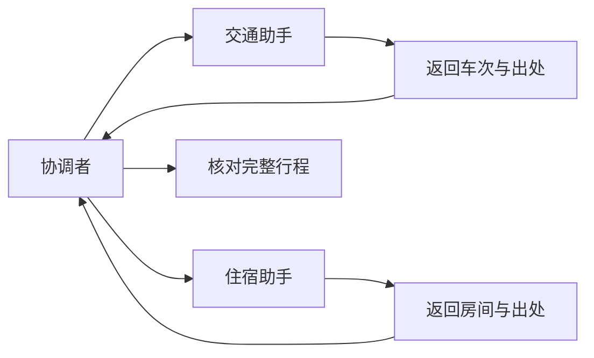

# 协作系统：更多 Agent，怎样共同交付一份结果？

旅行草稿漏了周日返程。协调助手决定把补查分给两名助手：一个查往返高铁，一个查住一晚的酒店。两人都回复“查好了”，合起来却用不了：前者查的是周五出发，后者查的是周日入住。

它们各自查到的车次和房间可能都是真的，但不是用户要的同一个周末。旅行要求仍是上海到杭州两天、住一晚、总预算 1500 元，先写草稿，不订票订房。

多找一个助手，不会自动把这些条件传过去。协调者要决定每人做什么、带哪些材料、返回什么，还要在最后检查它们能否拼成一项完整工作。

## 先确定谁还要回来收稿

把交通查询交出去，自己等结果并继续整理行程，这是委派。把用户后续问题交给另一名专员，由专员继续负责，这是交接。两者最关键的区别是：最后谁还要回来组织和交稿？

OpenAI Agents SDK 将另一个 Agent 当工具时，会启动子运行，把提取的结果交回父运行；handoff 则在当前运行中换执行者。LlamaIndex 的工作流交接也会记录下一个 Agent，再改变当前处理者。原来的协调者是否回来，需要另行安排。

Aider 的 Architect 与 Editor 是另一种自然分工：先拟方案，再交给编辑阶段执行，结果回到原过程。它不需要并行团队。CrewAI 可以按顺序执行任务，也可以由管理者分配。后者适合工作需要动态分拆的情况，也会增加分派和核对。

对这份旅行计划，交通与住宿确实可以分别查，但总价和时间要合在一起判断。所以协调者应当留下，而不是把两次委派当成两次交稿。



## 子助手究竟能看见什么

最省事的做法是把全部聊天复制给子助手。这样不容易漏掉原话，却会增加输入，也可能把大量无关尝试一起带过去。另一种做法只发送必要资料，代价是协调者要认真准备。

Deep Agents 的默认隔离路径用任务描述替换子消息，再传筛选后的状态；另有实验性的 fork 路径，可以带入整理后的父历史。Hermes 的委派可以使用独立子会话、较少工具，并跳过父会话的部分记忆与上下文文件。它们都没有让“派出去”自动等于“知道父方的一切”。

这次交通助手应明确收到：周六上海出发、周日返回上海、要查往返而非单程，以及供整份行程使用的 1500 元总预算。住宿助手应知道周六入住、周日退房，只住一晚，用户喜欢安静。两者还要知道不能下单。

1500 元不能各发一份，让交通与住宿各自“控制在 1500 以内”。协调者可以先给出参考分配，再根据查询结果调整；最后仍要加上餐饮和市内交通估算，才能判断总费用是否在 1500 元以内。

## 少看一些对话，不等于少拿一些权限

子模型没有看到完整父历史，代码仍可能共享同一个服务账号。反过来，共享一个应用对象，也不表示里面所有内容都会发给模型。

因此，输入资料、可用工具和服务权限要分别配置。Cline SDK 为子助手显式选择工具、政策、轮数和取消信号；Qwen Code 对子执行环境的选择还要结合项目可信性和全局配置。给助手取名“酒店研究员”，不会自动限制它只能查询酒店。

第一版旅行系统可以只给两人查询工具。交通助手不需要酒店下单能力，住宿助手也不需要付款凭证。限制少了一点临场灵活性，却避免一次误解直接形成订单。

## 先约定交什么，再决定派几个人

如果只要求“查一下酒店”，返回一个名字也算回答。真正需要的是日期、房型、包含哪些费用、可用情况、出处，以及还有哪些未确认条件。

交通也一样：要有去程和返程，知道上车站、到达时间和费用。协调者最后才能检查到达酒店是否来得及、周日游玩后是否赶得上返程、总价是否超支。

程序可以先做最容易确定的检查，例如日期是否一致、有没有出处。下面是设计示例：前两份回复查错日期，被拒绝；第三份日期正确，但仍需核对页面内容。这里没有访问真实平台。

```typescript
interface Report {
  topic: string; start: string; end: string;
  source: string; summary: string;
}
function check(report: Report): string {
  if (report.start !== "2026-10-24" || report.end !== "2026-10-25")
    return "wrong dates";
  if (!report.source || !report.summary) return "missing details";
  return "dates match; review details";
}
const reports: Report[] = [
  { topic: "train", start: "2026-10-23", end: "2026-10-25",
    source: "train-page", summary: "round trip" },
  { topic: "hotel", start: "2026-10-25", end: "2026-10-26",
    source: "hotel-page", summary: "one night" },
  { topic: "hotel", start: "2026-10-24", end: "2026-10-25",
    source: "hotel-page", summary: "one quiet room" },
];
for (const report of reports) console.log(check(report));
```
```python
from dataclasses import dataclass

@dataclass(frozen=True)
class Report:
    topic: str
    start: str
    end: str
    source: str
    summary: str

def check(report: Report) -> str:
    if (report.start, report.end) != ("2026-10-24", "2026-10-25"):
        return "wrong dates"
    if not report.source or not report.summary:
        return "missing details"
    return "dates match; review details"

reports = [
    Report("train", "2026-10-23", "2026-10-25", "train-page", "round trip"),
    Report("hotel", "2026-10-25", "2026-10-26", "hotel-page", "one night"),
    Report("hotel", "2026-10-24", "2026-10-25", "hotel-page", "one quiet room"),
]
for report in reports:
    print(check(report))
```

代码检查的是回复有没有符合约定的日期和字段，不能证明页面可读，更不能证明那间房真的安静、有房。协调者接着要读出处、检查费用，并保留尚待确认的部分。字段齐全与结论正确，是两道不同的检查。

## 两份报告打架时，先缩小补查问题

回到开场。协调者不必要求两名助手各写一篇更长的报告。它先指出具体错位：交通应查周六出发，住宿应查周六入住、周日退房。

补查回来以后，还要核对两份材料能否一起使用。便宜车次若周六深夜才到，可能损失大半天；酒店标价若不含附加费，也不能直接加进总预算。协调者应把冲突变成可查询的问题，例如“能否换成上午到达的车次”“这个价格是否覆盖这一晚全部住宿费用”。

若两名助手都引用同一段过期页面，它们意见一致也不是独立验证。判断要回到实际页面和查询条件，不能用赞成票数量代替。

共同写入也要有分工。两人分别保存车次和酒店材料，由协调者生成最终草稿，通常比同时修改同一份行程简单。必须共同修改时，程序要检查版本或规定顺序，否则后保存的人可能覆盖前一个人的修改。

## 后台工作，还需要知道何时结束

函数式子运行会把结果直接交回来；后台助手可能稍后才通知。OpenCode 用子会话和启动时间区分不同次运行，避免把上一次的完成通知送给新的等待者。Goose 可以复用已有的子任务成功输出，但仍会检查父子会话关系。

AgentScope 的团队把同成员任务顺序处理，不同成员可以并发，最后向协调者返回提取后的文本或数据。协调者得到的是选出的结果，不一定包含子助手的全部工作记录。

因此，协调者要保存正在等谁、这次分派的问题、何时停止等待，以及迟到结果还能不能用。如果用户已经换了周末，旧日期的酒店回复即使迟到，也不能直接并入新计划。

## 并行之前，给合并和检查留时间

交通和住宿独立查询时，并行可能节约等待；必须反复互相补材料时，一个连续助手可能更省事。只有比较查询、沟通、重复工作和最终检查，才能判断分工是否值得。

取消也要传到实际执行者：协调者停止新分派，通知活动助手停止新增查询，收回已经取得的结果。一个子进程停止，不代表远端请求已经取消。返回结果不明时，要把这个缺口交回来。

本书有一组独立的 SDK 实验，用真实 Runner（组织一次模型与工具循环的程序）与预设模型替身检查五个场景，没有访问旅行服务。它发现，交接沿用当前运行轮数，工具式委派可以另起子运行；父上限两轮时，父与子仍可能各调用两次模型替身。另一场景中，子运行超限变成工具错误文本，父替身仍按预设说“完成”。

这些观察没有证明真实模型一定忽视失败，却说明父运行正常结束不足以验收子任务。旅行协调者必须核对往返、一晚住宿，补上餐饮和市内交通估算，再检查总价，才能把查到的材料变成用户能用的草稿。

## 延伸阅读

[实现、版本与实验资料](../references/chapter-notes.md#19-delegation-and-handoffs)

[上一章：工具返回了，任务为什么还没有完成？](17-tool-results-and-retries.md) · [下一章：可靠执行系统：让动作可控、过程可恢复、结果可核查](12-action-boundaries.md)
