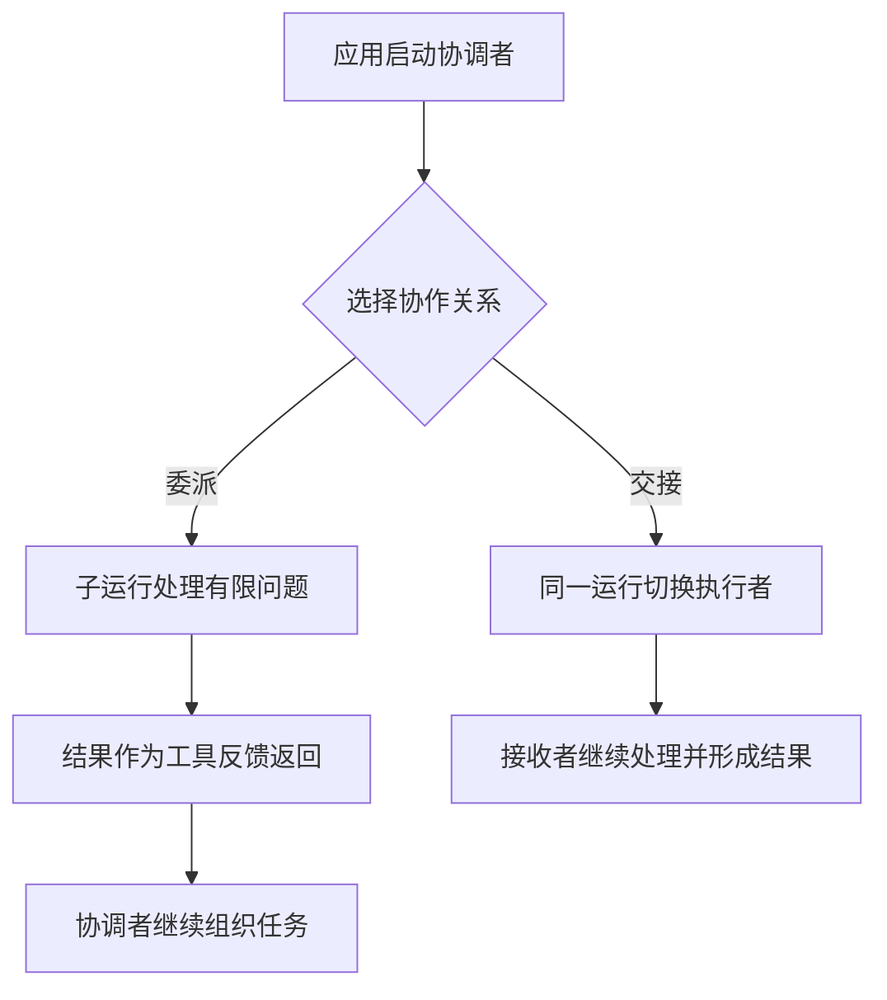

# 叫来更多 Agent，为什么还要有人收尾？

本章比较两种协作关系，主要案例的应用运行入口实际有三个：异步运行、同步运行和流式运行。委派与交接是这些运行里的组织方式，不是两个额外的应用启动入口。实验只走异步运行入口，对照另一项目时也只研究它的一条子任务工具路径。

报表助手把任务分给两个执行者：一个查失败日志，一个核对数据范围。两份回复都写着“已完成”。第一份认为任务没有启动，第二份却依据一份已经生成的报表得出了结论。

谁负责发现它们查的不是同一次运行？谁决定继续补查，谁向用户解释最后的结果？

执行者增加之后，这些责任不会自行消失。协作设计首先要确定工作结束后回到谁手上。

## 委派是一份结果回来，交接是后续处理换人

委派可以这样理解：协调者提交一个子问题，另一名执行者产出结果，再把结果交回协调者。协调者保留组织总任务的职责。

交接则改变后续执行者：原 Agent 把当前处理移交出去，接收者继续面对任务。设计上可以安排再交回来，但不能默认每次接收者结束后都有一个原协调者自动收稿。

在固定的 OpenAI Agents SDK 中，应用用 `Runner.run`、`run_sync` 或 `run_streamed` 启动工作。`Agent.as_tool()` 组装一个可以被模型点名的 Agent 工具；`handoff()` 组装交接关系。运行循环区分两种请求，再安排对应执行。这里的“三个入口”与“两种关系”统计的是不同层次。[^entry]

图只概括默认责任流向。工具反馈是否再进入父模型、交接时传递哪些历史，都能受配置影响。

## 子 Agent 看见了什么，与它能访问什么是两条关系

在 SDK 的默认 Agent 工具路径里，父模型生成一个子任务输入，包装器用它启动子 Runner。父运行的全部消息历史没有因此自动复制过去；应用也可以配置输入构建器或子会话，主动提供更多内容。[^input]

与此同时，应用传给代码的上下文对象与用量记录可以共享。子工具也可能访问同一个业务服务。模型没看见父历史，不表示资源已经隔离；代码共享一个对象，也不表示模型读到了对象中的全部事实。[^input]

因此，画协作关系时，至少要分别说明三条路径：消息怎样传，应用对象怎样传，外部资源由谁访问。把它们统一画成一条“上下文共享”箭头，会隐藏真正需要设计的边界。

Deep Agents 提供了另一条对照路径：模型通过一个 `task` 工具选择子代理，普通默认模式替换消息历史，同时传递筛选后的其他状态，再把允许的更新交回父图。该快照还有实验性的 `fork` 模式，不能把所有配置都写成只传一段描述。[^deep]

这也解释了为什么“只读研究者”“审查者”等名称不能独自证明权限隔离。限制需要落实到实际工具、资源范围与执行检查中。

## 返回值只是子过程被提取出来的一部分

子运行可能读过几十页材料，包装器最后却只给父 Agent 一段输出。SDK 的 Agent 工具支持自定义结果提取；默认提取也有最终输出为空、输出检查与暂停恢复等分支。结果不是子过程的所有知识和所有外部动作。[^output]

一段有用的子结果应当帮助协调者继续判断：它覆盖了哪个范围，依据哪份材料，哪些结论还不确定，是否做过外部修改，留下了哪些产物。表达这些信息可以用文字，也可以用结构化数据，关键在于接收者能够核查。

如果只返回“已完成”，协调者既不知道“完成”的主语是什么，也不知道还剩什么。把所有子结果拼接起来，不会自动产生覆盖完整、相互一致的总报告。

父模型也未必总会再审查一次。SDK 的默认工具行为会让父模型继续处理结果，但应用可以配置遇到工具结果就结束，或使用自定义收尾逻辑。因此，得到一个回传路径只是为验收提供了位置，不能据此宣称验收必定发生。[^output]

## 交接时，输入过滤也在改变责任

交接在同一个 Runner 中切换当前 Agent。接收者可以获得按配置整理后的历史；应用可以过滤历史、改变嵌套表示，或者加入交接参数。这些选择会影响接收者知道哪些目标、约束和已发生动作。[^handoff]

将全部原文传过去，增加处理量，也可能带入已失效的计划。只传一句摘要，又可能丢失授权范围和已经完成的写入。好的交接数据需要围绕接收者下一步必须判断的事情组织。

最终谁回答用户，也要与这次转移一致。如果系统需要原协调者做总验收，就应显式保留或重新安排这一步；把“专家接手”当成“自动闭环”，会让总任务没有明确的收尾人。

## 子任务失败，父运行仍可能正常结束

本书使用 SDK 固定快照自带的 `ScriptedModel` 做了无外网模型实验。它按预先写好的脚本返回函数调用和消息，用来观察真实 Runner 的控制流，没有测量真实模型的推理能力。

其中一个场景把子 Agent 的轮数上限设为 1。子 Agent 调用了一次模拟读取工具，随后在准备下一轮时超限。观察回调记录到 `MaxTurnsExceeded`，再原样使用 SDK 默认错误文本。父模型收到的是一条通用工具错误，仍能进入下一轮并返回预设的“完成”声明。[^failure]

这条轨迹中，子运行没有形成正常最终输出；父 Runner 却可以正常返回 `final_output`。两者同时成立，不表示库错误地声称业务已完成，而是应用还没有把子任务失败与总任务验收连接起来。

相同实验还比较了交接：当同一 Runner 的轮数只剩一轮，交接请求已经产生，接收者的模型却还没有执行就达到上限。委派启动新子运行与交接延续当前运行，预算行为因此不同。[完整记录](../experiments/README.md#委派交接与轮数边界) 保留了各执行者的调用数，以及父运行读取工具反馈时的实际输入。

默认错误文本没有暴露底层异常细节。应用若需要协调者区分超预算、权限拒绝或临时故障，应有意识地选择可提供的错误分类；不能假定异常的全部含义已经进入父模型。[^failure]

## 汇总需要核对覆盖、冲突与副作用

协调者接收结果后，首先要确认它们是不是在回答同一个任务：同一个环境、时间范围、数据版本与任务编号。否则，两份各自准确的结论仍可能无法放在一起使用。

接着是覆盖与冲突。一名执行者没有发现异常，不等于整个范围都已检查；两名执行者意见一致，也可能只是引用了同一份错误来源。重要结论需要能够回到各自的资料来源。

最后是已经发生的动作。子 Agent 如果都被允许修改同一对象，就需要明确写入顺序、版本检查和冲突处理。消息历史隔离不提供这些业务机制。

这些工作有成本。并行可以缩短独立阅读的等待时间，协调者却仍要花资源核查、整合与补查。只有把这些工作算进完整任务，才能判断分工是否值得。

协作最终扩大的是信息与动作的流动范围。接收一份子报告时，系统不仅要知道它说了什么，还要知道这段内容能影响哪些决定。这个问题会在[信任边界专题](20-trust-boundaries.md)继续展开。

[^entry]: [本地异步入口](../openai-agents-python/src/agents/run.py#L279-L324) · [固定源码](https://github.com/openai/openai-agents-python/blob/9abc9182d06dbd28330af888306031269d57a175/src/agents/run.py#L279-L324)；[同步入口](https://github.com/openai/openai-agents-python/blob/9abc9182d06dbd28330af888306031269d57a175/src/agents/run.py#L385-L407)；[流式入口](https://github.com/openai/openai-agents-python/blob/9abc9182d06dbd28330af888306031269d57a175/src/agents/run.py#L488-L509)；完整职责划分见 [研究记录](../references/studies/delegation-and-handoffs.md)。
[^input]: [本地 Agent 工具包装](../openai-agents-python/src/agents/agent.py#L606-L667) · [固定源码](https://github.com/openai/openai-agents-python/blob/9abc9182d06dbd28330af888306031269d57a175/src/agents/agent.py#L606-L667)；[共享对象与子运行配置](https://github.com/openai/openai-agents-python/blob/9abc9182d06dbd28330af888306031269d57a175/src/agents/agent.py#L746-L773)；应用上下文与会话区别见 [研究记录](../references/studies/delegation-and-handoffs.md#先区分执行者输入与基础设施)。
[^deep]: [本地子代理模式](../deepagents/libs/deepagents/deepagents/middleware/subagents.py#L84-L101) · [固定源码](https://github.com/langchain-ai/deepagents/blob/e80fd67dfaf5ef19f11a64c5d039f18b8b0c7b27/libs/deepagents/deepagents/middleware/subagents.py#L84-L101)；[输入与返回的排除规则](https://github.com/langchain-ai/deepagents/blob/e80fd67dfaf5ef19f11a64c5d039f18b8b0c7b27/libs/deepagents/deepagents/middleware/subagents.py#L404-L434)；[任务调用](https://github.com/langchain-ai/deepagents/blob/e80fd67dfaf5ef19f11a64c5d039f18b8b0c7b27/libs/deepagents/deepagents/middleware/subagents.py#L804-L911)。
[^output]: [本地 Agent 工具输出约定](../openai-agents-python/src/agents/agent.py#L630-L665) · [固定源码](https://github.com/openai/openai-agents-python/blob/9abc9182d06dbd28330af888306031269d57a175/src/agents/agent.py#L630-L665)；详细提取与 `tool_use_behavior` 的实现见 [研究记录](../references/studies/delegation-and-handoffs.md#返回的是一个被选取的输出不是子过程的全部知识)。
[^handoff]: [本地交接后切换当前 Agent](../openai-agents-python/src/agents/run.py#L2386-L2408) · [固定源码](https://github.com/openai/openai-agents-python/blob/9abc9182d06dbd28330af888306031269d57a175/src/agents/run.py#L2386-L2408)；历史过滤与参数关系见 [研究记录](../references/studies/delegation-and-handoffs.md)。
[^failure]: [本地默认工具错误文本](../openai-agents-python/src/agents/tool.py#L1997-L2002) · [固定源码](https://github.com/openai/openai-agents-python/blob/9abc9182d06dbd28330af888306031269d57a175/src/agents/tool.py#L1997-L2002)；[实际五场景记录](../experiments/results/agents-delegation-budgets.json) 与 [实验脚本](../experiments/agents_delegation_budgets.py)。

[上一章：工具返回了，任务为什么还没有完成？](17-tool-results-and-retries.md) · [下一章：用户说了停，动作为什么还在发生？](12-action-boundaries.md)
