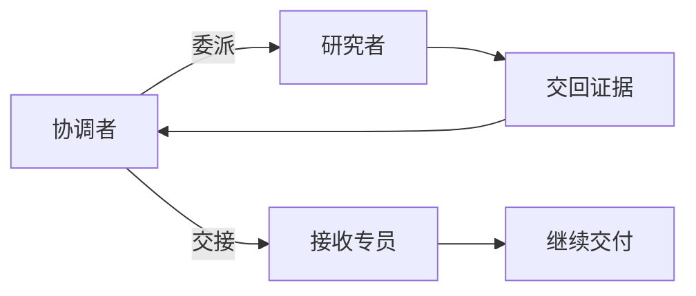

# 协作系统：更多 Agent，怎样共同交付一份结果？

协调者把经营日报 R42 的调查分给两名研究者：一名查日志，一名核对数据。两份报告都写着“已完成”，一份说任务没有启动，另一份说报表已生成、数据正常。

把两段文字接起来，会得到一份自相矛盾的报告。协调者检查来源才发现，日志研究者查的是生产环境的另一运行，数据研究者打开的是预发报表。两人可能各自认真完成了一个问题，却没有完成同一个问题。

协作的难点由此显现：工作可以分开，最终判断必须重新对齐。任务范围、状态、证据和责任若没有跟着分派一起传递，多几个角色只会多几份难以核对的文字。

## 先确定谁还要回来收稿

先有总任务，再决定关系。日志与数据研究者负责有限子问题，协调者保留总目标、补查与交稿责任。这是委派：执行者结束后把材料交回来。若用户的问题已经进入一个独立服务阶段，可以把控制权交给另一专员，让其继续负责。这是交接：原协调者未必自动回来。

OpenAI Agents SDK 的 Agent 工具会启动子 Runner，再把提取的结果交回父运行；handoff 则在当前 Runner 更换 Agent。LlamaIndex 的工作流交接也会记录下一 Agent，再在结果汇聚时切换当前执行者。两者都表达了责任转移，不能仅因有交接关系就假定原协调者最后验收。

Aider 的 Architect 与 Editor 展示另一种自然分工：一个形成方案，另一个按方案编辑，再把提交与费用交回。它不需要先建设一个并行团队。CrewAI 则提供顺序流程与带管理者的分层流程，后者把分派集中给管理者，也增加管理与核对成本。关系应由任务决定，角色数量不是设计目标。



## 在同一份报表任务下比较三条路径

“子 Agent”背后至少有三种执行单位：同一循环中的角色切换、函数式子运行、独立的后台会话。它们改变等待、恢复和输入的方式。

| 执行关系 | 代表机制 | 父任务需要安排什么 |
| --- | --- | --- |
| 当前循环切换执行者 | SDK handoff、LlamaIndex handoff | 交稿责任和授权是否转移 |
| 子过程返回材料 | SDK Agent 工具、Smolagents managed agent、Deep Agents 子图 | 输入契约、输出提取、父级验收 |
| 后台会话稍后通知 | OpenCode 子 job、OpenClaw 子会话、Hermes 后台委派 | 运行身份、通知世代、取消与迟到结果 |

Deep Agents 默认隔离路径用任务描述替换子消息，再传筛选后的状态；实验性的 fork 路径可带入整理后的父历史。Hermes 的委派路径使用独立子会话、受限工具，并跳过部分上下文文件与记忆加载。它们减少父历史无差别复制，也使任务信息包更重要。

独立会话还有生命周期。OpenCode 用子会话与启动时间区分一次 job 的完成通知，避免旧一代结果混进新的等待。Goose 会校验子会话的父归属，并可复用已保存的成功结果。AgentScope 的团队管线按成员分组，同成员顺序处理，不同成员可以并发，回到 leader 的是提取后的文本或数据。父任务得到结果的方式不同，都需要知道哪些证据被留下、哪些过程没有回传。

## 输入、共享状态和权限需要分开设计

“共享上下文”太笼统。模型可见消息、代码可访问依赖、可修改资源与最终合并状态，是不同的集合。

SDK 子运行可以共享应用上下文和用量对象，却不自动复制全部父历史；Deep Agents 筛选状态后传子图，也不表示外部资源权限已经隔离。Cline SDK 为委派显式选择工具、轮数、取消信号和政策；Qwen Code 对子执行后端的选择还要结合项目可信性与全局配置。这些机制把分派变成受控请求，而非仅向另一个模型发送长聊天记录。

对 R42，一个足够小的信息包应包含：生产运行 `run-807`，业务日期 16 日，核对窗口 15–16 日，配置 v6，日志定位，以及“生产只读，测试验证”。数据研究者只核对分区与字段结构；日志研究者只核对调度链与失败证据。已有测试 `job-42` 未通过完整性验收也应告诉两人，避免把绿色回执当新证据。

限制应在业务工具上落实。不给生产写权限，比期待每个子模型永远记得那句话更可靠。研究者需要更多材料时，请求补充或使用受限读取工具；没有必要自动获得整个会话与所有凭证。

## 先写交付契约，再决定派多少人

先定义总交付：原因的证据、已核对的影响范围、修复方案、测试状态与剩余问题。再拆子任务，使每个执行者知道自己要回答什么、凭什么回答、交给谁检查。

每份返回至少带任务与运行身份、覆盖范围、发现、证据和未决事项。结构化结果方便程序先拒绝范围错误，协调者再判断证据能否支持结论。下面的设计示例只做这第一道检查；两种语言对相同的错位报告给出相同结果。

```typescript
interface Report {
  task: string; env: string; run: string;
  window: string; evidence: string; finding: string;
}
const contract = {
  task: "R42", env: "production", run: "run-807", window: "15-16",
};
function checkScope(r: Report): string {
  if (r.task !== contract.task || r.env !== contract.env ||
      r.run !== contract.run || r.window !== contract.window)
    return "rejected:scope";
  if (!r.evidence || !r.finding) return "rejected:missing-evidence";
  return "scope-ok:needs-review";
}
const reports: Report[] = [
  { ...contract, run: "run-806", evidence: "old-log", finding: "not started" },
  { ...contract, env: "staging", evidence: "staging-report", finding: "normal" },
  { ...contract, evidence: "artifact:log-17#840-875", finding: "E42" },
];
for (const report of reports) {
  console.log(checkScope(report));
}
```
```python
from dataclasses import dataclass

@dataclass(frozen=True)
class Report:
    task: str
    env: str
    run: str
    window: str
    evidence: str
    finding: str

def check_scope(report: Report) -> str:
    scope = (report.task, report.env, report.run, report.window)
    if scope != ("R42", "production", "run-807", "15-16"):
        return "rejected:scope"
    if not report.evidence or not report.finding:
        return "rejected:missing-evidence"
    return "scope-ok:needs-review"

reports = [
    Report("R42", "production", "run-806", "15-16", "old-log", "not started"),
    Report("R42", "staging", "run-807", "15-16", "staging-report", "normal"),
    Report("R42", "production", "run-807", "15-16",
           "artifact:log-17#840-875", "E42"),
]
for report in reports:
    print(check_scope(report))
```

通过范围检查的第三份材料仍需审阅。非空的证据地址不保证可读，更不保证里面真有 E42。程序可以读取文件并核对版本与运行编号，协调者再判断推论是否成立。若契约只有固定字段检查，产品就应把结果叫“范围符合”，而不是“调查正确”。

## 合并结果，要合并证据而不只拼接文本

协调者现在可以实际处理开场矛盾：撤下另一次运行的“未启动”和预发环境的“正常”，把补查压成两个问题。日志研究者回答 `run-807` 的最后失败位置；数据研究者回答该次运行的源分区与配置 v6 是否一致。

补回的 `artifact:log-17` 第 840–875 行给出 E42。协调者核对它属于目标运行后，把共同判断收窄为“目标运行有字段映射线索”，再取配置 v6 与源结构比对。E42 单独不足以证明最终根因；预发存在一份正常报表，也不足以反驳这条生产证据。

这个过程消解了原来的冲突：首稿描述了不同对象，不能互相否定，也不能拼成生产正常。协调者保留有效证据，删去不适用断言，提出能被新证据推进的假设。这比要求两人各重写一篇观点更省工作。

应用也要控制写入。研究者各写自己的证据与草稿，由协调者生成总稿，通常比所有人并行改同一文件简单。必须共写时，用版本比较、顺序或业务事务处理冲突。图状态的归并规则只覆盖它实际管理的字段，不能自动解决外部数据库和文件的任意并发修改。

## 调度要同时考虑依赖、资源和停止

日志与分区读取可以并行，修复方案依赖二者，测试提交还依赖授权与具体方案。把所有角色一次启动，会让依赖中的执行者空等或猜测。只有分工独立、证据回流成本可控时，并行才值得。

取消同样需要完整链条：协调者停止新分派，运行系统通知活动子任务，执行者停止新增请求并返回已完成、未完成、效果未知的动作。若远端测试仍在运行，协调者继续保留其编号。协程结束只能说明本地停止等待，不能宣布远端写入已撤销。

预算则要给合并与验收留出份额。两名研究者分别花完自己的轮数，不表示总任务已经留下交稿资源。分派时明确额度与截止条件，比结束后才汇总费用更可控。

## 一条运行轨迹能证明什么

本书用真实 SDK Runner 与预编排模型替身运行了五个场景，没有调用远程模型。交接共用当前运行轮数；Agent 工具另起子运行。父上限为两轮、子采用默认上限时，父与子各调用替身两次，共四次。

另一个场景让子运行在一轮后超限，工具包装器把它变成通用错误文本，父替身仍按预编排返回了“完成”。这说明子任务失败与父运行正常返回能够同时成立。它没有证明真实模型必然忽略子失败，却明确了应用为什么需要独立验收。

R42 的协调者到这里得到了同一对象下的材料，也承担了删去错位结论的责任。继续执行前，还需要能随时回答：哪些动作等待开始，哪些已经发生，哪些无法确认。下一章把协作中的状态交付继续推进到可靠执行。

## 延伸阅读

[实现、版本与实验资料](../references/chapter-notes.md#19-delegation-and-handoffs)

[上一章：工具返回了，任务为什么还没有完成？](17-tool-results-and-retries.md) · [下一章：可靠执行系统：让动作可控、过程可恢复、结果可核查](12-action-boundaries.md)
