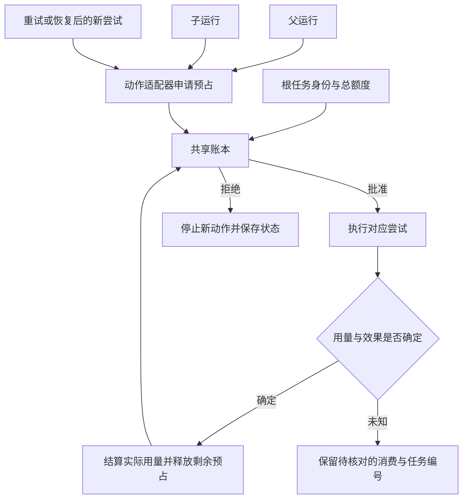

# 明明限制了步数，为什么还能花掉更多资源？

本章对照两类运行入口：SDK 的三个应用启动方法，以及实验使用的一个已编译图调用入口。计数范围是应用发起运行的方法，不含请求对象与内部包装器。

把父运行设为“最多两轮”，整项任务就只做两轮工作吗？本书用真实 SDK 运行的确定性实验给出一个容易误判的结果：**父模型替身调用了两次，子模型替身也调用了两次，总计四次**。父运行正常结束，限制也没有失效；它只是约束了另一件事。

这解释了 R42 协调者接下来的困难。日志与数据研究者对齐了同一运行，仍需要补查源结构、等待测试、核对产物。若每个子任务各自领取一份“最多两轮”，协调者最后可能拿回很多材料，却没有资源判断它们是否够用。

> [!NOTE]
> SDK 入口是 `Runner.run`、`run_sync`、`run_streamed`；图实验从编译图的 `invoke` 进入。请求输入与结果对象是数据，业务工具连接外部服务，子 Agent 包装器、执行器与重试配置提供运行支持，均不另计启动入口。
>
> 开场的四次调用来自真实 Runner 与预编排 `ScriptedModel` 响应，只运行 SDK 异步入口；图实验只运行同步入口。没有调用远程模型，没有把四次调用换算为费用或任务成功率。R42 的资源安排是接下来的设计推演。

要解释限制是否生效，需要明确：谁在计数，计的是什么，什么时候检查，以及哪些执行者共享这个计数。

## 一个数字不能同时代表所有资源

模型轮数、请求尝试数、工具调用数、图调度步、并发度、token、实际经过时间与业务写入次数，是不同的数量。

它们之间有联系，却没有固定换算关系。一轮模型输出可以包含多个工具调用；一个工具可以启动子 Agent；一次模型轮次内部还可能重试提供方请求；一个图节点又能发出很多业务动作。

因此，运行日志里的“已用额度”和执行前的“允许继续”也应分开。前者负责记账，后者负责限制。把结束后的用量汇总显示得很准确，仍不等于系统会在超出额度前停止。

## SDK 的轮数属于哪一次运行

在固定 OpenAI Agents SDK 中，应用启动 `Runner.run`、`run_sync` 或 `run_streamed`。Runner 持有当前 Agent 与运行轮数，工具包装器负责具体调用，输入与结果对象承载数据。计数在 Runner 的循环里生效。[^sdk]

`handoff` 在同一次循环中更换当前执行者，没有把轮数清零。`as_tool` 则可以启动一个新的子 Runner，单独解析子运行上限。包装器没有设置子上限时采用自己的默认值，不能把它理解成领取父运行剩下的余额。[^nested]

本书用真实 SDK 与预设模型响应比较了这两个范围：

| 场景 | 协调者模型替身调用 | 专员模型替身调用 | 结果 |
| --- | --- | --- | --- |
| 交接，外层上限 1 | 1 | 0 | 接收者执行前已超限 |
| 交接，外层上限 2 | 1 | 1 | 专员完成 |
| Agent 工具，外层上限 2，子运行默认 | 2 | 2 | 共四次调用，协调者完成 |
| Agent 工具，外层上限 1，子运行默认 | 1 | 2 | 子运行已完成，父运行随后超限 |

数字来自 [五场景实验](../experiments/README.md#委派交接与轮数边界)，表示实际进入 `ScriptedModel` 的次数，不是外网模型请求、计费 token 或任务成功率。

最后一行尤其重要：外层限制阻止了外层下一轮，却没有让已经完成的子工作变成未发生。要限制总消费，需要约束所有子工作经过的路径。

## 模型轮次也不等于网络尝试

SDK 的模型请求路径还有自己的重试处理。某一轮内部是否再次请求提供方，取决于错误与策略；Runner 的轮数没有因此自动变成所有网络尝试的计数器。现有实验没有运行这条提供方重试分支。[^request-retry]

同样，一次工具超时也可能留下仍在运行的远端任务。停止等待，只改变了本地控制流。外部动作是否取消，需要对应服务提供并实际执行取消约定。

这会影响预算的单位。希望限制昂贵服务调用时，应在该服务的实际请求处记账；希望限制整项任务的支出时，还需要把模型、工具、重试与子运行归到共同任务，而不是只统计外层可见的消息回合。

## 图的调度步，数的又是什么

LangGraph 的相关实验只从编译图的 `invoke` 进入。图循环安排一次调度步，运行本步的节点任务，再交付更新。一个调度步里可以有多个节点；一个节点内部也可以继续调用多个工具。`RetryPolicy` 是节点任务的重试配置，工具节点则是把消息中的动作请求分派到业务函数的适配器。[^graph]

在真实同步实验中，一个工具节点含有三次创建请求。把 `recursion_limit` 设为 1，三次模拟写入已经发生，图随后报步数超限；设为 2，同一批次可以正常完成。另一个永不结束的图在上限 3 时运行了三次节点，每次节点内安排两个模拟动作，总计六个动作。[^graph-exp]

这些观察说明该上限不是工具调用总数，也不是业务动作总数。超限错误又不具备回滚外部效果的含义。

下面几种配置可以同时存在，但各自约束不同位置：

| 配置 | 本章核对的计数范围 | 还需要单独限制的事情 |
| --- | --- | --- |
| SDK `max_turns` | 当前 Runner 的模型轮次 | 子运行与轮内请求尝试 |
| 图 `recursion_limit` | 本次图运行的调度推进 | 节点内部工具与外部动作 |
| `RetryPolicy.max_attempts` | 一项节点任务的尝试 | 整个任务树的累积消费 |
| `max_concurrency` | 指定调度层的同时执行数量 | 总调用次数与总支出 |

表中并发限制也要连着执行层看。本书的同步工具实验用一个工作线程固定顺序；异步工具节点另有直接汇聚协程的路径。不能从一个配置名推导任意内部实现都被同一把锁串行化。[^concurrency]

## 恢复时，额度是否跟着任务走

一项任务今天暂停，明天恢复。如果每次重新进入都获得一份完整额度，累积消费仍可能超出业务方想设的总量。

SDK 使用已保存运行状态恢复时，可以取回原有轮数与上限；拿着相似消息新开一次运行则是另一件事。LangGraph 被核对的循环会依据当前检查点位置计算这次运行的停止位置，不能把一个 `recursion_limit` 配置解释为跨全部调用的永久总额度。[^resume]

这两种状态行为都需要按实际入口理解。若应用要给“同一份报表修复”设置跨天总额度，应当保留稳定的业务任务身份与已消费记录。换会话、换执行者或恢复图，都不应无意中把业务账本清零。

## 共享预算需要在动作前分配

一种应用设计是为根任务保留共同账本。子任务启动之前先申请额度，获得分配后执行，结束时再按实际消费结算。并行申请需要原子处理，否则多个子任务可能同时读到“还有一次”，然后各自发起一次。

账本需要区分已消费、已预留与可以释放的部分。一个远端请求结果不明时，立刻把预留额度全部归还，可能让后续在旧请求仍执行时再发出新请求。

重试同一业务动作也需要身份关联：它属于同一个业务操作，但确实可能多消耗一次网络尝试或模型请求。业务去重与资源记账不能因为共用一个编号就省略其中一层。

这份应用账本要覆盖实际消费入口：模型请求、子运行、昂贵工具及重试。漏掉一条路径，总消费就可能绕过根任务额度。

图中的账本要在调用前真正分配可用资源。SDK 的 `max_turns` 或图的 `recursion_limit` 可以继续限制局部运行，账本则把它们关联到根任务。对于无法预知上界的消费，应明确估算与预留方式；事后汇总本身无法保证绝对不超支。

> [!NOTE]
> 业务幂等处理同一动作是否重复产生效果，资源账本处理每次实际尝试消耗多少。两份记录可以关联同一任务，但不能互相替代。

## 还要给验收与交接留资源

如果系统把全部预算花在探索上，最后可能没有机会核对产物、保存状态和解释未完成事项。协调者再想找一个执行者来总结，也可能启动新一轮未被计入的消费。

对 R42，应先给产物验收留出不可被探索耗尽的部分：核对 10 月 15–16 日窗口、业务日期 16 日、测试环境与配置，检查对应产物，再保存结果和未完成事项。具体额度需要依据实际模型、工具收费和数据量测量；这里的关键是先确定这几步必须发生，再把剩余资源分给补查。

如果调查范围很小、没有子运行，局部轮数加工具调用次数就足以作为第一版控制，接线少，代价是无法表达跨天总消费。若允许并行研究、自动重试和断点恢复，就应使用根任务账本，让子任务领取有界额度；这会增加预占、结算与未知状态核对的成本。业务动作昂贵或不可逆时，再单独限制写入次数，不能把它折算成模型轮数。

并行的取舍也要具体。R42 的日志与源分区核对互不依赖，可以各分一份额度同时做；后续读取配置 v6 若要依据前面发现选择字段，就等证据回来再启动。额度紧张时，协调者先做一个足以缩小范围的查询，可能比同时派出两名研究者更省资源；等待更敏感、两个问题确实独立时，才值得付出并行预留与合并的成本。

剩余额度不足以完成下一段工作时，应用停止新动作，保留根任务编号、已完成范围、证据位置、仍在运行的外部任务和下一接手点。验收未完成就报告“尚未验证”，不能因为没有钱继续查，就把已有材料改写成修复成功。

现在，R42 的探索不能再挤占最终核对，暂停与恢复也有了同一本消费记录。最后还缺一个决定：谁依据哪些产物与动作证据，宣布这次任务已经完成？下一章回到那份最初的报表。

[^sdk]: [本地 Runner 入口](../openai-agents-python/src/agents/run.py#L279-L324) · [固定源码](https://github.com/openai/openai-agents-python/blob/9abc9182d06dbd28330af888306031269d57a175/src/agents/run.py#L279-L324)；[计数与超限检查](https://github.com/openai/openai-agents-python/blob/9abc9182d06dbd28330af888306031269d57a175/src/agents/run.py#L1597-L1622)。
[^nested]: [本地子运行上限](../openai-agents-python/src/agents/agent.py#L746-L773) · [固定源码](https://github.com/openai/openai-agents-python/blob/9abc9182d06dbd28330af888306031269d57a175/src/agents/agent.py#L746-L773)；[同一 Runner 内交接](https://github.com/openai/openai-agents-python/blob/9abc9182d06dbd28330af888306031269d57a175/src/agents/run.py#L2386-L2408)。
[^request-retry]: [本地模型请求重试循环](../openai-agents-python/src/agents/run_internal/model_retry.py#L597-L681) · [固定源码](https://github.com/openai/openai-agents-python/blob/9abc9182d06dbd28330af888306031269d57a175/src/agents/run_internal/model_retry.py#L597-L681)。
[^graph]: [图调度、节点与入口的研究](../references/studies/execution-budgets.md#范围与实际入口)；[本地图循环](../langgraph/libs/langgraph/langgraph/pregel/_loop.py#L1879-L1881) · [固定源码](https://github.com/langchain-ai/langgraph/blob/41c9c22fdc83d68a2859d0c9a2b627c8615a792f/libs/langgraph/langgraph/pregel/_loop.py#L1879-L1881)。
[^graph-exp]: [实际工具与步数记录](../experiments/results/langgraph-tool-boundaries.json) · [可复现实验脚本](../experiments/langgraph_tool_boundaries.py)。
[^concurrency]: [本地同步与异步工具批次](../langgraph/libs/prebuilt/langgraph/prebuilt/tool_node.py#L827-L868) · [固定源码](https://github.com/langchain-ai/langgraph/blob/41c9c22fdc83d68a2859d0c9a2b627c8615a792f/libs/prebuilt/langgraph/prebuilt/tool_node.py#L827-L868)；[同步执行器配置](https://github.com/langchain-ai/langchain/blob/bd5b134d876ef47858beef27bd29c81eeda03293/libs/core/langchain_core/runnables/config.py#L660-L675)。
[^resume]: [本地 SDK 恢复的上限](../openai-agents-python/src/agents/run.py#L678-L697) · [固定源码](https://github.com/openai/openai-agents-python/blob/9abc9182d06dbd28330af888306031269d57a175/src/agents/run.py#L678-L697)；[恢复的当前轮数](https://github.com/openai/openai-agents-python/blob/9abc9182d06dbd28330af888306031269d57a175/src/agents/run.py#L813-L833)；[图停止位置的计算](https://github.com/langchain-ai/langgraph/blob/41c9c22fdc83d68a2859d0c9a2b627c8615a792f/libs/langgraph/langgraph/pregel/_loop.py#L1879-L1881)。更完整条件见 [预算研究](../references/studies/execution-budgets.md)。

[上一章：文档里的一句话，为什么变成了行动指令？](20-trust-boundaries.md) · [下一章：评测系统：让任务完成成为可复核的结论](22-evaluation-and-completion.md)
