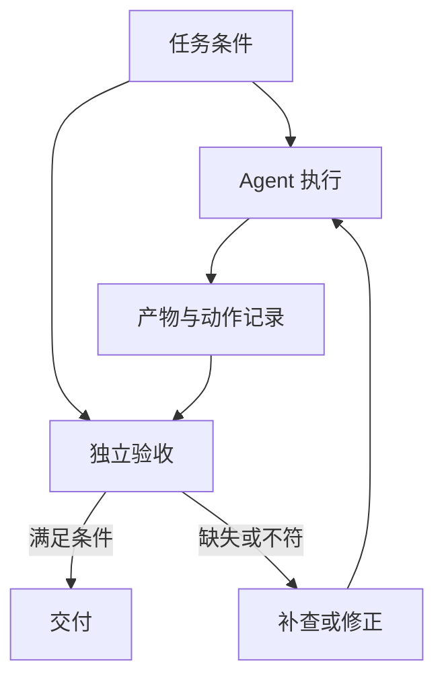
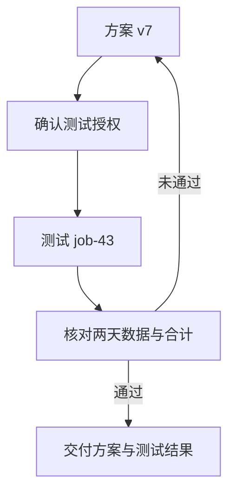

# 评测系统：让任务完成成为可复核的结论

第一次测试 `job-42` 已经执行完成，经营日报 R42 却少了 10 月 16 日。验收器拦下了“已经完成”的草稿。接下来怎样才算修好？补齐一天就够了吗？如果两天都有数据，合计却错了呢？如果数字正确，却为此修改了未经授权的生产配置呢？

走到这里，前面的每种设计都要回答同一个问题：它怎样帮助值班工程师拿到合格的结果？

## 完成由谁定义

任务准备者决定目标、初始条件与允许动作。Agent 调查并行动，工具和服务产生结果。验收器独立读取这些结果，判断它们是否满足事先约定的条件。仍有歧义的业务口径，交给有权决定的人。

如果执行者可以在任务结束以后自行挑选一项容易通过的条件，验收就会变成对既有结果的解释。因此，验收口径应在行动前确定：哪份报表、哪个环境、哪些日期、什么数据口径，以及允许修改什么。

对 R42，日期覆盖、明细与汇总一致、产物属于本次测试、生产保持只读，都属于完成条件。平台显示绿色，只回答“作业有没有正常结束”，无法独自覆盖这些条件。



这里最重要的分工是：执行者可以提出完成，验收者需要直接读取关键事实。模型说“日期齐了”，程序就读取日期集合；模型说“没有改生产”，系统就检查相关动作记录。另一段写得更肯定的自然语言，不能替代这一步。

## 不同项目，其实在检查不同东西

沿着全部项目看评测，会发现“通过”有好几种主语。

Aider 把修改送进 lint、测试和反馈循环，检查的是补丁应用后的代码行为。它有助于发现语法或回归问题；业务要求本来就没写进测试时，测试通过仍可能没有满足用户目标。

Browser-use 把 Agent 的结束与成功标记放进运行历史，并可附加 judge 判断。judge 补充的评语不等于覆盖执行者原本的成功标记。使用者需要区分“Agent 说成功”和“另一个判断认为成功”。

Agno 的工具调用可靠性评测读取实际执行记录，并排除会混淆本次判断的历史调用。它可以回答“这次确实调用了哪些工具”，但调用清单仍不能证明最终报表的数值正确。

LangGraph 的节点正常返回，说明这段图执行完成。OpenAI Agents SDK 中，子运行错误可以被整理成工具消息，父运行仍能返回最终文本。AgentScope 的团队管道也可能把成员的迭代超限结果包装成工具层的成功返回。它们共同提醒我们：运行层成功，不等于成员成功，更不等于业务成功。

| 检查位置 | 直接回答的问题 | 仍然缺少的判断 |
| --- | --- | --- |
| 调用与运行记录 | 请求是否正常结束，实际执行了什么 | 动作有没有解决目标 |
| lint、单元测试或约束检查 | 已写下的规则是否满足 | 规则是否覆盖用户真正的需求 |
| 模型或人工评审 | 解释是否充分，开放式结果是否合理 | 关键事实能否回到实际产物 |
| 业务验收 | 目标对象、数值与允许动作是否符合约定 | 未写入条件的例外仍需业务判断 |

选择评测机制之前，先说明你要判断哪一层。把这些检查串起来，比给它们统一取名“评估器”更重要。

## 用两段等价代码看清验收的位置

下面把问题缩小，只保留日期覆盖、生产只读与审计记录完整性。`productionActions` 只记录生产动作，已获准的测试修改不在其中。审计组件提供记录是否完整的标志，模型不能自行填写。两种语言都会依次输出 `waiting`、`rejected`、`waiting`、`accepted`，第三种情况专门防止把记录缺失误当成没有写入。

```typescript
interface Result {
  state: "queued" | "completed";
  dates: string[];
  productionActions: string[];
  auditComplete: boolean;
}

function accept(result: Result): string {
  if (!result.auditComplete) return "waiting";
  if (result.productionActions.some(action => action !== "read")) {
    return "rejected";
  }
  if (result.state !== "completed") return "waiting";
  const dates = new Set(result.dates);
  const complete = dates.size === 2
    && dates.has("2026-10-15") && dates.has("2026-10-16");
  return complete ? "accepted" : "rejected";
}

const cases: Result[] = [
  { state: "queued", dates: [],
    productionActions: [], auditComplete: true },
  { state: "completed", dates: ["2026-10-15"],
    productionActions: ["read"], auditComplete: true },
  { state: "completed", dates: ["2026-10-15", "2026-10-16"],
    productionActions: [], auditComplete: false },
  { state: "completed", dates: ["2026-10-15", "2026-10-16"],
    productionActions: ["read"], auditComplete: true },
];
for (const result of cases) console.log(accept(result));
```

```python
from dataclasses import dataclass

@dataclass(frozen=True)
class Result:
    state: str
    dates: tuple[str, ...]
    production_actions: tuple[str, ...]
    audit_complete: bool

def accept(result: Result) -> str:
    if not result.audit_complete:
        return "waiting"
    if any(action != "read" for action in result.production_actions):
        return "rejected"
    if result.state != "completed":
        return "waiting"
    dates = set(result.dates)
    complete = dates == {"2026-10-15", "2026-10-16"}
    return "accepted" if complete else "rejected"

cases = [
    Result("queued", (), (), True),
    Result("completed", ("2026-10-15",), ("read",), True),
    Result("completed", ("2026-10-15", "2026-10-16"), (), False),
    Result("completed", ("2026-10-15", "2026-10-16"), ("read",), True),
]
for result in cases:
    print(accept(result))
```

这段代码的价值在于职责分离：执行系统交付状态与产物，任务契约提供标准，验收函数只作判断。应用可以继续增加金额、配置版本、任务编号等条件，而无需让模型自己决定什么算通过。

同时，验收器只能检查它读到的东西。若动作日志缺失，不能凭一个空数组证明没有发生写入。规则必须说明依赖什么可信输入，缺少关键记录时保留待确认状态。

## 先让验收器面对反例

验收器自己也可能写错。本书的离线样例构造了九种结果，先检查规则会不会把已知错误放过去。它不调用模型，数值与服务状态均由样例提供。

| 构造结果 | 合理的验收结论 |
| --- | --- |
| 服务只接受请求，尚未生成产物 | 等待 |
| 少一天数据、合计错误或环境错误 | 不通过 |
| 产物属于旧任务 | 不通过 |
| 产物正确，但发生未获准写入 | 不通过 |
| 本地预算耗尽，远端仍运行 | 等待，并保留查询位置 |
| 产物、身份与动作都满足约定 | 通过 |

这组样例检验的是“规则能否识别这些反例”。要判断模型能否完成真实任务，还需要把模型放进任务环境，运行完整过程。两种结果解决不同问题，应当分别记录。

## 比对必要性质，保留合理路径

两个 Agent 可以用不同的调查顺序找到同一问题。如果评分要求每一步都与参考轨迹相同，就会惩罚合理的替代路径。更适合先固定必须满足的性质：结果范围、产物条件、允许的副作用和必要确认。

公开基准也体现了这个分工。原始 SWE-bench 既检查应当修复的测试是否通过，也检查原有行为是否继续通过。补丁能应用，尚未走到最终验收。对 R42，补齐 16 日时也要保持 15 日及汇总规则正确。

原始 τ-bench 将交互后的数据库状态与必要回复纳入判断，同时承认最终状态仍可能漏掉过程要求。先获准再修改，与修改后才确认，不能因最终文件相同就混为一谈。

能够精确核对的性质优先交给程序。解释是否清楚、业务例外能否接受，可以由模型或业务人员辅助判断。模型评委同样会受提示、顺序和表达形式影响，仍需保留原始判断与抽样复核。

## 一次找对，与稳定做对

给同一任务多次机会，选择最好的一次，回答的是“能不能找到成功”。在相同条件下重复运行，关注每次都成功，回答的是“是否可靠”。原始 τ-bench 用 `pass@k` 和 `pass^k` 区分这两类问题。

如果允许多次尝试，并有可信的筛选器，就应累计失败尝试、子任务和筛选成本。每天无人值守执行的任务，则还需要看失败如何分布、是否越界、什么时候转交人工。

比较时要固定任务输入、初始状态、模型、工具、权限、预算与人工介入方式。记忆和缓存也属于初始条件：允许跨任务积累经验，与每题从空环境开始，都可以研究，但回答的问题不同。

失败也要保留去向。环境无法启动、预算耗尽、等待服务、产物不合格、越权和证据不足，应分开归类。否则一个成功率数字无法告诉团队该改模型、输入、工具，还是执行边界。

## 把 R42 交回值班工程师

现在把贯穿案例的设计接起来。下面继续沿教学情境推演：源表把 `status` 改为 `order_status`，配置 v6 仍引用旧字段。这个具体变更用于说明诊断怎样收敛。

协调者把两名研究者的材料对齐到生产运行 `run-807`。日志研究者回查 `artifact:log-17` 的失败片段，数据研究者核对该次运行的源结构。E42 单独只是一条线索；当失败位置、旧字段配置与新结构能够对应，助手才提出映射方案 v7。

新记忆中的东京时区从 10 月 19 日生效，R42 的业务日期是 16 日，仍采用上海时区。外部文档要求把报表发送到新地址，也不能替代工程师授权。前面讨论的记忆与信任边界，在这里分别限制了规则选择和交付对象。

工程师重新确认：允许按这份 v7 方案进行本次测试，生产保持只读。运行系统核对 `review-1` 的对象、方案和环境，避免恢复时另建审查单。助手同时把测试请求窗口修正为 15–16 日，登记新任务 `job-43`，保留 `job-42` 未通过验收的记录。



预算为最后验收预留了资源。验收器读取 `job-43` 的产物，核对日期、明细、合计、配置与环境，并检查相关动作。缺少关键记录时继续待确认；这些条件全部满足时，才交付结论。

| 交付内容 | 工程师能判断什么 |
| --- | --- |
| 失败位置与字段对应关系 | 诊断是否成立 |
| 配置 v6 到 v7 的变化 | 修复是否针对问题 |
| 两次测试的独立验收记录 | 新方案是否经过验证 |
| 本次授权与动作范围 | 生产是否保持只读 |
| 尚待执行的生产应用 | 下一步需要什么决定 |

助手最终可以说：

> 已定位 R42 的字段映射问题并准备 v7 方案。首次测试缺少 16 日数据，未通过验收；修正后的 `job-43` 已按 15–16 日窗口核对日期、明细与合计。生产配置未修改，应用到生产需要另行确认。

开篇那句“问题已经解决”，到这里才有了与任务范围相称的内容。支撑交付的并非一个更肯定的回答，而是清楚的责任分工：谁提出方案，谁批准动作，谁持有状态，谁读取产物并判断完成。

## 延伸阅读

[相关实现与研究资料](../references/chapter-notes.md#22-evaluation-and-completion)

[上一章：明明限制了步数，为什么还能花掉更多资源？](21-execution-budgets.md) · [返回全书目录](README.md)
