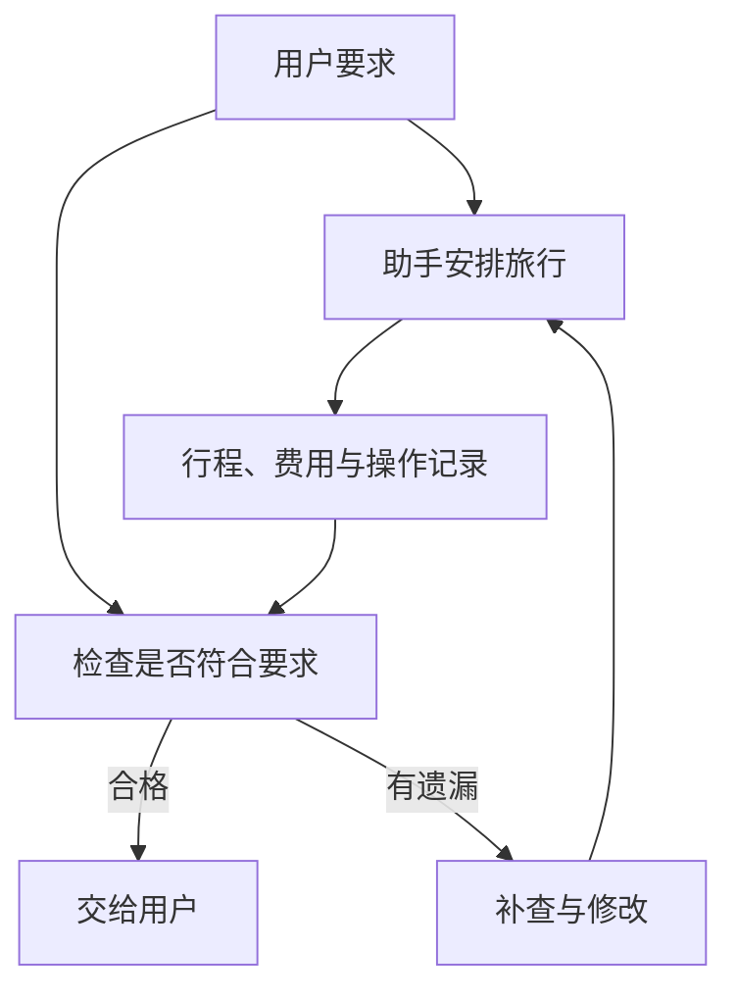
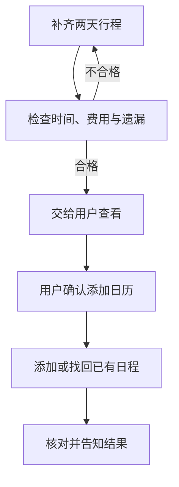

# 评测系统：让任务完成成为可复核的结论

助手交来一份排版漂亮的杭州行程。周六去哪儿、晚上住哪里都写了，却没有周日回上海的车次。

我们一眼就能发现它没做完。可如果返程补上了，交通和住宿加起来超过 1500 元呢？如果费用没超，却为了让价格看起来确定，已经替用户下了订单呢？

前面讨论的记忆、工具、分工和恢复，最后都要落到一个问题上：**用户拿到的东西，究竟能不能用？**

## 先说好什么算做好，再让助手去做

这次任务的要求并不神秘：安排周末两天，高铁往返，住一晚，连同餐饮和市内交通，总预算 1500 元；先给草稿，不订票订房。用户确认后，才可以添加日历。

这些要求应在行动前定下来。不能等助手交稿以后，再挑一个容易通过的条件。例如，“成功查询了一家酒店”当然是进展，却不能代替完整行程。

谁来检查也要分清。模型负责整理行程，可以告诉程序“我认为做完了”；检查程序读取行程、查询结果和操作记录，核对明确条件。有歧义的地方，例如一天排得会不会太累，再请用户判断。

工程里把这一步叫作验收。这个词说的就是：照着事先说好的要求，看交来的东西合不合格。



“没有擅自下单”要看操作记录，“两天都安排了”要看行程内容。再找一个模型写一句“检查通过”，并不能替代这些实际核对。

## 看起来都叫“成功”，说的可能不是一件事

查询工具正常返回，只说明这次调用没有在程序里报错；结果里也可能写着“没有合适车次”。行程文件成功生成，也可能少了一整天。

开源项目里的检查也各有用途。Aider 会把代码修改送进 lint 和测试，再根据错误继续改。lint 检查一部分代码问题，测试检查已经写下的行为；用户的要求没写进测试，测试就未必能发现。

Browser Use 可以同时保留助手自己给出的成功标记和另一个评审模型的判断。两者意见可能不同，所以使用者要知道自己正在读哪一份。Agno 的相关工具可靠性评测检查本次实际执行记录，能帮助判断有没有真正调用成功，却不能仅靠调用清单确认行程安排合理。

运行框架正常结束同样不是最终答案。LangGraph 的节点返回，说明那段程序运行到了返回处；OpenAI Agents SDK 的父运行可能收到整理成工具消息的子运行错误，然后继续作答；AgentScope 的某些团队返回还可能包住成员用尽迭代次数的情况。

因此，收到“成功”时先问：谁成功了，完成的是哪一步？

| 看到的结果 | 能说明什么 | 还需要检查什么 |
| --- | --- | --- |
| 工具正常返回 | 一次调用走完了 | 返回的是结果、空记录，还是错误说明？ |
| 文件生成成功 | 文件写出来了 | 两天安排和返程有没有漏？ |
| 自动检查通过 | 写进规则的条件满足了 | 有没有忘记写进检查的要求？ |
| 模型认为安排合理 | 多了一份判断 | 车次、费用等事实是否有依据？ |

## 用一小段程序检查最明确的要求

不必把所有判断都交给模型。两天行程是否齐全、费用是否超过上限、有没有订票订房，都可以先写成明确规则。

下面只演示其中几项。`cost` 是人工给定的样例总价。真实应用应从查询和估算得到的费用明细相加，不能只接受模型自报的总数；`hasReturn` 表示已找到本次周日的返程，来自对查询结果的核对；`auditComplete` 由记录操作的程序提供，表示相关记录是否收齐。没有记录时要继续核对，不能把空列表当成“什么都没做”。

这些都是人工样例，不是实时旅游报价。两份代码依次输出 `waiting`、`rejected`、`waiting`、`rejected`、`accepted`，意思是等待、未通过、等待、未通过、通过。第四份样例已经写了两天，却没有返程，专门检查开场的那种遗漏。

```typescript
interface Plan {
  days: string[];
  hasReturn: boolean;
  cost: number;
  orders: string[];
  auditComplete: boolean;
}
function accept(plan: Plan): string {
  if (!plan.auditComplete) return "waiting";
  if (plan.orders.length > 0) return "rejected";
  const days = new Set(plan.days);
  const complete = plan.hasReturn && days.size === 2
    && days.has("周六") && days.has("周日");
  return complete && plan.cost <= 1500 ? "accepted" : "rejected";
}
const cases: Plan[] = [
  { days: [], hasReturn: false, cost: 0, orders: [], auditComplete: false },
  { days: ["周六"], hasReturn: false, cost: 900, orders: [], auditComplete: true },
  { days: ["周六", "周日"], hasReturn: true, cost: 1480,
    orders: [], auditComplete: false },
  { days: ["周六", "周日"], hasReturn: false, cost: 1480,
    orders: [], auditComplete: true },
  { days: ["周六", "周日"], hasReturn: true, cost: 1480,
    orders: [], auditComplete: true },
];
for (const plan of cases) console.log(accept(plan));
```
```python
from dataclasses import dataclass

@dataclass(frozen=True)
class Plan:
    days: tuple[str, ...]
    has_return: bool
    cost: int
    orders: tuple[str, ...]
    audit_complete: bool

def accept(plan: Plan) -> str:
    if not plan.audit_complete:
        return "waiting"
    if plan.orders:
        return "rejected"
    complete = plan.has_return and set(plan.days) == {"周六", "周日"}
    return "accepted" if complete and plan.cost <= 1500 else "rejected"

cases = [
    Plan((), False, 0, (), False),
    Plan(("周六",), False, 900, (), True),
    Plan(("周六", "周日"), True, 1480, (), False),
    Plan(("周六", "周日"), False, 1480, (), True),
    Plan(("周六", "周日"), True, 1480, (), True),
]
for plan in cases:
    print(accept(plan))
```

这还不是一个完整的旅行检查器。列表里有“周日”，不代表返程时间一定正确；总费用未超，也不代表价格到下单时仍然有效。真实应用还要检查往返车次、住宿日期、餐饮和市内交通估算、价格来源及更新时间。

程序能把明确条件逐条守住，人来判断难以写死的部分。用户觉得景点太密，就应改行程；不必为了自动化，把个人感受硬塞进一个分数。

## 先拿坏结果，试试检查程序会不会放过

如果检查程序本身漏了条件，助手就算次次“通过”，也没什么用。

可以先故意准备几份错误答案：只有周六的行程、忘了返程、费用超支、住宿日期不对、用了上次旅行的结果，或者不经同意就下单。再看看检查程序能否逐一拦住。

本书已有的离线验收实验采用人造报表与动作记录，共九种情况，检查缺失日期、数值错误、旧任务结果、未经允许的写入和服务仍在运行等问题。这里没有把它改称旅行实验；它说明的共同方法是，先用已知坏结果检查规则，再让模型来完成任务。

这两步回答不同的问题。前者问“检查规则有没有漏”，后者问“模型有多常做对”。不能混成同一个通过率。

## 允许不同做法，但要满足同样要求

一个助手先查高铁，另一个先查酒店，只要最后时间接得上、费用没超，就都可能合理。如果评分要求查询顺序一模一样，反而会错罚另一条可行路线。

因此，先检查必须满足的条件，再看哪些操作顺序确实重要。例如，用户确认以前不能添加日历，这个先后不能放松；先查去程还是先查住宿，通常可以自由选择。

代码任务的公开评测也体现了类似思路。原始 SWE-bench 不仅看要修的测试是否通过，还看原有行为是否继续正常。旅行计划补上返程时，也不能顺手把原先安排好的住宿日期弄错。

原始 τ-bench 检查交互后的数据库状态和必要回复，同时指出最终状态不能覆盖所有过程要求。最后日历里只有一条安排，仍需要确认添加发生在用户同意之后。

明确的事实优先让程序核对；开放的质量判断可以请模型或人帮助。评审模型也会犯错，所以要保留它看过的材料，并抽样复查。

## 偶尔做对，和每天都做对

同一份任务试五次，挑最好的一次展示，能说明它有机会做好。每天独立使用一次，要求五天都做好，要求就高得多。

τ-bench 用 `pass@k` 与 `pass^k` 区分“多次机会里能否成功”和“重复尝试能否都成功”。名称可以晚点记，先记住它们在问不同的问题。

比较两套助手时，要说明用什么模型、给多少查询机会、是否允许人帮忙、是否保留以前的记忆。失败的尝试也有费用，不能挑完最好的一份以后，把其余尝试都忘掉。

出错时还要分清原因：查不到资料、等用户回答、调用次数用完、行程有误、擅自下单，需要的改进各不相同。单独一个成功率，很难告诉你下一步该改哪里。

## 最后把这趟旅行安排交清楚

现在把整本书的例子接起来。这仍然是教学推演，不是我们实际查询和预订了一趟旅行。

第一份草稿漏了周日返程，程序没有交稿。助手保留这个缺口，补查返程，并把往返时间、两天安排和一晚住宿放在一起检查，还将餐饮和市内交通算进总费用。它记得用户喜欢安静，也没有把 11 月起的 2000 元预算套到这次旅行上。

为了看清楚检查的结果，给这份修改稿填入一组人工数据：周六上午出发，周日的活动在下午五点结束，返程选在晚上七点，留出到车站的时间。费用也逐项列出，而不是只说“大约不贵”：

| 样例费用 | 金额 |
| --- | --- |
| 往返高铁 | 220 元 |
| 一晚住宿 | 680 元 |
| 两天餐饮 | 400 元 |
| 市内交通 | 180 元 |
| 合计 | 1480 元 |

这些金额和时间只用来说明检查方法。相对于初稿，现在能看见返程确实补上了，各项费用也合计在 1500 元内；真实出行仍需查询实际车次和价格。

住宿网页里的“立即下单”没有变成用户指令。助手没有订票订房，只交出行程与费用估算，并提醒价格和余位要在真正下单时再确认。

用户先前说过“先等等”，助手一直没有添加日历。现在用户看过这份完整行程并重新确认，程序才开始添加。日历服务已经创建成功、程序却没来得及记下结果时，恢复先查询已有日程，避免再建一条。



最后的答复可以很普通：

> 两天行程已补齐，包含往返高铁和一晚住宿，估算费用在 1500 元以内。车次与住宿信息已列在行程里，下单前还要确认价格和余位。没有订票订房；按你确认的安排添加了日历，并检查没有重复。

这比一句“旅行安排好了”更有用。用户知道拿到了什么、哪些事还没发生、下一步由自己决定什么。

理解 Agent，也是在学会问这些朴素的问题：它看到了什么？刚才做了什么？还缺什么？谁检查过了？我们从这里出发，才知道该让模型更会想，还是该让程序把事情接稳。

## 延伸阅读

[相关实现与研究资料](../references/chapter-notes.md#22-evaluation-and-completion)

[上一章：明明限制了步数，为什么还能花掉更多资源？](21-execution-budgets.md) · [返回全书目录](README.md)
