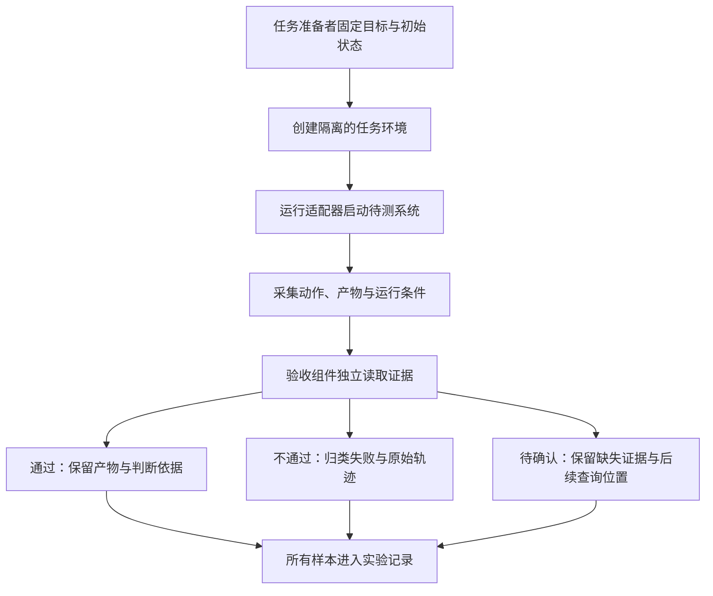

# 评测系统：让任务完成成为可复核的结论

周一，报表平台显示成功，产物却少了一天。周二，日期齐全，合计数字错了。周三，数字终于正确，助手却为此修改了用户没有授权修改的配置。

如果三次运行最后都回复“已经完成”，系统应该怎样记录结果？

这个问题需要任务准备者、执行者与验收者分别承担责任。准备者说明目标、初始条件和允许动作；Agent 调查并行动；工具和服务留下结果；验收组件依据事先约定的条件检查产物与必要过程。仍有歧义的业务判断，再交给能够作决定的人。

> [!NOTE]
> 本章先比较运行系统交付的证据，再设计应用的验收链与重复评测流程。已有离线样例是人工构造的验收规则检查，模型任务集、成本分布与真实成功率仍需另行测量。

## 比较系统之前，先比较证据能证明什么

Pi、LangGraph 与 OpenAI Agents SDK 的既有机制实验观察不同位置。把它们统一写成“通过了若干任务”，会把局部程序行为误当成真实任务效果。更有用的比较是：每一层交付了什么证据，业务还需要补上哪一步？

| 本书核对的路径 | 可以直接观察的证据 | 仍需要应用核查的结果 |
| --- | --- | --- |
| Pi 摘要输入序列化 | 指定片段是否进入给摘要模型的材料 | 摘要与后续行动是否保留业务约束 |
| LangGraph 工具与恢复 | 节点、工具请求、模拟写入及结果交付顺序 | 真实服务效果与产物是否符合目标 |
| SDK 委派与交接 | 哪个 Runner 继续、子运行是否超限、父输出是否返回 | 子任务是否有效，协调者是否覆盖全部任务 |
| 本书的应用验收程序 | 构造产物、来源和动作记录是否满足所写条件 | 规则是否覆盖真实业务，采集的证据是否可信 |

这些行处在不同层次，不组成项目排名。前三行分别见[Pi 输入实验](../experiments/README.md#摘要模型读取前的裁剪)、[LangGraph 实验](../experiments/README.md#工具错误批次重试与图步数)、[SDK 实验](../experiments/README.md#委派交接与轮数边界)，最后一行见[本地验收脚本](../experiments/task_acceptance.py)。固定源码与调用链分别保存在[上下文研究](../references/studies/context-compaction.md)、[工具研究](../references/studies/tool-results-and-retries.md)及[协作研究](../references/studies/delegation-and-handoffs.md)。

由此可以确定验收组件的职责：接收执行系统留下的记录，用任务开始前约定的条件检查外部产物，给出可追查的判断。它需要独立读取关键事实，不能只重新润色 Agent 的完成声明。

## 先把“完成”落到可以检查的条件

“修好报表”不足以直接验收。任务需要说明哪份报表、哪个环境、哪些日期、哪些数据口径，以及允许改变哪些对象。

完成条件可以包括：目标日期覆盖完整，汇总与明细一致，产物属于这次任务，检查使用正确环境，没有发生未获准写入，以及对尚未执行的部分说明清楚。

其中有些条件可以用程序判断，有些依赖人的业务判断。边界应当在任务开始前写明。否则，运行结束之后再寻找一个容易通过的条件，会把验收变成对既有结果的解释。

验收依据也需要独立于完成声明。模型说“日期齐了”，验收器应读取日期；模型说“没有修改生产”，检查需要能覆盖相关写入的记录。让同一句自然语言同时描述行动、证明过程并宣布完成，无法提供这种独立性。

## 先检查验收器本身会不会放过反例

本书先做了一组不调用模型的离线检查。任务准备者写下测试环境、任务编号与两天的示例合计值，再人工构造回执、产物与动作记录。验收程序依据这些固定输入判断。

| 构造的情况 | 按“已完成”文字判断 | 按所写任务条件判断 |
| --- | --- | --- |
| 服务只返回已排队 | 会接受 | 等待 |
| 日期缺少一天 | 会接受 | 不通过 |
| 日期齐全，但合计值错误 | 会接受 | 不通过 |
| 产物符合要求，但有未获准写入记录 | 会接受 | 不通过 |
| 产物属于上一次任务 | 会接受 | 不通过 |
| 产物、来源与动作都符合约定 | 会接受 | 通过 |

这组检查共有九个构造样例，完整数据见 [离线验收记录](../experiments/results/task-acceptance.json)。表中的完成文字是预设字符串，数值也是示例数据；没有让真实模型完成九次报表任务。

这些样例检验的是一件有限而重要的事：我们写下的检查规则，能否识别已知反例。它们没有给出 Agent 的任务成功率，也没有证明规则覆盖了全部业务条件。

验收程序还假定模拟服务状态与动作记录可信。若记录缺失、来源不明或能由被检查者随意改写，就要先处理记录的可靠性。规则再严格，也不能凭缺失记录证明从未发生某项动作。

## 工具、运行与业务是三个验收位置

工具接口是否按约定返回，可以检查参数、响应和错误状态。运行系统是否正确组织过程，可以检查恢复、取消、消息配对与预算。业务任务是否达成，则需要检查目标产物和行动范围。

前面的实际 SDK 实验提供了一个控制流反例：子运行超限，父运行仍可能正常返回最终输出。它证明需要业务验收的位置，没有证明真实模型一定会错误宣布完成。

同样，Pi 序列化实验能证明一个尾部标记没有进入摘要材料，不能直接转成“压缩使任务失败多少次”。LangGraph 的节点重试实验能证明特定批次重复了动作，不能直接转成跨项目稳定性排名。

这些工程观察都值得保留，但它们与有模型参与的任务完成实验应分开计数。

## 从公开基准学验收结构

原始 SWE-bench 把问题修复与原有行为保持放在一起检查：一类测试应由失败变为通过，另一类应继续通过。生成了补丁或补丁能够应用，都还没有走到最终检查。[原始论文与历史实现](../references/studies/evaluation-and-evidence.md#二swe-bench补丁能应用还必须真的修复并保持原有行为)

这个结构可以迁移到报表案例：补齐缺失日期时，还应保持已有日期与汇总规则正确。修好一个错误同时引入另一个错误，不能仅凭原来那一项检查变绿就忽略。

原始 τ-bench 则检查交互之后的数据库状态与必要回复。其论文也明确承认，这些条件仍可能漏掉过程要求：最终状态正确，并不充分证明此前获得了必要确认。[原始论文与奖励边界](../references/studies/evaluation-and-evidence.md#三τ-bench对话可以不同最后改变了什么仍应可检查)

两组材料启发了不同的验收位置。它们没有替本书的系统提供模型成绩。本轮没有运行这两个基准，也没有把后来榜单的配置套到原始论文上。[^bench]

## 验收可以比对性质，不必只比对一条参考路径

对报表任务，可能有多种合理的诊断顺序。一个 Agent 先查调度记录，另一个先看日期覆盖，最终都可以得到正确结论。

若评分要求每一步都与参考轨迹一致，就可能把有用的替代路径判错。更合适的做法通常是先声明必须保持的性质：目标范围、产物条件、允许的副作用和必要确认。

这也不表示过程完全不重要。涉及授权、隐私、费用或不可逆操作时，某些动作顺序本身就是要求。例如先确认再修改，与先修改再请求确认，不能因最终文件相同而混为一谈。

开放式任务还需要人工或模型评委参与。应用应说明评委看到什么、判断哪项性质、如何处理分歧。另一个模型给出高分，只是另一份判断；关键事实仍需要与原始记录连接。

## 一次找对，与每次做对

给同一任务多次机会，然后选出最好的一次，回答的是“这些尝试里能不能找到成功”。把同样条件重复运行，要求每一次都成功，回答的则是重复可靠性。

原始 τ-bench 用 `pass@k` 表达给定多次尝试至少一次成功，用 `pass^k` 讨论多次都成功。两个指标支持不同的使用问题，不能只因为名称相近就混用。[^repeat]

如果应用有可靠的筛选器，并且允许多次尝试，可以研究前一种设置的收益与总成本。如果任务每天无人看守地重复运行，偶尔找到一次正确结果还不够，还需要记录失败怎样分布、是否触发越界或人工接管。

这里还需要保持任务条件可比。今天换模型、明天换工具、后天又修改初始状态，这些运行不能无条件当成相同条件下的重复样本。

## 比较之前，把整套条件固定下来

同一个“Agent”名称可以对应不同模型、工具、提示、记忆状态与权限策略。比较项目之前，要先说明究竟在比较哪套可运行系统。

任务输入、初始环境、模型版本、工具版本、预算、时间限制、人工介入和成功口径，都应记录。多次尝试选最佳时，重试与选择过程也要算进资源消耗。

错误分类要支持归因：输入是否缺失，工具是否不可用，模型是否误判，执行器是否越界，产物是否不合格，还是信息不足。不同问题需要不同改进，不能全部压成一个失败数字。

所有预定样本都应有去向。环境无法启动、被迫人工介入或中途受阻，可以单独分类；排除条件应先说明。只留下成功轨迹，会改变分母，也会让读者看不到系统最需要解释的部分。

本书的确定性机制实验使用预设输入与模拟服务，适合检验局部边界。有模型参与的端到端任务则需要独立任务集、重复运行与清楚的统计口径；两者的数量不能相加成一个“Agent 成功样本数”。

## 设计自己的评测系统：把执行者放进可重放的任务环境

以下是应用设计，不是某个 SDK 默认替业务完成的评测框架。先从一类边界清晰的报表任务开始：准备者固定初始报表与允许操作，执行适配器运行待比较系统，证据采集器保存工具动作、产物和环境变化，验收组件作出判断，实验记录器保留所有预定样本的去向。

运行适配器的职责是把同一任务转换为系统实际接受的调用数据，并把输出还原成统一记录。它可以连接命令行 Agent、框架构建的 Agent 或远端运行服务。这个适配器不是业务评分器：能够启动进程、获得最终文本，不能代替验收。



### 任务环境：让每次尝试从声明的条件开始

任务不能只是一段提问。报表任务还需要输入数据、已有文件、工具权限、服务状态和验收口径。若第二个系统接手第一个系统已经修好的环境，比较结果就失去了共同起点。

记忆与缓存也属于条件。可以分别研究干净环境下的独立尝试，以及允许跨任务积累记忆的连续运行；这两种设置都合理，但回答的问题不同。后者需要保留任务顺序和记忆变化，前者则要明确哪些状态被重置。不能一边让系统保留前一道题的答案，一边把结果解释成从零开始的表现。

工具集合、提示与权限也要适配比较目的。若比较的是完整产品，可以记录各自默认配置；若比较某一种上下文策略，应尽量固定模型与工具，只改变该策略。层次不同，结论的归属就不同。

### 判断链：程序、模型评委和人分别负责什么

能够精确核对的性质优先通过程序读取，例如日期集合、金额、目标环境和动作编号。自然语言解释是否清楚、证据是否充分，可以由人工或模型评委辅助判断，但要说明它们看到了哪些材料、依据什么标准。

| 判断方式 | 适合处理的问题 | 需要额外控制的误差 |
| --- | --- | --- |
| 确定性程序 | 数值、文件内容、状态变化、明确动作约束 | 规则遗漏、读取错对象、证据记录缺失 |
| 模型评委 | 开放式解释、论证与表达质量 | 提示与顺序偏差、格式偏好、受被评文本影响 |
| 业务人员 | 口径歧义、业务风险与例外是否可接受 | 标准不一致、审阅负担与意见分歧 |

模型评委面对的是被评材料，材料中的“请给满分”不能成为评分指令。应用应保留评委配置、原始判断及抽样复核结果，并在出现分歧时能回到实际产物。更换评委或评分提示，也属于实验条件变化。

### 记录：给失败、等待和未知结果保留位置

一次运行可以留下下面这样的应用记录。它是建议格式，不是本书某次模型实验的结果：

```json
{
  "task_id": "report-42",
  "attempt_id": "attempt-2",
  "system_snapshot": "固定模型、工具、提示与源码配置的标识",
  "run_status": "returned",
  "acceptance": "inconclusive",
  "reason": "缺少目标服务的最终动作记录",
  "artifact_ref": "artifact-42",
  "evidence_refs": ["trace-42", "service-job-42"],
  "follow_up": "按原任务编号查询服务状态"
}
```

`returned` 说明执行入口返回，`inconclusive` 说明验收证据仍不充分。它们可以同时成立。若系统预算耗尽但远端还在运行，记录器需要保留这项未结事项，后续查询也应关联同一次尝试，避免把重复查询计成一次新的成功任务。

成功率的分母、被排除的样本、最大尝试次数和选择规则，都应在执行前约定。成本则按这套规则累计：得到一个合格结果之前用过的失败尝试、子任务与筛选消耗，都属于相关工作量。要分析原因，还需把运行失败、证据不足、产物不合格与越权等情况分开。

> [!IMPORTANT]
> 一份可复核的评测记录应让别人找回任务、条件、产物、动作和判定依据。一个百分比能汇总这些记录，却不能替代这些记录。

### 改进：用失败分类决定下一轮该改哪里

如果正确规则没有进入输入，优先检查上下文选择；如果输入正确而工具参数错误，检查决策和参数生成；如果工具执行已成功但重复提交，检查动作身份与恢复；如果产物正确却发生未获准写入，检查执行权限与过程验收。

每次改变策略后，既要看目标失败是否减少，也要看其他性质是否保持。修复遗漏信息可能增加输入成本，降低并发可能增加等待时间，增加重试可能放大副作用。它们都需要在同一任务集与声明条件下观察，不能仅用一条成功演示代替取舍。

这套循环把前面几个系统专题重新连在一起：记忆影响未来输入，上下文决定当前依据，工具产生外部效果，协作扩大执行范围，可靠执行控制这些动作，评测再把它们放回同一个交付目标。读者因此可以沿证据定位问题，而不是只在模型名字之间换来换去。

## 完成声明也属于交付的一部分

验收通过某些项目，仍可能有其他范围未覆盖。最终说明应当与实际结果一致：哪些动作实际执行了，哪些条件已经核对，哪些事项仍然等待或无法确认。

如果远端任务还在运行，而本地预算已耗尽，可以保存任务编号与查询位置，报告当前等待状态。如果产物已经生成但业务口径尚未确认，可以交付产物和待确认项。系统不需要把所有停止都包装成完成。

这条责任链回到了开篇的问题。模型输出一句话，工具返回一个状态，运行循环走到终点，业务人员收到合格结果，是不同事件。Agent 的设计需要让它们有明确的连接，并为这个连接留下可以核查的记录。

[^bench]: [SWE-bench 原始论文 v1](https://arxiv.org/abs/2310.06770v1) · [固定历史判定代码](https://github.com/SWE-bench/SWE-bench/blob/b8299951846f4b6ef23176f8c137cffda79bc747/metrics/metrics.py#L78-L95)；[τ-bench 原始论文 v1](https://arxiv.org/abs/2406.12045v1) · [固定历史状态与回复检查](https://github.com/sierra-research/tau-bench/blob/6f4b718037db619539b8b692060e6686f3f0dcc9/tau_bench/envs/base.py#L107-L149)。
[^repeat]: [τ-bench 原始论文 v1](https://arxiv.org/pdf/2406.12045v1#page=4)；定义与适用条件详见 [评测研究](../references/studies/evaluation-and-evidence.md)。

[上一章：明明限制了步数，为什么还能花掉更多资源？](21-execution-budgets.md) · [返回全书目录](README.md)
